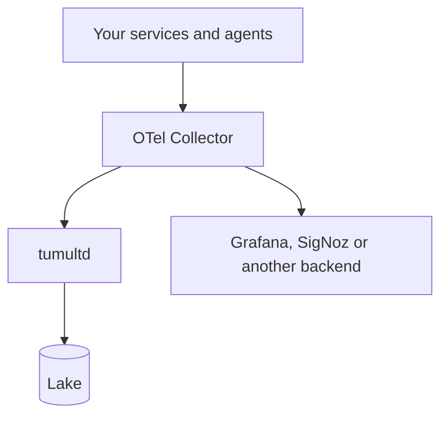

# Send telemetry

Bring traces, metrics, logs and entity events from your services into
the lake, and look at them in the backend you already use.

| You want to | Page |
|---|---|
| Wire Tumult and the daemon to a Collector and a backend | [Observability setup](observability-setup.md) |
| Name your services so Tumult can match them | [Auto-instrumentation](otel-autoinstrumentation.md) |
| Track hosts and pods as they come and go | [Entity events](entity-events.md) |
| Run Tempo, Mimir, Loki and Grafana on a laptop | [Grafana stack](grafana-stack.md) |
| Copy spans the lake holds into SigNoz | [SigNoz bulk import](signoz-bulk-import.md) |
| Look up a span, attribute, metric or ingest limit | [Telemetry reference](telemetry-reference.md) |
