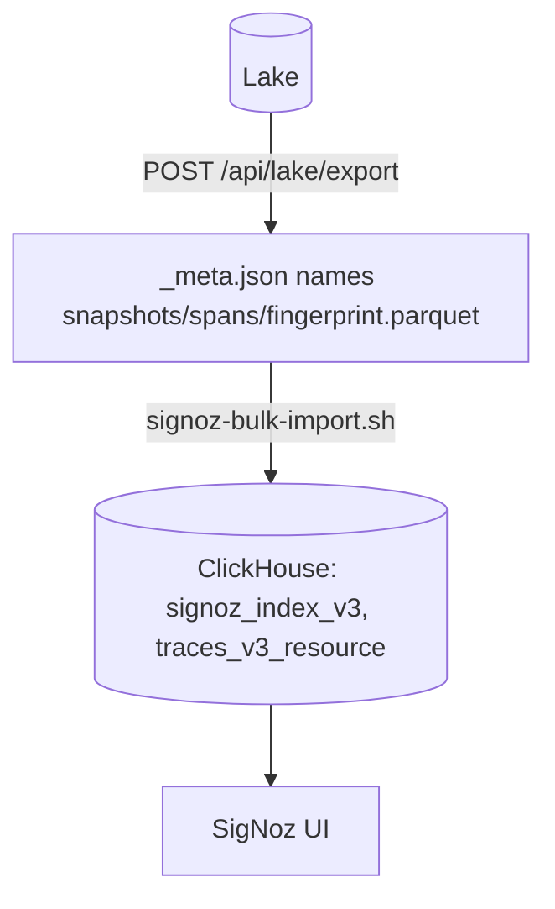

# SigNoz bulk import

`scripts/signoz-bulk-import.sh` copies spans from a Parquet export of the
lake straight into the trace tables of SigNoz's ClickHouse, without a
Collector. Use it once, to fill a new SigNoz with the spans the lake
already holds.



The export writes one full snapshot of each table and names the current
one in `<lake>/_meta.json`. Older snapshots stay next to it. The script
reads only the spans snapshot that `_meta.json` names, and only once.

## Import the current snapshot

Start SigNoz and the daemon, and export the lake. The observability stack
takes port 4318, so run `tumultd` on another HTTP port, such as
`KRONIKA_OTLP_HTTP_ADDR=127.0.0.1:24318`:

```bash
docker compose -f docker/docker-compose.observability.yml up -d
curl -X POST -H "Authorization: Bearer $KRO_TOKEN" http://127.0.0.1:24318/api/lake/export
```

The export needs the Operator role.

Point the script at the lake folder. It needs `python3` to read
`_meta.json`. Try a dry run first: it counts the rows and changes nothing.

```bash
export KRONIKA_LAKE_DIR=~/.tumult/lake   # where tumultd exports
export SIGNOZ_DOCKER_CONTAINER=docker-signoz-1
scripts/signoz-bulk-import.sh --dry-run
scripts/signoz-bulk-import.sh
```

Open SigNoz at `http://localhost:3301`, then **Services**. Imported spans
carry the attribute `tumult.import=signoz-bulk-import`.

## Settings

| Variable | Default | Meaning |
|---|---|---|
| `SIGNOZ_DOCKER_CONTAINER` | none | Run `clickhouse-client` in this container and copy the files in with `docker cp` |
| `SIGNOZ_CLICKHOUSE_DSN` | none | `clickhouse://[user[:pass]@]host[:port][/db]`, for a local `clickhouse-client` |
| `CLICKHOUSE_HOST`, `CLICKHOUSE_PORT` | `localhost`, `9000` | The native protocol, not HTTP |
| `CLICKHOUSE_USER`, `CLICKHOUSE_PASSWORD` | `default`, none | |
| `CLICKHOUSE_DB` | `signoz_traces` | |
| `KRONIKA_LAKE_DIR` | `~/.tumult/lake` | The export folder, with its `_meta.json` |
| `PARQUET_SERVER_DIR` | none | Local `clickhouse-client` only: the export folder as the server sees it, under its `user_files` |
| `SIGNOZ_IMPORT_STATE` | `<lake>/.signoz-import-ledger` | The list of snapshots already imported |

`--dry-run` counts and inserts nothing. `--force` ignores the list of
imported snapshots and stores every row again.

## What lands in SigNoz

Each span becomes a row of `signoz_index_v3`, with its times, kind,
status, attributes and events. The target, fault and outcome columns of
the lake become span attributes under their own names. The script also
fills `traces_v3_resource`, without which SigNoz shows no service. Logs
and metrics are not imported.

## Before you import

- ClickHouse does not remove duplicates here. The list of imported
  snapshots is the only guard. A second run of the same snapshot does
  nothing. After an import, a newer snapshot is refused, because it holds
  the imported spans too.
- SigNoz removes trace rows after its retention time, so spans older
  than that disappear at the next merge unless you raise it.
- The script computes its own resource fingerprint. A service can show
  twice in SigNoz: once from the Collector, once from the import.
- Spans skip the Collector, so no span metrics and no sampling.

To find or remove everything the script wrote:

```sql
SELECT count() FROM signoz_traces.distributed_signoz_index_v3
WHERE attributes_string['tumult.import'] = 'signoz-bulk-import';

ALTER TABLE signoz_traces.signoz_index_v3
  DELETE WHERE attributes_string['tumult.import'] = 'signoz-bulk-import';
```

## When it fails

| Message | Fix |
|---|---|
| `no lake manifest` | Export the lake, and set `KRONIKA_LAKE_DIR` to the export folder |
| `PARQUET_GLOB is not read any more` | Unset `PARQUET_GLOB`: the script reads `_meta.json` |
| `would store them twice` | The spans are in SigNoz already. Use `--force` only into a SigNoz without the earlier import |
| `cannot reach ClickHouse` | Check the container name with `docker ps`, or use port 9000 |
| `target tables not found` | Check `CLICKHOUSE_DB` and that SigNoz has created its schema |

## Next

- [Observability setup](observability-setup.md): send live telemetry instead.
- [Data portability](data-portability.md): the lake export and backups.
