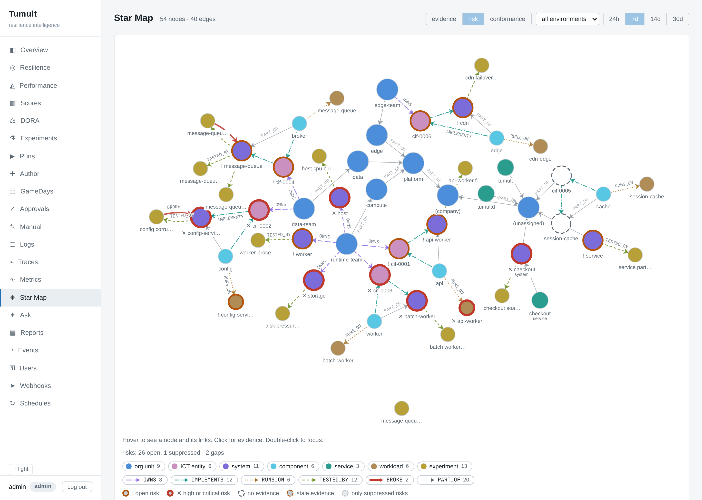
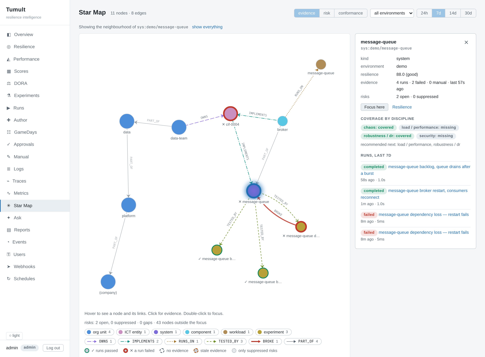

# Star Map

The Star Map shows everything Tumult knows as one graph: your
organisation in the middle, then ICT entities, systems, components,
services and workloads, with experiments around them. A ring on each node
tells you if it has evidence, risks or good telemetry.



## Where the map comes from

Nothing is stored for the map. Each request builds it from the lake, the
org file and your Kubernetes manifests.



| Node | Comes from |
|---|---|
| Organisation unit | `nodes` in `org.yaml` |
| ICT entity | `ict.entity.id` on telemetry or on a workload label |
| System, component | `resilience.target.system` and `resilience.target.component` on telemetry, runs and manual records |
| Service | `service.name` on spans in the time range |
| Workload | the manifests in `KRONIKA_MANIFESTS_DIR` |
| Experiment | registered definitions and the experiments that ran |

A workload joins the map without telemetry when its manifest has the
naming labels (`resilience.target.system`, `resilience.target.component`,
`resilience.target.environment`, `ict.entity.id`). Without them it is
matched to a system by its name or its `app` label.

## Who owns an entity

Tumult places an entity under the first owner it finds:

1. `ict.entity.owner` on its telemetry or workload, when it names a unit
   in `org.yaml`.
2. An `entities` pattern in an `org.yaml` assignment.
3. The `targets` pattern that matches the experiments run against it.
4. Otherwise the `(unassigned)` unit.

```yaml
assignments:
  - team: data-team
    targets: ["message-queue*"]
    entities: ["cif-0002", "cif-01*"]
```

Patterns ignore case, and the first assignment that matches wins. An
entity gets a flag when its owner is unclear: `multiple_owners`,
`owner_conflict` (telemetry and `org.yaml` disagree) or `malformed_id`.

## Read the map

Each node is a circle in the colour of its kind. Each arrow is a relation
with its own colour and dash: `OWNS`, `IMPLEMENTS`, `RUNS_ON`,
`TESTED_BY`, `BROKE` (thick and red), `CALLS`, `DEPENDS_ON`, `COVERS`,
`MEASURES` and a thin grey `PART_OF`. Click a chip under the map to hide a
kind or a relation.

Pick a lens at the top. A lens changes the ring and the mark, never the
colour:

| Lens | Ring and mark |
|---|---|
| Evidence (default) | Green ring and a check: every run in the range passed. Red ring and a cross: a run failed. Dashed and hollow: no evidence. Amber dash: the evidence is stale. |
| Risk | Amber ring: an open finding. Thick red ring: a high or critical finding. Faded with a dotted ring: all findings are suppressed. |
| Conformance | The telemetry level of a service: `spine`, `target` or `none`. |

An aborted or interrupted run proves nothing, so it does not count.

A system with no evidence, or only stale evidence, is a gap. An entity or
unit shows what sits below it, for example "5 of 6 systems untested".

Click a node to open its evidence: runs, verdicts, manual records and
findings. Double-click, or press **Focus here**, to see only its
neighbours.



The range, environment, lens and focus are in the URL, so you can share a
view as a link. The list next to the map opens the same panel from the
keyboard. The old `/topology` page now opens the Star Map.

## The API

`GET /api/starmap` needs the Viewer role.

| Parameter | Values | Default |
|---|---|---|
| `range` | `24h`, `7d`, `14d`, `30d` | `7d` |
| `env` | one environment; `403` outside your scopes | your scopes |
| `focus` | a node id, such as `sys:demo/message-queue` | none |
| `depth` | `1` to `4`, with `focus` | `2` |
| `kinds` | node kinds to keep, comma-separated | all |
| `budget` | `1` to `5000` nodes; deeper rings fold into `cluster:` nodes | `1500` |
| `include` | `runs` adds one node per run | none |

The answer has `nodes`, `edges`, `clusters` and `counts`. Node ids look
like `org:platform/data`, `ent:cif-0002`, `sys:demo/message-queue`,
`cmp:demo/api/checkout`, `svc:checkout` and `wl:default/deployment/api`:
`sys:` and `cmp:` start with the environment.

The daemon keeps each map for 30 seconds and sends an `ETag`. A write
that changes the map (a suppressed risk, a manual record, an imported
journal, a stored verdict) shows at once. New telemetry shows within 30
seconds. When a graph table is too large to read whole, the answer says
`truncated: true` and the page says the map is incomplete.

## Next

- [DORA score](dora-score.md): the score for the same organisation.
- [Krönika pages](../reference/kronika-pages.md): every page of the web UI.
