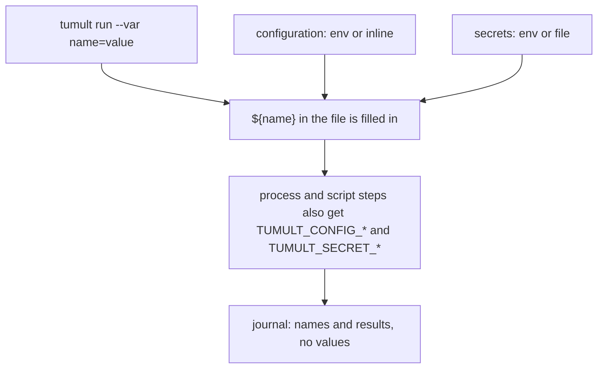

# Variables and secrets

Put `${name}` in an experiment file and fill it in when the run starts. One
file then runs against dev and staging alike, and a password never sits in
the file or the journal.



## Declare the values

```toon
configuration:
  db_host:
    type: env
    key: CHAOS_DB_HOST
  retries:
    type: inline
    value: "3"
secrets:
  db:
    password:
      type: env
      key: CHAOS_DB_PASSWORD
```

| Section | Entry types |
|---|---|
| `configuration` | `env` (read the variable `key`) or `inline` (the `value` itself) |
| `secrets` | `env` (read the variable `key`) or `file` (read the file at `path`) |

The values are read when the run starts. A missing variable or file stops the
run before any step runs.

## Use them

| Write | Gets |
|---|---|
| `${name}` | The value of `tumult run --var name=value` |
| `${config.retries}` | The `retries` entry of `configuration` |
| `${secrets.db.password}` | The `password` entry of the `db` group of `secrets` |
| `$${name}` | The text `${name}`, left as it is. Use it for shell commands |

A `--var` with the full name wins: `--var config.retries=5` overrides the
`retries` configuration. When a run has a `--var`, a `configuration` or a
`secrets` section, every `${...}` in the file must have a value: the error
lists each missing name.

`process` and `script` steps also get each value as an environment variable:
`TUMULT_CONFIG_RETRIES`, `TUMULT_SECRET_DB_PASSWORD`. A value the step sets
itself wins over them. A name that is not a valid shell name after upper casing
is skipped, with a warning. `native` steps get none.

## Keep secrets out of the evidence

The journal records the name, status, timing and output of each step. It never
records provider arguments or environments, and the CLI never prints a
resolved value. So:

- Pass a secret through the environment of the step, or inside its arguments.
- Do not put a secret in a step name. Names are in the journal.
- Do not let the step print it. Its output is in the journal.

## Next

- [Experiment format](experiment-format.md): every section of the file.
- [Experiment scheduling](scheduling.md): a schedule sends its own values.
