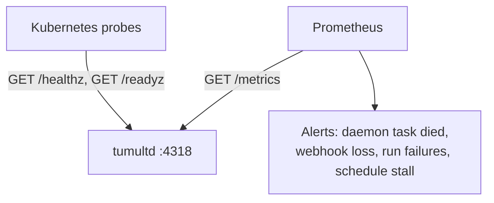

# Daemon settings and health

The settings `tumultd` reads at start, and how to check that it is healthy:
its probes, its metrics and the alerts worth setting.



## Settings

Each setting is an environment variable. A tick, count or budget that is not
a whole number above 0 falls back to its default.

| Setting | Default | What it does |
|---|---|---|
| `TUMULTD_RUN_CONCURRENCY` | `2` | Runs that execute at the same time. Each run injects real faults. |
| `TUMULTD_RUN_QUEUE_DEPTH` | `32` | Runs that may wait for a worker. One more is refused with HTTP 429. |
| `TUMULTD_APPROVAL_SWEEP_S` | `60` | Seconds between sweeps that end lapsed `pending_approval` runs. |
| `TUMULTD_SCHEDULE_TICK_S` | `30` | Seconds between scheduler ticks. A schedule interval must be 60 seconds or more. |
| `TUMULTD_WEBHOOK_TICK_S` | `15` | Seconds between webhook dispatcher ticks. |
| `TUMULTD_WEBHOOK_MAX_ATTEMPTS` | `5` | Failing ticks of one endpoint before its pending events go to `webhook_dead_letters`. |
| `TUMULTD_WEBHOOK_ENDPOINT_BUDGET_S` | `120` | Time one endpoint may take per tick. A hung receiver is retried later; the others go on. |
| `TUMULTD_GAMEDAY_TICK_S` | `15` | Seconds between GameDay supervisor ticks. |
| `TUMULTD_RUN_RETENTION_DAYS` | `0` | Must stay `0`: automatic deletion is off. Any other value stops the start. |
| `TUMULTD_RUN_RETENTION_TICK_S` | `3600` | Seconds between retention sweeps. |
| `TUMULTD_EXECUTION_BINDINGS` | next to the database | The bindings file; see [Execution bindings](../guides/execution-bindings.md). |
| `TUMULTD_FORECAST_URL` | unset | The forecast sidecar, an `http` or `https` URL; another value stops the start. Unset uses the built-in model. See [Forecasting](../guides/forecasting.md). |
| `TUMULTD_FORECAST_COOLDOWN_S` | `30` | Seconds the daemon skips a failing sidecar. An invalid value keeps the default. |

For labs and tests only, never in production:

| Setting | Default | What it does |
|---|---|---|
| `TUMULTD_WEBHOOK_ALLOW_INSECURE` | off | `1` or `true` allows `http://` webhook URLs. |
| `TUMULTD_WEBHOOK_ALLOW_LOCAL` | off | `1` or `true` allows loopback, private and link-local webhook addresses, cloud metadata too. |

The first start of an empty database can take `KRONIKA_BOOTSTRAP_ADMIN_PASSWORD`
(12 characters or more) and `KRONIKA_BOOTSTRAP_TOKEN` (`kro_` and 20
characters or more). Both are ignored once a user exists. In production, run
`tumultd create-admin` instead. The listeners, TLS and the ingest token are
on [Production deployment](../guides/production-deployment.md).

## Health endpoints

Three endpoints on the HTTP listener. They need a Viewer token once the
store has users; with no users yet they answer anyone.

| Endpoint | Answers 200 when |
|---|---|
| `GET /healthz` | Liveness: the writer answers and the store answers a query. |
| `GET /readyz` | Readiness: liveness, the schema is current, and the supervisor has ticked. |
| `GET /metrics` | Always: the counters below in Prometheus text. |

`/readyz` answers with JSON. `schema` is the schema version of the lake,
`engine` the DuckDB version that has it open, and `storage` the storage format
of the lake file. `v2.0.0+` is a file that needs DuckDB 2.0.0 or later. A lake
created by an older engine keeps its older format.

```json
{"status": "ready", "schema": 26, "engine": "v2.0.0", "storage": "v2.0.0+"}
```

A failing check answers 503 with the reason. Kubernetes HTTP probes count 401
as a failure, so use an exec probe that sends the token, as
`deploy/k8s/tumultd.yaml` does. A browser that asks for `text/html` on
`/metrics` gets the web UI's Metrics page instead.

## Metrics

| Metric | Type | Meaning |
|---|---|---|
| `tumultd_runs_started_total` | counter | Runs that began to execute. |
| `tumultd_runs_completed_total` | counter | Runs that ended with their journal stored, whatever their outcome. |
| `tumultd_runs_failed_total` | counter | Runs the daemon could not carry out: a refused dispatch, a plan that did not validate, a runner error. |
| `tumultd_webhook_deliveries_succeeded_total` | counter | Webhook events delivered. |
| `tumultd_webhook_deliveries_failed_total` | counter | Deliveries that failed and will be retried. |
| `tumultd_webhook_dead_letters_total` | counter | Events given up on: lost for the receiver. |
| `tumultd_schedule_fires_total` | counter | Schedule fires. |
| `tumultd_malformed_entity_ids_total` | counter | Resources that came in with a malformed `ict.entity.id`. |
| `tumultd_score_snapshots_skipped_total` | counter | Daily score snapshots not stored because the org file was refused. |
| `tumultd_active_campaigns` | gauge | GameDay campaigns in progress. |
| `tumultd_supervisor_last_tick_ns` | gauge | The last supervisor heartbeat, in epoch nanoseconds. |

The `tumultd_entity_*` metrics are on [Entity events](../guides/entity-events.md).

```yaml
scrape_configs:
  - job_name: tumultd
    metrics_path: /metrics
    scheme: https                  # or http behind your TLS proxy
    bearer_token: <viewer-token>
    static_configs:
      - targets: ["tumultd.internal:4318"]
```

## Alerts

Chaos runs fail on purpose, so alert on rates, not on one failure.

| Alert | Rule | Level |
|---|---|---|
| Daemon task died | `time() - tumultd_supervisor_last_tick_ns / 1e9 > 120`, or `/readyz` failing for 2 minutes | page |
| Webhook events lost | `increase(tumultd_webhook_dead_letters_total[15m]) > 0` | page |
| Webhook failures | failed over all deliveries above 0.1 for 30 minutes | warn |
| Run failures | `rate(tumultd_runs_failed_total[1h]) / rate(tumultd_runs_started_total[1h]) > 0.25` for an hour | warn |
| Schedules stalled | `rate(tumultd_schedule_fires_total[1h]) == 0` while schedules are enabled | warn |

After webhook loss, replay the events from `run_audit` once the receiver is
back. After run failures, check whether the daemon failed (approval, start)
or the experiments simply found faults.
