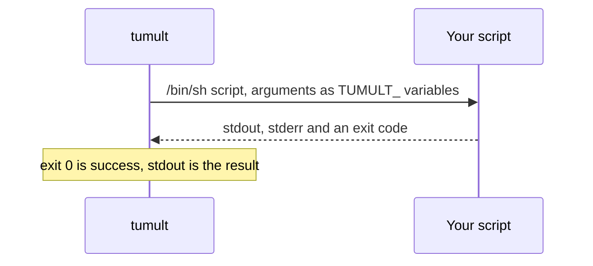
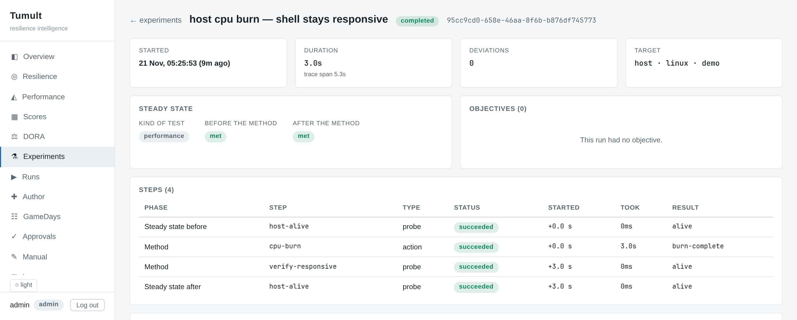

# Write a plugin

A script plugin is a folder with a manifest and shell scripts. You need no
Rust. This page builds a small plugin for nginx, then tests it.



## 1. Make the folder

```
tumult-nginx/
├── plugin.toon              # the manifest
├── actions/
│   └── kill-worker.sh       # a fault
└── probes/
    └── connection-count.sh  # a reading
```

## 2. Write the manifest

`plugin.toon` names the plugin and lists its scripts:

```toon
name: tumult-nginx
version: 0.1.0
description: Nginx faults and probes

actions[1]:
  - name: kill-worker
    script: actions/kill-worker.sh
    description: Kill an nginx worker process

probes[1]:
  - name: connection-count
    script: probes/connection-count.sh
    description: Count active nginx connections
```

| Field | What it holds |
|---|---|
| `name` | The plugin name, such as `tumult-nginx`. It must be unique in all plugin folders. |
| `version` | A version, such as `0.1.0` |
| `description` | One line about the plugin |
| `actions` | The faults. Each has a `name`, a `script` and a `description`. The list may be empty: `actions[0]:` |
| `probes` | The readings, with the same three fields. The list may be empty. |

All fields are required. A `script` path starts at the plugin folder and
must stay inside it. Name an action with a verb and a noun
(`kill-worker`), and a probe with a noun (`connection-count`).

## 3. Write the scripts

What a script gets, and what it gives back:

| | |
|---|---|
| In | Each argument of the step as `TUMULT_<NAME>`: `worker_pid` becomes `TUMULT_WORKER_PID`. Every value is text. |
| In | `TUMULT_CONFIG_<NAME>` and `TUMULT_SECRET_<GROUP>_<KEY>` from the `configuration:` and `secrets:` of the experiment |
| In | `TRACEPARENT` of the step, so a tool the script calls can join the trace |
| Out | stdout is the result of the step. stderr is kept as the error text. |
| Out | Exit code `0` means success. Any other code fails the step. |

Tumult runs each script with `/bin/sh`, whatever its first line names, so
write plain POSIX shell. An argument name must be a valid variable name,
and two names that differ only in case are refused. On a timeout or a
stop, Tumult ends the script and every process it started. It keeps at
most 8 MiB of each output stream.

An action, `actions/kill-worker.sh`:

```bash
#!/bin/sh
set -eu

WORKER_PID="${TUMULT_WORKER_PID:-$(pgrep -f 'nginx: worker' | head -1)}"
if [ -z "$WORKER_PID" ]; then
    echo "no nginx worker process found" >&2
    exit 1
fi

kill -9 "$WORKER_PID"
echo "killed nginx worker pid=$WORKER_PID"
```

A probe, `probes/connection-count.sh`. It prints one number that a
tolerance can check:

```bash
#!/bin/sh
set -eu

CONNECTIONS=$(curl -s http://localhost:8080/nginx_status | awk '/Active connections/ {print $3}')
if [ -z "$CONNECTIONS" ]; then
    echo "failed to read nginx status" >&2
    exit 1
fi
echo "$CONNECTIONS"
```

## 4. Test it

Put the folder in `./plugins/` next to your experiment and run `tumult`
from there. See [where Tumult finds plugins](index.md#where-tumult-finds-script-plugins).

```bash
tumult discover --plugin tumult-nginx       # Tumult sees the plugin
TUMULT_WORKER_PID=12345 sh plugins/tumult-nginx/actions/kill-worker.sh
tumult init --plugin tumult-nginx           # experiment.toon that reads your first probe
tumult validate experiment.toon
```

`tumult init --plugin` writes a starter experiment whose first step reads
the first probe of your plugin. Add a step that calls your action, then
`tumult run experiment.toon`. Each step shows its output in the journal
and on the run page of Krönika:



## 5. Share it

There is no central registry. Pack the folder as a `.tar.gz`, keep it in a
git repository that people clone into `~/.tumult/plugins/`, or copy it
into a container image next to `tumult`. Add a `README.md` that names the
arguments of each script.

Tips:

- Start each script with `set -eu`.
- Make an action safe to run twice where you can.
- Add a rollback action for each fault that does not end by itself.
- Name the plugin `tumult-<technology>`.
