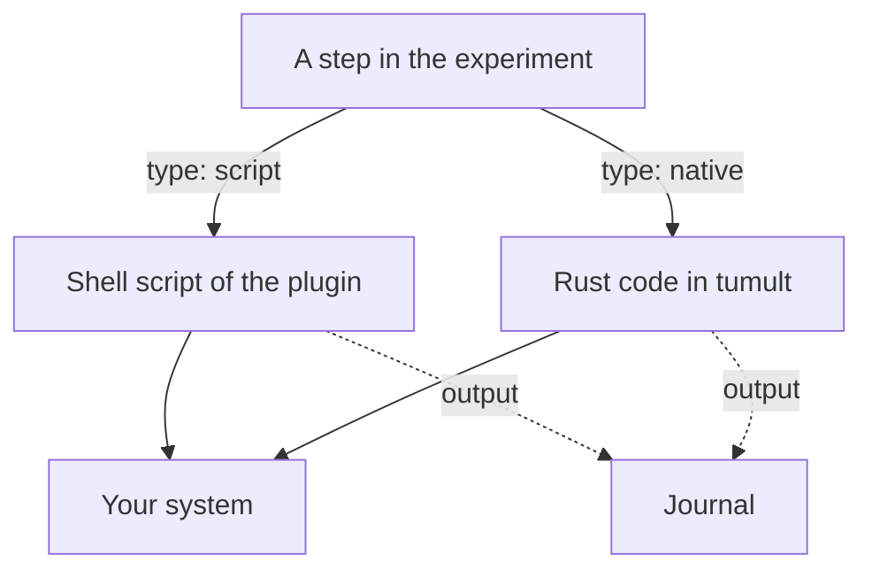
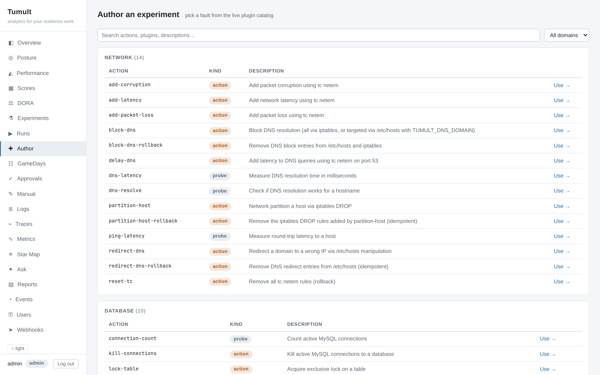

# Plugins

A plugin gives Tumult faults to inject and probes to read. Tumult ships
16 plugins. This page lists them and shows how a step calls one.



## Two kinds of plugin

| | Script plugin | Native plugin |
|---|---|---|
| What it is | A folder with `plugin.toon` and shell scripts | Rust code built into `tumult` |
| Provider type | `script` | `native` |
| Arguments reach it as | Environment variables `TUMULT_<NAME>` | JSON values |
| Runs on | Linux and macOS (`/bin/sh`) | Every system that runs `tumult` |
| Write your own | Yes, no Rust needed | Only by changing Tumult |

A step runs on the machine that runs Tumult. To act on another host, use
[tumult-ssh](tumult-ssh.md).

## Call a script plugin

```toon
method[1]:
  - name: pause-the-database
    activity_type: action
    provider:
      type: script
      plugin: tumult-containers
      function: pause-container
      arguments:
        container_id: orders-db
      timeout_s: 30.0
```

Each argument reaches the script as an environment variable:
`container_id` becomes `TUMULT_CONTAINER_ID`. Numbers and `true` or
`false` arrive as text. `timeout_s` ends a script that runs too long. A
native step names `plugin`, `function` and `arguments` the same way, with
`type: native`; its arguments stay JSON values.

## Where Tumult finds script plugins

Tumult looks in these folders, in this order. When two plugins have the
same name, the first one wins.

1. `./plugins/` in the folder where you run `tumult`
2. `~/.tumult/plugins/`
3. each folder in `TUMULT_PLUGIN_PATH` (separate them with `:`)

Native plugins are always there. `tumult discover` lists both kinds:

```bash
tumult discover
tumult discover --plugin tumult-network
```

The Author page of Krönika shows the script plugins as a catalog, with a
form for each action:



## Bundled plugins

### Native (5)

| Plugin | What it does |
|---|---|
| [tumult-ssh](tumult-ssh.md) | Runs a command on a remote host over SSH |
| [tumult-kubernetes](tumult-kubernetes.md) | Deletes pods, scales deployments, drains nodes, adds latency or stress inside a pod |
| [tumult-windows](tumult-windows.md) | Kills a process, loads the CPU or blocks traffic on a Windows host |
| tumult-net ([blog post](../blog/19-net-chaos-proxy.md)) | A TCP proxy that adds latency, limits bandwidth, splits, corrupts or cuts connections |
| tumult-cloud ([README](https://github.com/mwigge/tumult/blob/main/tumult-cloud/README.md)) | Starts and stops AWS FIS and Azure Chaos Studio experiments, stops EC2 and GCP instances |

### Script (11)

| Plugin | What it does |
|---|---|
| [tumult-containers](tumult-containers.md) | Kills, stops, pauses or limits a Docker or Podman container |
| [tumult-db](tumult-db.md) | Three plugins: `tumult-db-postgres`, `tumult-db-mysql`, `tumult-db-redis` |
| [tumult-kafka](tumult-kafka.md) | Kills or cuts off a broker; reads lag, brokers and replicas |
| [tumult-loadtest](tumult-loadtest.md) | Starts and stops k6, reads its numbers |
| [tumult-network](tumult-network.md) | Latency, packet loss, DNS faults and partitions on the host |
| [tumult-process](tumult-process.md) | Kills, suspends or resumes a process |
| [tumult-pumba](tumult-pumba.md) | Network faults, kills and stress for one container, through Pumba |
| [tumult-stress](tumult-stress.md) | CPU, memory and disk load with `stress-ng` |
| tumult-timewarp ([README](https://github.com/mwigge/tumult/blob/main/plugins/tumult-timewarp/README.md)) | Clock skew, certificate and token expiry, load on the random number generator |

## Next

- Write your own: [Write a plugin](authoring-guide.md)
- All the keys of a step: [Experiment format](../guides/experiment-format.md)
