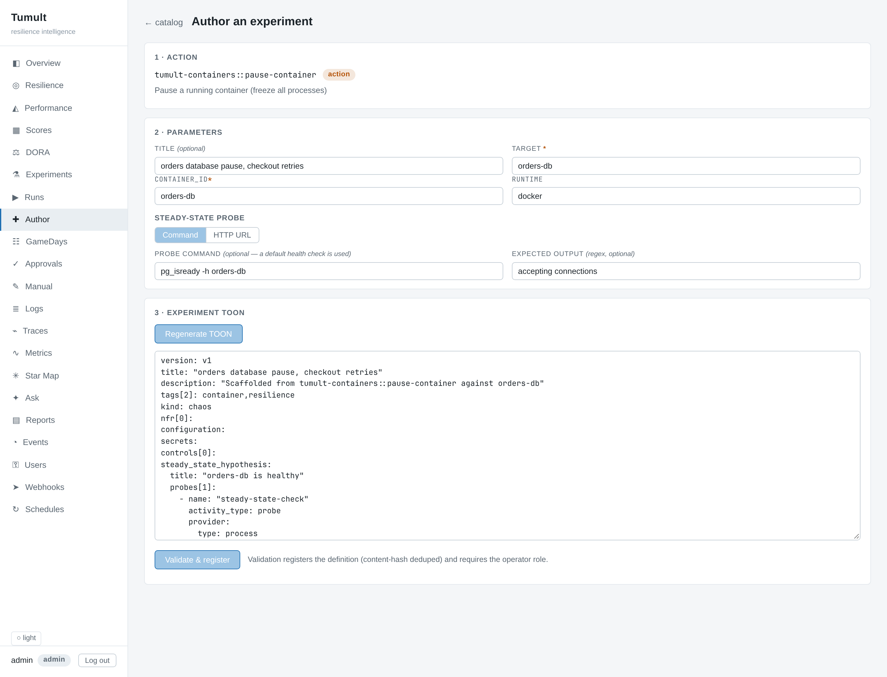

# tumult-containers

Kill, stop, pause or limit a Docker or Podman container. This script
plugin needs `docker` or `podman` on the machine that runs Tumult.

Every function takes `container_id` (a name or an ID, required) and
`runtime` (`docker` or `podman`, default `docker`).

## Faults

| Action | What it does | More arguments |
|---|---|---|
| `kill-container` | Sends a signal to the container | `signal` (`KILL`) |
| `stop-container` | Stops it, with a grace period | `timeout` in seconds (10) |
| `pause-container` | Freezes every process in it | |
| `unpause-container` | Lets it run again | |
| `limit-cpu` | Sets a CPU limit while it runs | `cpu_quota` (50000), `cpu_period` (100000), both in microseconds |
| `limit-memory` | Sets a memory limit while it runs | `memory_limit` (`128m`) |

## Probes

| Probe | Result |
|---|---|
| `container-status` | The state, such as `running` or `paused`, or `not_found` |
| `container-health` | `healthy`, `unhealthy`, `starting`, `none` (no health check) or `not_found` |

## Example

```toon
title: The API comes back after a pause

steady_state_hypothesis:
  title: The API container is healthy
  probes[1]:
    - name: api-health
      activity_type: probe
      provider:
        type: script
        plugin: tumult-containers
        function: container-health
        arguments:
          container_id: api-server
      tolerance:
        type: exact
        value: healthy

method[2]:
  - name: pause-api
    activity_type: action
    provider:
      type: script
      plugin: tumult-containers
      function: pause-container
      arguments:
        container_id: api-server
    pause_after_s: 10.0
  - name: unpause-api
    activity_type: action
    provider:
      type: script
      plugin: tumult-containers
      function: unpause-container
      arguments:
        container_id: api-server
```

The Author page of Krönika asks for the same arguments in a form and writes the experiment for you:


