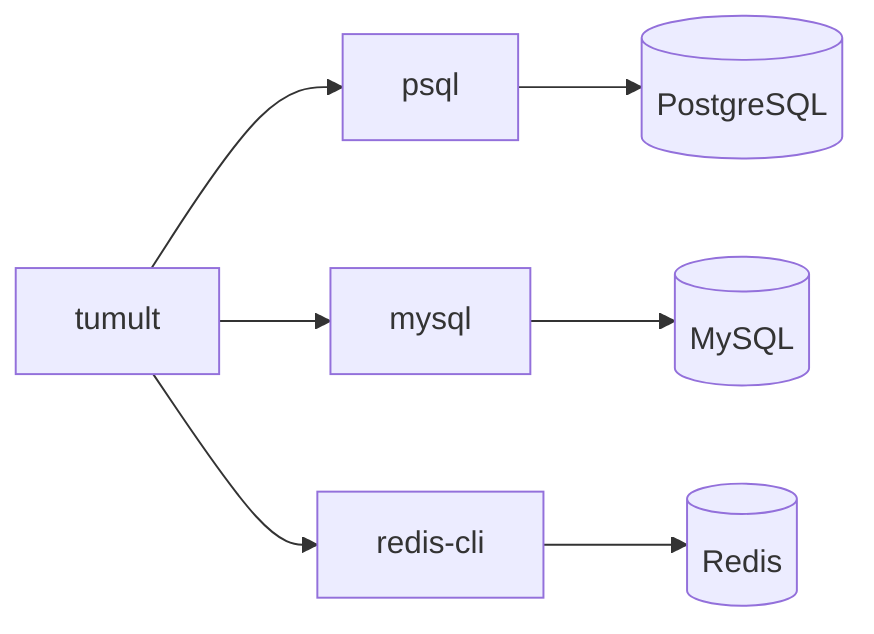
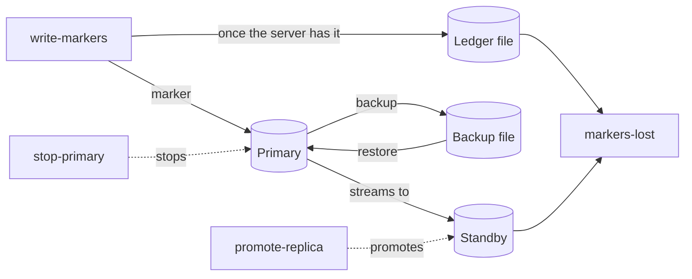
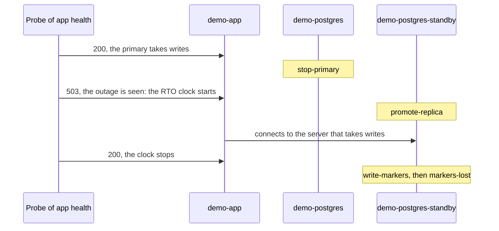
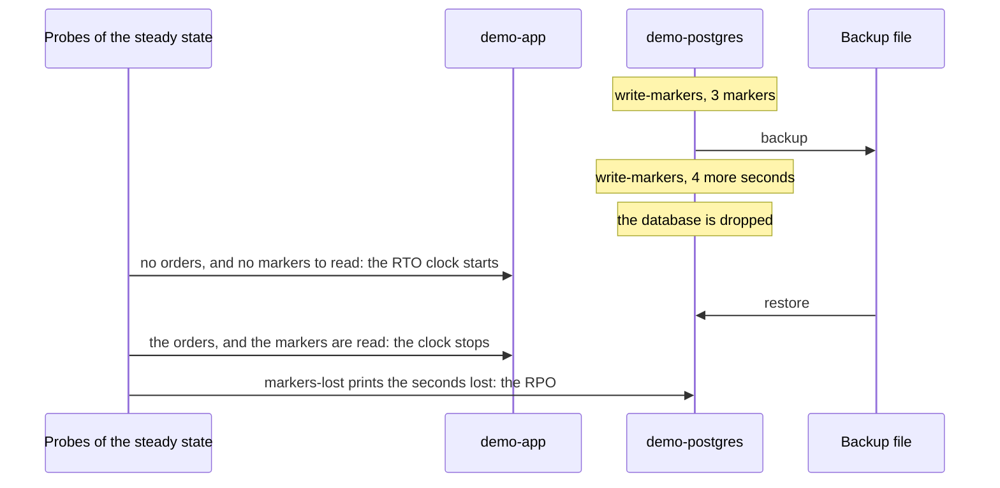

# tumult-db

Three script plugins that break and read a database: `tumult-db-postgres`,
`tumult-db-mysql` and `tumult-db-redis`. Each one drives the client tool of
its database, so that tool must be on the machine that runs Tumult.



## PostgreSQL

Arguments of every function: `pg_host` (`localhost`), `pg_port` (`5432`),
`pg_user` (`postgres`), `pg_password` (empty; Tumult writes it to a
temporary `.pgpass` file, not to the command line).

| Function | Kind | What it does | More arguments |
|---|---|---|---|
| `kill-connections` | action | Ends every connection to a database and prints how many | `pg_database` (required) |
| `lock-table` | action | Holds an exclusive lock on a table | `pg_database`, `pg_table` (required), `duration` in seconds (10) |
| `inject-latency` | action | Runs `pg_sleep` in the database | `pg_database` (required), `latency_ms` (100) |
| `exhaust-connections` | action | Opens idle connections and holds them | `pg_database` (required), `connection_count` (50, at most 500), `duration` in seconds (30) |
| `connection-count` | probe | The number of connections | `pg_database` (optional: only that database) |
| `replication-lag` | probe | Replica lag in seconds, 0 on a primary | |
| `pool-utilization` | probe | JSON: `current_connections`, `max_connections`, `utilization_pct` | |

## PostgreSQL disaster recovery

These functions back up and restore a database, fail over to a standby,
and measure the data a run lost. They need `pg_dump`, `pg_restore` and
`psql` of PostgreSQL 13 or later on the machine that runs Tumult, of the
same major version as the server: `pg_dump` refuses a newer server, and a
newer `pg_dump` writes settings an older server refuses on restore. The
Tumult image has the client of PostgreSQL 16, the version of the demo.
`stop-primary` and `start-primary` also need `docker` or `podman`. Each
action prints one line of JSON with its times in epoch seconds.



| Function | Kind | What it does | More arguments |
|---|---|---|---|
| `backup` | action | Writes the database to a file with `pg_dump -Fc`. Prints `path`, `size_bytes` and `finished_at`. A failed dump keeps an older file at the path | `pg_database`, `backup_path` (both required) |
| `restore` | action | Drops the database, makes it again and restores the file in one transaction. Prints `finished_at`. A file that is no archive drops nothing | `pg_database`, `backup_path` (both required) |
| `stop-primary` | action | Checks that the server is a primary, then stops its container. Prints `stopped_at` | `container_id` (required), `stop_mode` (`fast`, or `kill` for a crash), `runtime` (`docker`), `timeout` in seconds (10) |
| `start-primary` | action | Starts the container of the primary again: the rollback of `stop-primary` | `container_id` (required), `runtime` (`docker`) |
| `promote-replica` | action | Promotes the standby with `pg_promote()`, then checks that it takes writes. Prints `writable_at`, by the clock of the server | `timeout` in seconds (60) |
| `write-markers` | action | Writes a row to the table `tumult_markers` every interval. Once the server has the row, the same time goes to the ledger | `pg_database`, `ledger_path` (both required), `interval_ms` (1000), `duration` in seconds (10), `marker_count` (0, no limit) |
| `markers-lost` | probe | The newest ledger time minus the newest marker left: the seconds of data lost, 0 when nothing is lost. Fails when the database does not answer | `pg_database`, `ledger_path` (both required) |

Only `stop-primary` has a rollback. Do not run `start-primary` after
`promote-replica`: two primaries would take writes. A promoted standby
cannot go back. Make the old primary a standby of the new one, with
`pg_rewind` or a new base backup. `backup` changes nothing, a newer backup
undoes `restore`, and `markers-lost` reads the markers of `write-markers`.

### The failover example of the demo

`examples/postgres-failover.toon` fails the demo database over for real.
`make demo-check` runs it in the demo, where `demo-postgres` streams to
the standby `demo-postgres-standby`.



What a run proves:

- **The fault lands.** A step reads the app until it answers 503.
- **The standby takes over.** `promote-replica` gives it its first write,
  and `markers-lost` reads back the markers written to it.
- **The clients follow.** The database address of the app names both
  servers and asks for the one that takes writes
  (`target_session_attrs=read-write`). The app reaches the standby without
  a restart. The standby comes first in the address: a lookup of the name
  of a stopped server can take seconds.
- **The RTO is measured.** It runs from the first read that failed to the
  read where the app was back. The run expects it within 30 s.

The run ends with a promoted standby and a stopped primary.
`make demo-check` makes the pair again before and after it. The
[demo README](https://github.com/mwigge/tumult/blob/main/demo/README.md#the-dr-examples-and-the-demo-gameday)
says how to do that by hand.

### The RPO example of the demo

`examples/postgres-restore-rpo.toon` loses the demo database and restores
it from a backup that is a few seconds old. It measures the RTO and the
RPO of the restore. `make demo-check` runs it in the demo.



What a run proves:

- **The data is lost for real.** The writes after the backup are gone,
  and so are the orders the demo traffic placed after it.
- **The backup brings the database back.** `restore` makes the database
  again from the file, and the app reads its orders again without a
  restart.
- **The RPO is measured.** `markers-lost` prints the newest time in the
  ledger minus the newest marker left: the 4 seconds of writes after the
  backup and the time the backup took. In the demo that is 4 to 7 s. The
  run expects at most 10 s, its `rpo_target_s`.
- **The RTO is measured.** It runs from the first read that saw the
  outage to the read where the app read its orders and the markers again.
  The app reads no orders until the restore has ended. The run expects it
  within 30 s.

The journal holds the RPO in `objectives.rpo_measured_s` and the verdict
`rpo`. The lake has the run in the view `dr_tests`, and `GET /api/dr`
shows it under `demo-postgres`.

### Example: restore an older backup

The run writes markers, backs up, writes markers for 5 more seconds and
restores the backup. The markers of those 5 seconds are lost.

```toon
method[4]:
  - name: markers-before
    activity_type: action
    provider:
      type: script
      plugin: tumult-db-postgres
      function: write-markers
      arguments:
        pg_database: orders
        ledger_path: orders.ledger
        marker_count: 5
  - name: back-up
    activity_type: action
    provider:
      type: script
      plugin: tumult-db-postgres
      function: backup
      arguments:
        pg_database: orders
        backup_path: /var/backups/orders.dump
  - name: markers-after
    activity_type: action
    provider:
      type: script
      plugin: tumult-db-postgres
      function: write-markers
      arguments:
        pg_database: orders
        ledger_path: orders.ledger
        duration: 5
  - name: restore
    activity_type: action
    provider:
      type: script
      plugin: tumult-db-postgres
      function: restore
      arguments:
        pg_database: orders
        backup_path: /var/backups/orders.dump
```

### Example: read the data lost

`markers-lost` is a probe of the steady state. After the restore above it
prints about 5. With an `rpo` objective it measures the RPO of the run,
see [Objectives](../guides/objectives.md).

```toon
    - name: data-lost
      activity_type: probe
      provider:
        type: script
        plugin: tumult-db-postgres
        function: markers-lost
        arguments:
          pg_database: orders
          ledger_path: orders.ledger
      tolerance:
        type: number
```

### Example: fail over to the standby

The primary crashes and the standby takes over. `pg_host` names the
server each step talks to.

```toon
method[2]:
  - name: crash-the-primary
    activity_type: action
    provider:
      type: script
      plugin: tumult-db-postgres
      function: stop-primary
      arguments:
        pg_host: db-primary
        container_id: db-primary
        stop_mode: kill
  - name: promote-the-standby
    activity_type: action
    provider:
      type: script
      plugin: tumult-db-postgres
      function: promote-replica
      arguments:
        pg_host: db-standby
```

### Example: stop the primary and start it again

With no standby to promote, the rollback starts the primary again.

```toon
method[1]:
  - name: stop-the-primary
    activity_type: action
    provider:
      type: script
      plugin: tumult-db-postgres
      function: stop-primary
      arguments:
        pg_host: db-primary
        container_id: db-primary

rollbacks[1]:
  - name: start-the-primary
    activity_type: action
    provider:
      type: script
      plugin: tumult-db-postgres
      function: start-primary
      arguments:
        container_id: db-primary
```

## MySQL

Arguments of every function: `mysql_host` (`localhost`), `mysql_port`
(`3306`), `mysql_user` (`root`), `mysql_password` (empty).

| Function | Kind | What it does | More arguments |
|---|---|---|---|
| `kill-connections` | action | Kills the connections to a database and prints how many it killed | `mysql_database` (required) |
| `lock-table` | action | Holds `LOCK TABLES ... WRITE` | `mysql_database`, `mysql_table` (required), `duration` in seconds (10) |
| `connection-count` | probe | The number of connections | |

## Redis

Arguments of every function: `redis_host` (`localhost`), `redis_port`
(`6379`), `redis_auth` (the password, empty).

| Function | Kind | What it does | More arguments |
|---|---|---|---|
| `flush-all` | action | Deletes every key in every database (`FLUSHALL`). It cannot be undone. | |
| `block-clients` | action | Pauses all clients (`CLIENT PAUSE`) | `duration` in milliseconds (5000) |
| `simulate-hang` | action | Makes Redis hang (`DEBUG SLEEP`) and returns at once | `duration` in seconds (5) |
| `redis-ping` | probe | `PONG` when Redis answers | |
| `redis-info` | probe | JSON: `connected_clients`, `used_memory_bytes`, `ops_per_sec` and more. A reply without these fields fails the probe. | |

`simulate-failover` is the old name of `simulate-hang`. It still runs, and
it writes a warning to the step: Redis hangs, nothing fails over. Use
`simulate-hang`.

## Example

```toon
title: The app survives a full connection pool

steady_state_hypothesis:
  title: The pool has room
  probes[1]:
    - name: connections
      activity_type: probe
      provider:
        type: script
        plugin: tumult-db-postgres
        function: connection-count
        arguments:
          pg_database: myapp
      tolerance:
        type: range
        from: 0.0
        to: 80.0

method[1]:
  - name: fill-the-pool
    activity_type: action
    provider:
      type: script
      plugin: tumult-db-postgres
      function: exhaust-connections
      arguments:
        pg_database: myapp
        connection_count: 80
        duration: 30
      timeout_s: 60.0
```

The step holds the connections for 30 seconds, then lets them go. The
steady state is checked again after that.
