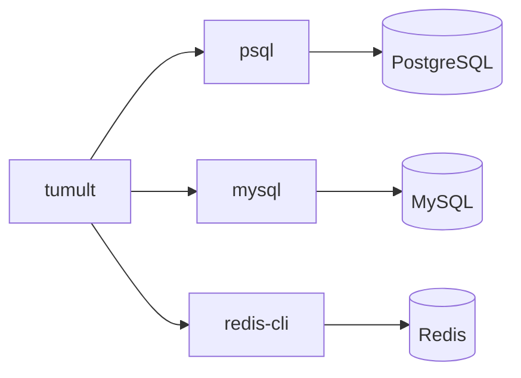

# tumult-db

Three script plugins that break and read a database: `tumult-db-postgres`,
`tumult-db-mysql` and `tumult-db-redis`. Each one drives the client tool of
its database, so that tool must be on the machine that runs Tumult.



## PostgreSQL

Arguments of every function: `pg_host` (`localhost`), `pg_port` (`5432`),
`pg_user` (`postgres`), `pg_password` (empty; Tumult writes it to a
temporary `.pgpass` file, not to the command line).

| Function | Kind | What it does | More arguments |
|---|---|---|---|
| `kill-connections` | action | Ends every connection to a database and prints how many | `pg_database` (required) |
| `lock-table` | action | Holds an exclusive lock on a table | `pg_database`, `pg_table` (required), `duration` in seconds (10) |
| `inject-latency` | action | Runs `pg_sleep` in the database | `pg_database` (required), `latency_ms` (100) |
| `exhaust-connections` | action | Opens idle connections and holds them | `pg_database` (required), `connection_count` (50, at most 500), `duration` in seconds (30) |
| `connection-count` | probe | The number of connections | `pg_database` (optional: only that database) |
| `replication-lag` | probe | Replica lag in seconds, 0 on a primary | |
| `pool-utilization` | probe | JSON: `current_connections`, `max_connections`, `utilization_pct` | |

## MySQL

Arguments of every function: `mysql_host` (`localhost`), `mysql_port`
(`3306`), `mysql_user` (`root`), `mysql_password` (empty).

| Function | Kind | What it does | More arguments |
|---|---|---|---|
| `kill-connections` | action | Kills the connections to a database and prints how many it killed | `mysql_database` (required) |
| `lock-table` | action | Holds `LOCK TABLES ... WRITE` | `mysql_database`, `mysql_table` (required), `duration` in seconds (10) |
| `connection-count` | probe | The number of connections | |

## Redis

Arguments of every function: `redis_host` (`localhost`), `redis_port`
(`6379`), `redis_auth` (the password, empty).

| Function | Kind | What it does | More arguments |
|---|---|---|---|
| `flush-all` | action | Deletes every key in every database (`FLUSHALL`). It cannot be undone. | |
| `block-clients` | action | Pauses all clients (`CLIENT PAUSE`) | `duration` in milliseconds (5000) |
| `simulate-failover` | action | Makes Redis hang (`DEBUG SLEEP`) and returns at once | `duration` in seconds (5) |
| `redis-ping` | probe | `PONG` when Redis answers | |
| `redis-info` | probe | JSON: `connected_clients`, `used_memory_bytes`, `ops_per_sec` and more. A reply without these fields fails the probe. | |

## Example

```toon
title: The app survives a full connection pool

steady_state_hypothesis:
  title: The pool has room
  probes[1]:
    - name: connections
      activity_type: probe
      provider:
        type: script
        plugin: tumult-db-postgres
        function: connection-count
        arguments:
          pg_database: myapp
      tolerance:
        type: range
        from: 0.0
        to: 80.0

method[1]:
  - name: fill-the-pool
    activity_type: action
    provider:
      type: script
      plugin: tumult-db-postgres
      function: exhaust-connections
      arguments:
        pg_database: myapp
        connection_count: 80
        duration: 30
      timeout_s: 60.0
```

The step holds the connections for 30 seconds, then lets them go. The
steady state is checked again after that.
