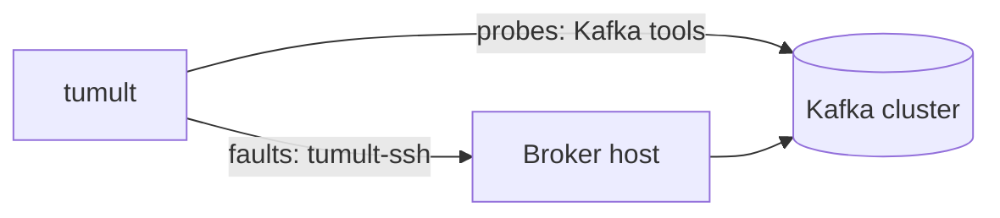

# tumult-kafka

Break a Kafka broker and read the health of the cluster. The probes call
the Kafka command line tools over the network. The faults act on the
machine they run on, so run them on the broker host.



## Faults

| Action | What it does | Arguments |
|---|---|---|
| `kill-broker` | Sends a signal to the Kafka broker process on this machine | `signal` (`KILL`) |
| `partition-broker` | Drops Kafka traffic from the other brokers with `iptables` | `broker_ip`, `cluster_ips` (comma-separated), both required; `kafka_port` (9092) |
| `partition-broker-rollback` | Removes those rules. Safe to run twice. | Same as `partition-broker` |
| `add-broker-latency` | Adds latency to the Kafka port with `tc netem` | `interface` (`eth0`), `delay_ms` (100), `jitter_ms` (10), `kafka_port` (9092) |

The network faults need Linux and root. To remove the latency, run
`reset-tc` of [tumult-network](tumult-network.md) on the same interface.

## Probes

| Probe | Result | Arguments |
|---|---|---|
| `consumer-lag` | The lag of a consumer group, summed over all partitions | `consumer_group` (required), `kafka_bootstrap` (`localhost:9092`), `kafka_dir` (`/opt/kafka`) |
| `under-replicated` | The number of under-replicated partitions, 0 when healthy | `kafka_bootstrap`, `kafka_dir` |
| `broker-count` | The number of brokers in the cluster | `kafka_bootstrap`, `kafka_dir` |

A probe looks for the tools in `kafka_dir/bin`, then on the `PATH`. A probe
whose query fails exits with the message of the Kafka tool and prints no
number.

## Example: kill a broker

```toon
title: Kafka survives broker failure
description: Kill a broker and verify consumer lag recovers

steady_state_hypothesis:
  title: No under-replicated partitions
  probes[1]:
    - name: check-replicas
      activity_type: probe
      provider:
        type: process
        path: plugins/tumult-kafka/probes/under-replicated.sh
        env:
          TUMULT_KAFKA_BOOTSTRAP: broker-1:9092
      tolerance:
        type: exact
        value: 0

method[1]:
  - name: kill-broker-2
    activity_type: action
    provider:
      type: native
      plugin: tumult-ssh
      function: execute
      arguments:
        host: broker-2
        user: kafka
        key_file: /home/ops/.ssh/id_ed25519
        command: pkill -KILL -f kafka.Kafka

rollbacks[1]:
  - name: restart-broker
    activity_type: action
    provider:
      type: native
      plugin: tumult-ssh
      function: execute
      arguments:
        host: broker-2
        user: kafka
        key_file: /home/ops/.ssh/id_ed25519
        command: /opt/kafka/bin/kafka-server-start.sh -daemon /opt/kafka/config/server.properties
```

The probe names its script by path with the `process` provider, so its
argument is the environment variable itself. A test runs this probe. The
kill goes to the broker host through [tumult-ssh](tumult-ssh.md).
