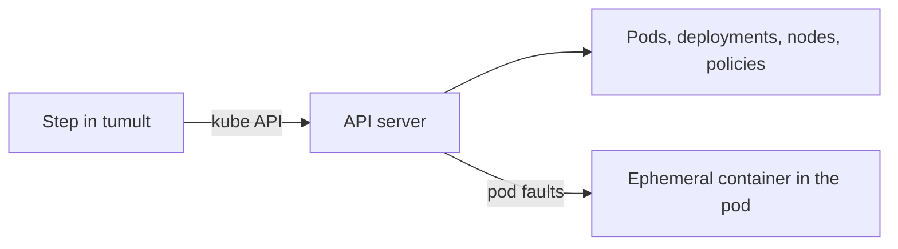

# tumult-kubernetes

Break and read Kubernetes objects. This native plugin talks to the API
server with `kube-rs`, so it needs no `kubectl`.



Tumult logs in like `kubectl`: with `KUBECONFIG`, with `~/.kube/config`,
or with the service account of its pod. An OIDC login works through the
`id-token` in the kubeconfig, which Tumult does not refresh.

## Faults

| Function | What it does | Arguments |
|---|---|---|
| `delete_pod` | Deletes one pod | `namespace`, `name`, `grace_period_seconds` (optional; 0 kills at once) |
| `scale_deployment` | Sets the number of replicas | `namespace`, `name`, `replicas` |
| `cordon_node` | Marks a node unschedulable | `name` |
| `uncordon_node` | Marks it schedulable again | `name` |
| `drain_node` | Cordons a node and evicts every pod that no DaemonSet owns | `name`, `grace_period_seconds` (optional) |
| `apply_network_policy` | Creates a network policy | `namespace`, `policy` (a NetworkPolicy object) |
| `delete_network_policy` | Deletes it | `namespace`, `name` |
| `pod_network_latency` | Adds latency to the traffic out of a pod | `namespace`, `pod` or `label_selector`, `delay_ms`; optional `jitter_ms` (0), `duration_s` (30), `iface` (`eth0`), `image` |
| `pod_stress` | Loads the CPU or the memory inside a pod | `namespace`, `pod` or `label_selector`, `cpu_workers` or `mem_bytes`; optional `duration_s` (30), `target_container`, `image` |

## Probes

| Function | Arguments | Result |
|---|---|---|
| `pod_is_ready` | `namespace`, `name` | `true` or `false` |
| `all_pods_ready` | `namespace`, `label_selector` | `{"total":3,"ready":3}` |
| `deployment_is_ready` | `namespace`, `name` | JSON with `desired`, `ready`, `available`, `up_to_date` |
| `node_status` | `name` | JSON with `ready`, `schedulable` and the conditions |
| `service_has_endpoints` | `namespace`, `name` | `true` or `false` |
| `count_pods_in_phase` | `namespace`, `label_selector`, `phase` | A number |

## Example

```toon
title: The API keeps its backends when a pod dies

steady_state_hypothesis:
  title: The API service has backends
  probes[1]:
    - name: api-has-endpoints
      activity_type: probe
      provider:
        type: native
        plugin: tumult-kubernetes
        function: service_has_endpoints
        arguments:
          namespace: shop
          name: api
      tolerance:
        type: exact
        value: true

method[1]:
  - name: delete-an-api-pod
    activity_type: action
    provider:
      type: native
      plugin: tumult-kubernetes
      function: delete_pod
      arguments:
        namespace: shop
        name: api-7b8c9d-xk2p1
        grace_period_seconds: 0
```

The deployment starts a new pod by itself, so this needs no rollback.

## Limits of the pod faults

`pod_network_latency` and `pod_stress` add an ephemeral container to the
pod, the way `kubectl debug` does. There is no agent to install.

- The cluster must run Kubernetes 1.25 or later.
- Kubernetes cannot remove an ephemeral container. It ends itself after
  `duration_s` and stays in the pod as `Terminated` until the pod is
  replaced.
- `tc` needs `NET_ADMIN`. A `restricted` PodSecurity profile refuses the
  latency container, and the step fails.
- The stress container has its own cgroup. It competes with the target
  container; it does not fill the limit of that container exactly.
- The step returns when the API server accepts the container. Watch the
  effect with probes and traces.
