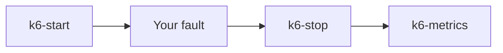

# tumult-loadtest

Start and stop a k6 load test from steps of the method. You rarely need
this plugin: the `load:` section of an experiment, or `tumult run --load`,
starts k6 or oha before the method, stops it after the recovery samples
and records the result in the journal. See the
[load testing guide](../guides/load-testing-guide.md).

Use the plugin when the load must start or stop at one exact step.



## Functions

| Function | Kind | What it does | Arguments |
|---|---|---|---|
| `k6-start` | action | Starts k6 in the background and returns | `k6_script` (required), `k6_vus` (10), `k6_duration` (`30s`), `k6_binary` (`k6`), `k6_pidfile` (`/tmp/tumult-k6.pid`), `k6_out` (`json=/tmp/tumult-k6-results.json`), `otel_endpoint` |
| `k6-stop` | action | Stops the k6 that `k6-start` started | `k6_pidfile` |
| `k6-metrics` | probe | JSON with `avg`, `min`, `max` and `count` of each k6 metric | `k6_results` (`/tmp/tumult-k6-results.json`) |

With `otel_endpoint` set, k6 also sends its metrics over OTLP, so they sit
next to the traces of the run. Install k6 first:
[k6 installation](https://grafana.com/docs/k6/latest/set-up/install-k6/).

## Example

```toon
method[3]:
  - name: start-traffic
    activity_type: action
    provider:
      type: script
      plugin: tumult-loadtest
      function: k6-start
      arguments:
        k6_script: load/payment-api.js
        k6_vus: 50
        k6_duration: 5m
  - name: kill-db-connections
    activity_type: action
    provider:
      type: script
      plugin: tumult-db-postgres
      function: kill-connections
      arguments:
        pg_database: myapp
    pause_before_s: 30.0
  - name: stop-traffic
    activity_type: action
    provider:
      type: script
      plugin: tumult-loadtest
      function: k6-stop
```

`plugins/tumult-loadtest/examples/` has two k6 scripts to start from.
