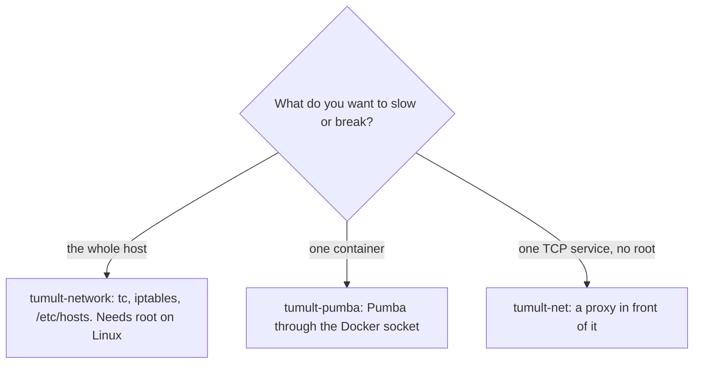

# tumult-network

Slow down, drop or cut network traffic on the host that runs Tumult. This
script plugin uses `tc netem`, `iptables` and `/etc/hosts`.

## Pick the layer

Tumult has three ways to break a network. Pick the one that fits where
your service runs.



[tumult-pumba](tumult-pumba.md) and tumult-net ([blog post](../blog/19-net-chaos-proxy.md))
have their own pages.

## Faults

| Action | What it does | Arguments |
|---|---|---|
| `add-latency` | Adds latency with `tc netem` | `delay_ms` (100), `jitter_ms` (10), `interface` (`eth0`), `target_ip` (optional: only traffic to this address) |
| `add-packet-loss` | Drops packets | `loss_pct` (10), `correlation` (25), `interface` |
| `add-corruption` | Corrupts packets | `corruption_pct` (5), `interface` |
| `delay-dns` | Adds latency to DNS traffic on port 53 | `dns_delay_ms` (500), `dns_jitter_ms` (50), `interface` |
| `reset-tc` | Removes every `tc` rule of the interface: the rollback of the four above | `interface` |
| `block-dns` | Without `dns_domain`, drops all DNS traffic with `iptables`. With it, points that one name to `127.0.0.1` in `/etc/hosts`. | `dns_port` (53), `dns_domain` (optional) |
| `block-dns-rollback` | Removes what `block-dns` added | |
| `redirect-dns` | Points a name to a wrong address in `/etc/hosts` | `dns_domain` (required), `dns_redirect` (`127.0.0.1`) |
| `redirect-dns-rollback` | Removes what `redirect-dns` added. Safe to run twice. | |
| `partition-host` | Drops all traffic to and from an address with `iptables` | `target_ip` (required), `direction`: `both`, `ingress` or `egress` (`both`) |
| `partition-host-rollback` | Removes those rules. Safe to run twice. | `target_ip`, `direction` |

`tc` and `iptables` need Linux and root. The `/etc/hosts` faults also work
on macOS and in a container, but need write access to `/etc/hosts`.

A DNS name travels in a packet as labels with lengths, not as dotted text,
so `iptables --string` cannot match it. That is why the targeted DNS faults
edit `/etc/hosts`.

## Probes

| Probe | Result | Arguments |
|---|---|---|
| `ping-latency` | The mean round trip in milliseconds. A host that does not answer fails the probe. | `target_host` (required), `ping_count` (3) |
| `dns-resolve` | The address of the name, or `failed` | `target_host` (required) |
| `dns-latency` | The lookup time in milliseconds, or `error` | `target_host` (required), `dns_server` (optional) |

The probes work on Linux and macOS.

## Example: send a name to the wrong address

```toon
method[1]:
  - name: redirect-the-upstream
    activity_type: action
    provider:
      type: script
      plugin: tumult-network
      function: redirect-dns
      arguments:
        dns_domain: upstream.example.internal
        dns_redirect: 127.0.0.1
      timeout_s: 10.0

rollbacks[1]:
  - name: restore-dns
    activity_type: action
    provider:
      type: script
      plugin: tumult-network
      function: redirect-dns-rollback
      timeout_s: 10.0
```

`examples/dns-redirect-chaos.toon` is a full experiment with this fault.
