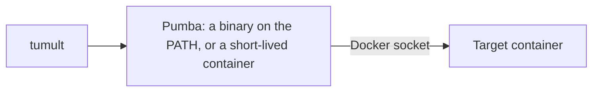

# tumult-pumba

Break the network of one container, or kill, pause or load it, with
[Pumba](https://github.com/alexei-led/pumba). Pumba reaches the container
through the Docker socket, so this works on Linux, macOS and Docker
Desktop without root on the host.



You need Docker with access to `/var/run/docker.sock` and a running target
container. Without a `pumba` binary on the `PATH`, the script runs the
Pumba image `ghcr.io/alexei-led/pumba:1.6.0`, pinned by digest.

## Functions

Every function takes `container` (a name or an ID, required).

| Function | What it does | More arguments |
|---|---|---|
| `netem-delay` | Adds latency to traffic out of the container | `delay_ms` (100), `jitter_ms` (10), `correlation` (20), `duration` in seconds (30), `interface` (`eth0`), `target_ip` |
| `netem-loss` | Drops outgoing packets | `loss_pct` (10), `correlation` (25), `duration` (`30s`), `interface`, `target_ip` |
| `netem-duplicate` | Duplicates outgoing packets | `duplicate_pct` (5), `correlation` (0), `duration` (`30s`), `interface` |
| `netem-corrupt` | Corrupts outgoing packets | `corruption_pct` (5), `duration` (`30s`), `interface` |
| `netem-rate` | Limits outgoing bandwidth | `rate` (`100kbit`), `duration` (`30s`), `interface` |
| `iptables-loss` | Drops incoming packets | `loss_pct` (10), `duration` (`30s`) |
| `kill-container` | Sends a signal to the container | `signal` (`SIGKILL`), `interval` (such as `10s`, to repeat), `random` (`false`) |
| `pause-container` | Freezes the container for a while | `duration` (`10s`) |
| `stop-container` | Stops the container | `duration` (`30s`), `restart` (`false`) |
| `stress-container` | Loads CPU, memory or disk inside the container with stress-ng | `stress_type`: `cpu`, `memory`, `io` or `all` (`cpu`); `cpu_workers`, `mem_workers`, `io_workers` (1 each); `duration` (`30s`); `stress_image` |
| `container-running` | Probe: `true` or `false` | |
| `container-latency` | Probe: the mean ping time in milliseconds from inside the container | `ping_host` (`8.8.8.8`), `ping_count` (3) |
| `container-packet-stats` | Probe: JSON with packets, errors and drops in and out | `interface` (`eth0`) |

Mind the unit of `duration`: `netem-delay` takes a number of seconds
(`30`), the others take a time with its unit (`30s`, `5m`).

The netem, iptables, pause and stress faults end after `duration`, so a
fault ends even when the run is stopped. `kill-container`, and
`stop-container` without `restart: true`, leave the container down.

## Images

`pumba_image` sets another Pumba image. `stress_image` sets the stress-ng
image of `stress-container`; the default is
`ghcr.io/alexei-led/stress-ng:0.20.01`, pinned by digest. That stress-ng
picks its code by CPU model and can stop with `SIGILL` on a VM without
AVX-512. A stress-ng built on Alpine does not. That is why the lab
examples use the SSH server image of the lab, `tumult-sshd:lab`.

## Example

`examples/pumba-latency.toon` adds latency to a Redis container and checks
that it recovers. From the repository root:

```bash
docker compose -p docker -f docker/docker-compose.yml up -d redis
tumult run examples/pumba-latency.toon
```
