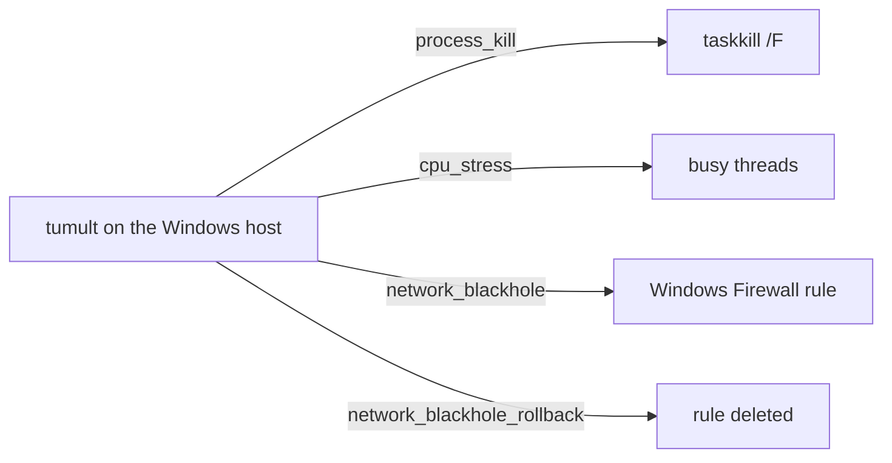

# tumult-windows

Kill a process, load the CPU or block network traffic on a Windows host.
This native plugin drives the tools Windows ships with, `taskkill` and
`netsh`, and spins the CPU itself.



A step runs on the machine that runs Tumult, so the faults act on Windows
only when Tumult runs there. `tumult discover` lists the plugin on every
system. Firewall changes need Administrator rights.

## Functions

| Function | What it does | Arguments |
|---|---|---|
| `process_kill` | Ends a process with `taskkill /F` | `image` or `pid`, exactly one |
| `cpu_stress` | Keeps CPU threads busy for a while | `workers` (one per CPU; at most 4 per CPU and 256), `duration_secs` (10) |
| `network_blackhole` | Blocks outgoing TCP to a port or a host with a firewall rule | `port` or `remote_host`, exactly one |
| `network_blackhole_rollback` | Deletes that rule. A rule that is gone counts as deleted, so it can run twice. | The same `port` or `remote_host` |

The rule is named `tumult-blackhole-port-<port>` or
`tumult-blackhole-host-<host>`, and `network_blackhole` returns the
command that deletes it.

## Example

```toon
title: The Windows service survives a process kill

steady_state_hypothesis:
  title: The service runs
  probes[1]:
    - name: service-running
      activity_type: probe
      provider:
        type: process
        path: cmd
        arguments[2]: "/c", "sc query MyService | findstr RUNNING"

method[1]:
  - name: kill-the-service
    activity_type: action
    provider:
      type: native
      plugin: tumult-windows
      function: process_kill
      arguments:
        image: MyService.exe
```

The run writes a normal journal, so the results reach the lake, the
scores and the Star Map like any other run.

## Undo a block

Put the rollback of a block in `rollbacks:`:

```toon
rollbacks[1]:
  - name: remove-the-block
    activity_type: action
    provider:
      type: native
      plugin: tumult-windows
      function: network_blackhole_rollback
      arguments:
        port: 443
```

Rollbacks run when the run deviates or fails after a fault started. Run
with `tumult run --rollback-strategy always` to remove the block after
every run.

## The winfault tool

The crate also builds `winfault`, a small program that runs one fault and
prints a JSON result. It has no DuckDB inside, so it cross-compiles from
Linux. Copy it to a Windows host to try a fault by hand:

```
winfault process-kill --image notepad.exe
winfault cpu-stress --workers 4 --duration-secs 30
winfault network-blackhole --port 443
winfault network-blackhole-rollback --rule-name tumult-blackhole-port-443
```

## Scope

Three faults built on the tools of Windows. There is no packet filter
driver, no ETW and no service control fault. Tests on Linux check the
exact `taskkill` and `netsh` commands; each fault has also run on a
Windows 11 guest. The [crate README](https://github.com/mwigge/tumult/blob/main/tumult-windows/README.md)
says how to build and test it.
