# Krönika pages

Every page of the web UI, by sidebar group: what you see, where the data
comes from, and the API calls the page makes. For a guided tour, read the
[platform walkthrough](../guides/platform-walkthrough.md).

Krönika is the web UI inside `tumultd`. Each page reads the lake through the
JSON API, with the role and environment scopes of the user who signed in. A
page keeps no data of its own. Every page also calls `GET /api/me`, and
`POST /api/auth/logout` when you sign out.

## Colours of a run

Badges, chart bands and legends use one colour for each way a run can end.

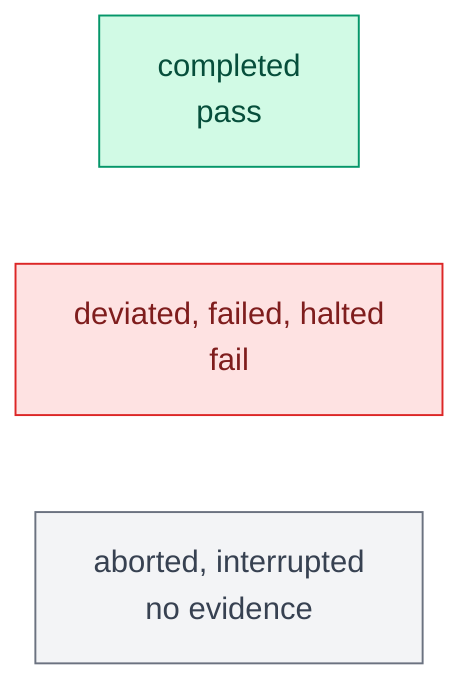

| Colour | Run ended as | What it means |
|---|---|---|
| Green | `completed` | A pass: the hypothesis held. |
| Red | `deviated`, `failed`, `halted` | A fail. |
| Grey | `aborted`, `interrupted` | No evidence: the run proves nothing either way. It is left out of counts, rates and scores. |

A run that has not ended yet (queued, running) is grey too. Amber marks a
state in between: a manual record that partly passed, a pending rollback, or
an approval request that was rejected or expired.

## The scores

The compliance and resilience scores run from 0 to 100 and belong to a target.

- **Compliance score** (Scores page, the gate, the digest). The latest run of
  each experiment: pass 100, pass older than 30 days 75, failure 50, never
  run 0. Averaged per target.
- **Resilience score** (Resilience page). A continuous score from objective
  margins, discipline coverage, evidence freshness and recovery against
  target, per target and weighted by criticality.

Two more scores run from 0 to 1 and belong to one run:

- **GameDay score** (`tumult gameday run` and `analyze`). Pass rate 30 %,
  recovery 25 %, load impact 25 % and compliance coverage 20 %. Each run is
  judged against its own RTO. When no run measured a recovery, the recovery
  is `not measured` and the other three share its weight.
- **Agentic score** (agentic runs). The share of contracts that passed,
  weighted by their severity.

## Evidence and intelligence

### Overview

Route `/`. KPI cards with sparklines, runs per day (one band per run in the
colour of its outcome), a pie of fault injections by type and plugin, and the
target systems.


- **Evidence:** the runs in the range you pick and their fault steps.
- **API:** `GET /api/overview`, `GET /api/experiments/windows`.

### Resilience

Route `/resilience`; old `/posture` links open it. Top risks with an inline
accept, accepted risks, a coverage heatmap and radar of the four
disciplines, an objectives heatmap coloured by margin, the compliance score
over 14 days, the telemetry contract and the resilience score per target.

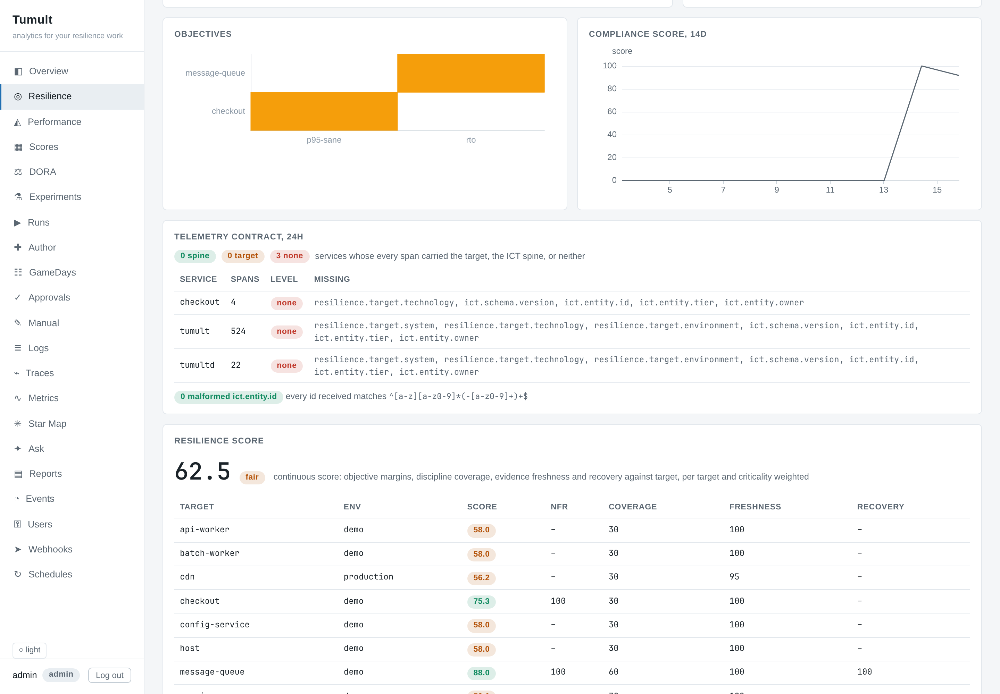


- **Evidence:** findings of the passive risk scan, objective verdicts,
  discipline coverage, score history, and which services follow the
  OpenTelemetry naming contract.
- **API:** `GET /api/risks`, `GET /api/posture`, `GET /api/scores/tree`,
  `GET /api/otel/conformance`, `POST /api/risks/{id}/suppress`.

#### Findings about recovery

The risk scan reads the RTO and the RPO of each DR run and of each verified
manual record, and the register of when each target needs its next DR
test. A record is judged against its own targets. Five rules look at
recovery. A critical target here is one of criticality `critical` or
`high`.

| Rule | It fires when | Severity |
|---|---|---|
| `recovery_target_missed` | The latest run took longer than its RTO, or did not recover at all. A manual record over its RTO fires it too, and the finding says it is a manual record. | High, critical on a critical target |
| `rpo_missed` | The latest run or a manual record lost more data than its RPO allows. The finding gives the RPO measured and the target. | High, critical on a critical target |
| `recovery_not_measured` | The target declares an RTO, and none of its DR runs of the last 30 days measured a recovery: no outage was seen, the method failed or the watch was cut short. A manual record of that time that recovered within its targets proves the RTO. | Low, medium on a critical target |
| `dr_test_overdue` | The next DR test of the target is past due, and no planned DR exercise covers it. See [When a DR test is overdue](#when-a-dr-test-is-overdue). | Medium, high after 30 days past due; one step more on a critical target |
| `objective_breached` | The latest run breached an objective. For a run that did not recover, the text says "not recovered" and gives the time it watched. | By the objective: blocking is high |

A run did not recover when the runner marked the verdict on its RTO so.
The lake keeps that mark, and the risk scan, the DORA score and the DR page
read it.

A late DR test is one finding. When the target also has DR runs of the
last 30 days that measured no recovery, the finding of the late test names
them, and the target gets no `recovery_not_measured`. When a planned DR
exercise covers the target, that finding is the `manual_exercise_overdue`
of the plan.

The recovery part of the resilience score reads the same facts:

- A run within its RTO scores 100. A slower run scores less, and 0 at
  twice its RTO.
- A run that did not recover scores 0.
- A run that measured no recovery is left out.
- A manual record with a recovery time and an RTO counts as a run does.

### Performance

Route `/performance`. Pick a target. The page shows the verdict for two
versions, the difference at the compared quantile with its confidence
interval, the latency distribution, tables per version, and the stored
verdicts. Read [Performance regression](../guides/performance-regression.md)
for how a verdict is made.

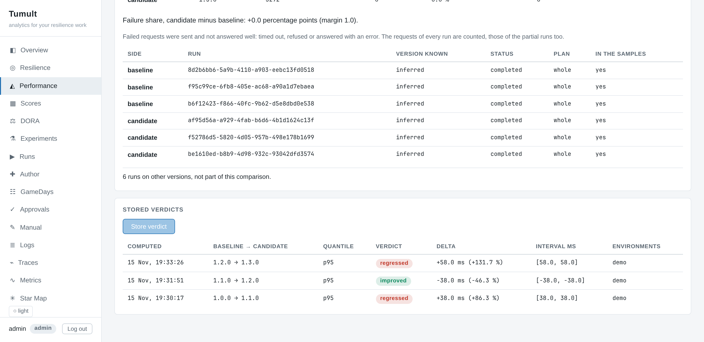

- **Evidence:** latency samples of two `service.version`s of one target in
  one environment, and the verdicts an operator stored.
- **API:** `GET /api/perf`, `GET /api/perf/{target}`,
  `POST /api/perf/{target}/verdicts`.

### Scores

Route `/scores`. The company score with a trend, a treemap of domains that
drills down to members, and a member table.

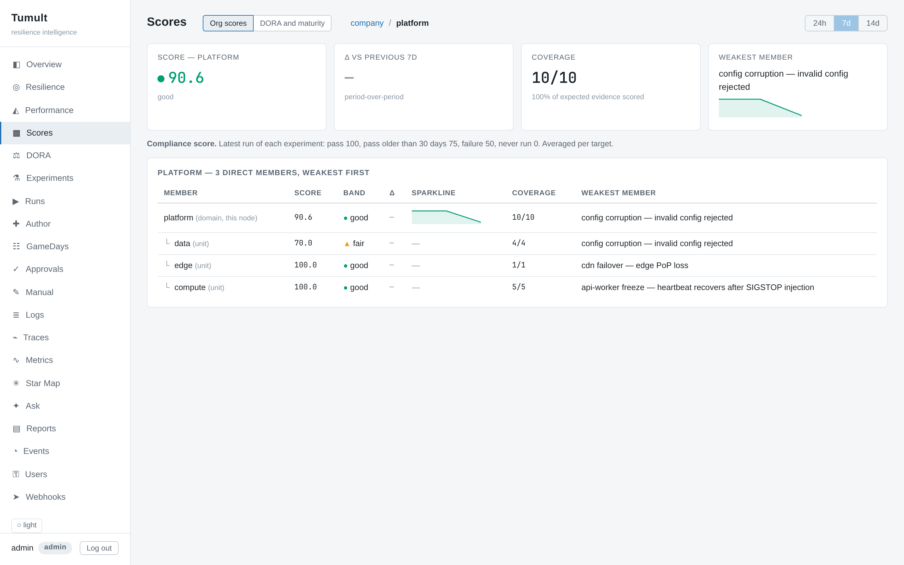

- **Evidence:** the latest run of each experiment, rolled up through the
  `org.yaml` hierarchy, with coverage against expected evidence.
- **API:** `GET /api/scores/tree`.

### DORA

Route `/scores?view=dora`. A heatmap of DORA articles against functions or
org units, expected against actual evidence with an evidence drawer per row,
and the maturity level with the component that caps it. The page reports
what evidence exists; it does not say that an entity complies. Read the
[DORA score guide](../guides/dora-score.md).


- **Evidence:** runs and manual records matched to the DORA requirements,
  the daily snapshots, and the function register in `org.yaml`.
- **API:** `GET /api/dora`, `GET /api/dora/{article}`, `GET /api/maturity`.

### Disaster recovery

Route `/dr`. The DR tests of each target, automated and manual together,
and when the next one is due. A DR test is a run of kind `dr`, or a
submitted or verified manual record of a type the house counts as DR: by
default `failover`, `drill`, `restore` and `backup`.


- **Due register.** One row per target: its state (`ok`, `due` within 30
  days, `overdue` or `never tested`), its last DR test with its date,
  origin and verdict, when the next one is due, the interval and where it
  comes from, the plan that covers it, and the RTO and RPO it is held to
  against what its last test measured. Read
  [When a DR test is overdue](#when-a-dr-test-is-overdue) for how the
  register works.
- **RTO and RPO over time.** Per target, a chart of the RTO and one of the
  RPO that each test measured, with the target as a dashed line. A diamond
  marks a manual test. A triangle marks a run that did not recover. It is
  drawn at the least its RTO was: the time from the outage seen to the end
  of the watch.
- **DR tests in the period.** Newest first, 20 to a page. A run links to
  its page, and a manual record to the records of the Manual page.
- **Filters.** A target, an environment and a period of 90 days, 1 year or
  3 years. The URL keeps them, so a link opens the same view. The period
  selects the tests. The register shows the targets as they are now.

A lake with no DR test says so, and links to the guide and to the Manual
page.

`GET /api/dr` answers with `targets` (the register), `tests` (one page of
the DR tests of the period, with the columns of `dr_tests`) and `summary`
(the targets per state, and the tests per origin and verdict). A run that
did not recover measured no RTO. Its test, and a target whose last test it
is, have `rto_at_least_s`: the least its RTO was. `from` and `to` set the
period in unix nanoseconds, both ends included. By default it is the 365
days up to now. `target` keeps one target system, and `environment` one of
your environments. `limit` (100 by default, 1000 at most) and `cursor` page
the tests as `GET /api/entities` does. A query field the API does not know
is refused with 400.

- **Evidence:** the lake view
  [`dr_tests`](../guides/analytics-guide.md#dr-tests), the planned manual
  exercises, and the DR test plans of the functions in `org.yaml`.
- **API:** `GET /api/dr`.

### Star Map

Route `/starmap`; old `/topology` links point to it. One graph of org units,
ICT entities, systems, components, services, workloads and definitions, with
three lenses (evidence, risk, conformance) and an evidence drawer per node.
Read the [Star Map guide](../guides/star-map.md).


- **Evidence:** spans, runs, verified manual records, accepted risks,
  `org.yaml` and the manifests under `KRONIKA_MANIFESTS_DIR`.
- **Drawer of a system:** links to its manual records and to its DR page,
  with the target and environment of the system in the URL.
- **API:** `GET /api/starmap`, and in the drawer `GET /api/gate/{target}`
  and `GET /api/experiments`.

## Experiments and runs

### Experiments

Route `/experiments`. A table you can filter: status, experiment, ID, start,
duration, faults and target.

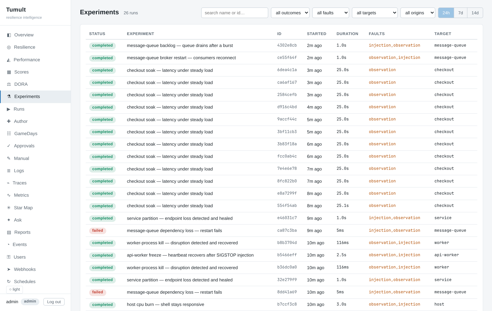

- **Evidence:** the newest 500 runs in the lake, from the CLI, MCP, the
  daemon or a manual record. A draft is not on the list. A submitted record
  is, as waiting for review.
- **API:** `GET /api/experiments`, `GET /api/dimensions`.

### Experiment detail

Route `/experiments/{id}`. Steady state, objectives, steps, load charts,
probe samples with the fault window marked, the trace waterfall, logs and
metric points.


- **Evidence:** the journal of the run as the lake keeps it, and the spans
  and metric points of the run.
- **API:** `GET /api/experiments/{id}`, `GET /api/experiments/windows`.

### Runs

Route `/runs`. Daemon runs with state filters and a two-step **Halt all**.


- **API:** `GET /api/runs`, `POST /api/runs/stop-all`.

### New run

Route `/runs/new`. Pick a definition, fill in its parameters and see a dry
run of the resolved plan before you start it.

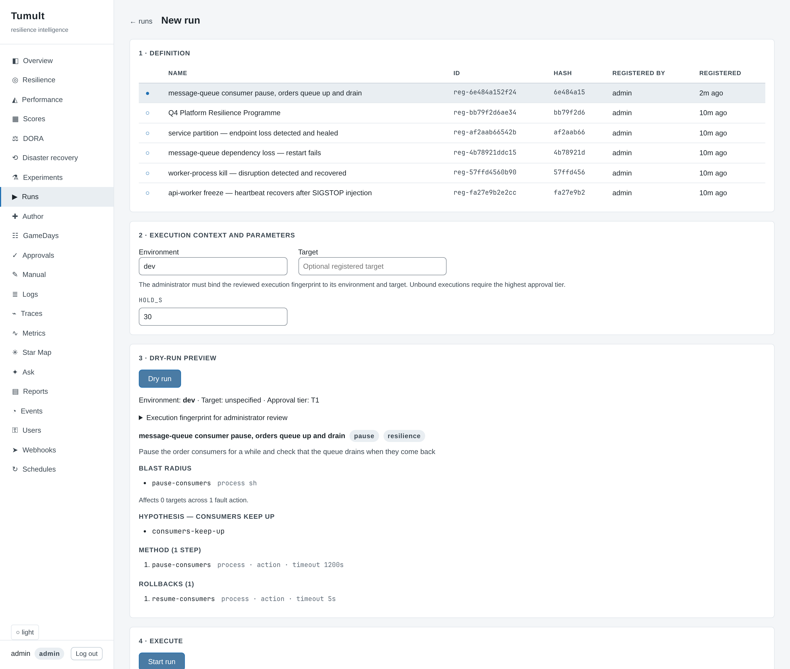

- **API:** `GET /api/registry`, `GET /api/registry/{id}`,
  `POST /api/runs/dry-run`, `POST /api/runs`.

### Run detail

Route `/runs/{id}`. The run header with the stop button, the planned blast
radius (a plan, not a measure), the live trace, the **Impact** panel (each
probe against its forecast band), the approval chain and the audit timeline.
The Impact panel is the only chart of a forecast; see
[Forecasting](../guides/forecasting.md).


- **API:** `GET /api/runs/{id}`, `GET /api/runs/{id}/impact`,
  `GET /api/experiments/{id}`, `GET /api/experiments/windows`,
  `POST /api/runs/dry-run`, `POST /api/runs/{id}/stop`,
  `POST /api/runs/{id}/approve`, `POST /api/runs/{id}/reject`,
  `POST /api/runs/{id}/break-glass`.

### Author

Routes `/author` and `/author/new`. The fault catalog of the mounted plugins
and a wizard that writes a TOON experiment.

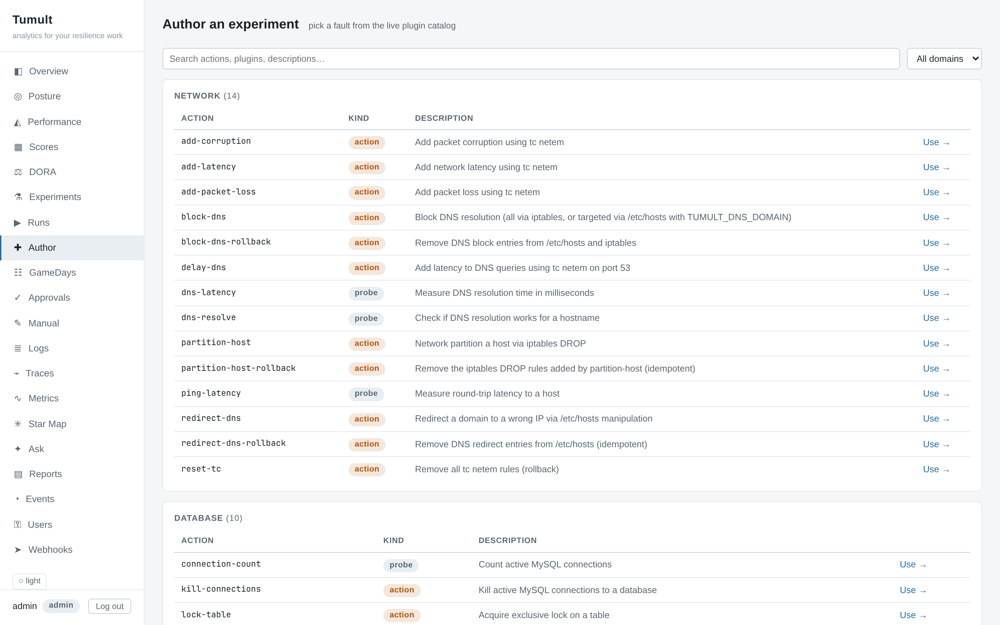

- **API:** `GET /api/authoring/catalog`, `POST /api/authoring/scaffold`,
  `POST /api/runs/validate`.

### GameDays

Routes `/gamedays` and `/gamedays/{id}`. Campaigns and a form to register
one; a campaign with its child runs and the **Environment** it runs in.


- **API:** `GET /api/gamedays`, `GET /api/gamedays/{id}`,
  `POST /api/gamedays/validate`, `POST /api/gamedays/{id}/runs`,
  `GET /api/runs` (with `registry_id` or `gameday_id`), `GET /api/runs/{id}`.

### Approvals

Route `/approvals`. Pending requests with approve and reject. Each request
is pinned to the hash of its content.


- **API:** `GET /api/approvals`, `POST /api/runs/{id}/approve`,
  `POST /api/runs/{id}/reject`.

### Schedules

Route `/schedules`, for operators. Recurring runs of registered definitions.


- **API:** `GET /api/schedules`, `GET /api/registry`, `POST /api/schedules`,
  `POST /api/schedules/{id}/enable`, `POST /api/schedules/{id}/delete`.

### Manual

Route `/manual`. Manual evidence: DR exercises and other tests run by hand.
You plan them, record them, attach evidence, sign them off and verify their
audit trail. A record is a draft, submitted, verified or rejected.


The page has five tabs:

- **New entry** records an exercise. See [Record a DR exercise](#record-a-dr-exercise).
- **Plans** lists the plans with their due dates, and plans an exercise.
- **Verification queue** lists the submitted records. Open one to sign it off.
- **All records** lists every record. Open one to see its steps, actions,
  evidence, sign-offs and audit trail, and to verify it.
- **Import** takes records as JSON, as drafts in one batch.

**Plans**, **Verification queue** and **All records** keep to the target in
the URL: `/manual?tab=records&target=payments-db&environment=production`.
The Star Map drawer opens the page this way. **Show every target** clears it.

When the API refuses a change, the page shows the reason the API gives.

- **API:** `GET /api/manual/experiments`, `GET /api/manual/experiments/{id}`,
  `POST /api/manual/experiments`, `PUT /api/manual/experiments/{id}`,
  `POST /api/manual/experiments/{id}/submit`,
  `POST /api/manual/experiments/{id}/verify`,
  `POST /api/manual/experiments/{id}/reject`,
  `GET /api/manual/experiments/{id}/audit/verify`,
  `POST /api/manual/experiments/{id}/attachments`,
  `GET /api/manual/experiments/{id}/attachments/{attachment_id}/file`,
  `POST /api/manual/import`, `GET /api/manual/plans`,
  `POST /api/manual/plans`, `GET /api/manual/plans/{id}`,
  `PATCH /api/manual/plans/{id}`, `POST /api/manual/plans/{id}/cancel`,
  `GET /api/manual/plans/{id}/audit/verify`.

#### Record a DR exercise

The form of **New entry** takes what an auditor asks of a restore test, a
failover drill or a tabletop:

- the exercise type, `restore` and `backup` included, the target system and
  environment, and the plan it fulfils. The list shows the planned plans of
  the same type and target. A plan you pick fills the target and the planned
  RTO and RPO where the form is blank.
- the planned RTO and RPO, the actual recovery time and RPO, and whether the
  data was verified after the recovery.
- the participants with their roles, the steps in order with their start,
  end and result, and the actions with an owner and a due date.
- how much the findings matter and how much each action matters: `low`,
  `medium`, `high` or `critical` (DORA Art. 24(5)). An action can also name
  the run or the record that retested it.
- the tester, and whether the tester is `internal` or `external` (DORA
  Art. 24(4)).
- the requirements the record is evidence for, in **Framework refs**. See
  [Cite a requirement](#cite-a-requirement).

The form sends the actions as `actions`. It no longer sends the older
`action_items` list. Nor do the MCP tool `tumult_manual_create_draft`, the
draft of a break-glass run and the demo seed. When you edit an older draft,
each of its plain action items becomes an action that still needs an owner.

Save the draft first. Then attach files and links to it in **Evidence**, and
submit it with **Save & submit**.

#### Cite a requirement

A record names the requirements it is evidence for in `framework_refs`.
Name a DORA requirement by its registry id: `dora.art12.1` for Art. 12(1),
`dora.art12` for the article. The
[DORA score](../guides/dora-score.md#requirement-ids) explains the ids.

- A DORA id the registry does not know is refused with 422, and nothing is
  stored. The answer names the nearest registry id:
  `'dora.art12.9' is not a requirement id of the DORA registry; did you mean 'dora.art12.1'?`.
  A reference that names no framework, such as a bare `Art. 12(1)`, is
  refused the same way. The same check runs on a draft edit, an import and
  a draft over MCP.
- An older form of a known id, such as `DORA Art. 12(1)`, is taken and kept
  as written. The score, the Star Map and a run report read it as
  `dora.art12.1`, so they show the same requirement.
- A reference to another framework, such as `ISO 27001 A.5.30` or
  `NIS2 Art. 21(2)(c)`, is kept as written and not checked: the registry
  holds DORA only.

#### Record a TLPT

A record of type `tlpt` is a threat-led penetration test. Next to the
fields of any record it takes the TLPT block, from the TLPT RTS
(Delegated Regulation (EU) 2025/1190): the reference and the date of the
attestation the TLPT authority issued (Art. 14), and the reference of the
test summary report (Art. 12). Its actions are the remediation plan
(Art. 13): each item has an owner, a due date, a severity, and the run or
the record that retested it.

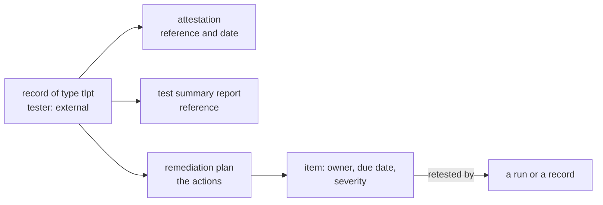

On the page, choose the type `tlpt`: the **TLPT** panel opens and
**Actions** becomes **Remediation plan**. With the API:

```json
{"exercise_type": "tlpt", "findings_severity": "high",
 "tester": {"name": "Red Team Ltd", "kind": "external"},
 "tlpt": {"attestation_ref": "TLPT-ATT-2026-07", "attested_at_ns": 1795000000000000000,
          "summary_report_ref": "TSR-2026-07"},
 "actions": [{"title": "Remove stale VPN accounts", "owner": "carol", "severity": "critical",
              "retest": {"kind": "run", "id": "exp-vpn-retest"}}]}
```

- The `tlpt` block is refused with 400 on a record of another type.
- A severity is `low`, `medium`, `high` or `critical`; a tester kind is
  `internal` or `external`; a retest kind is `run` (an automated run, by its
  id) or `record` (a manual record, by its id). Any other value is refused
  with 400 and the values it may be.
- The record reads them back as `findings_severity`, `tester`,
  `tester_kind`, `tlpt_attestation_ref`, `tlpt_attested_at_ns` and
  `tlpt_summary_ref`, and each action as `severity`, `retest_kind` and
  `retest_id`.
- All of them are part of the seal of the record, so the audit verify finds
  a direct edit of any of them.

#### Plan an exercise

A plan says which manual exercise is due when, and who owns it. Plan one on
the **Plans** tab, or send `POST /api/manual/plans` with a name, an exercise
type, the target system and environment, an owner and a due date
(`due_at_ns`). A plan can also name a function of the register
(`function_id`), what it will test (`scope`), a planned date, an interval
in days and the planned RTO and RPO. On the page a due date holds the whole
day: the plan is due at the end of it.

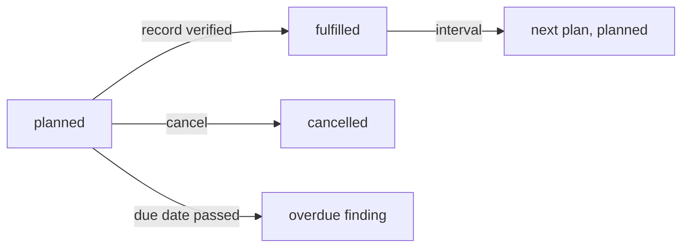

- A plan of a DR type that names no interval comes back every 365 days.
  The DR types are the ones the house counts as `dr`: by default
  `failover`, `drill`, `restore` and `backup`.
- Change a planned plan with **Edit** on its row, or with
  `PATCH /api/manual/plans/{id}`. A field you send as `null` is cleared.
  Cancel it with **Cancel** and a reason, or with
  `POST /api/manual/plans/{id}/cancel`.
- Every change seals the plan and adds a row to its audit trail.
  `GET /api/manual/plans/{id}` shows both. On the page, open the row of the
  plan.
- To fulfil the plan, send its id as `plan_id` with the record of the
  exercise. The plan must still be planned, and the record must test what
  the plan planned: the same exercise type, and the same target system,
  target environment and function (a `function` link) where the plan sets
  them. If not, the API answers 422 and names the field that differs. The
  same check runs again when the record is verified.
- When the record is verified (see [Sign off a record](#sign-off-a-record)),
  the plan is fulfilled. A plan with an interval then comes back, due one
  interval after the day the exercise ran. A rejected record leaves the
  plan as it was.

#### When a plan is overdue

A plan that is still planned after its due date is marked overdue on the
**Plans** tab. It is also a finding on the Resilience page, with the rule
`manual_exercise_overdue`. It is medium for
the first 30 days past the due date, and high after that. The finding goes
away when a verified record fulfils the plan, or when someone cancels it.
An overdue plan does not change the compliance score.

#### When a DR test is overdue

The risk scan keeps a register of when each target needs its next DR
test. A target is in it when it has a DR test, declares an RTO, or has a
planned DR exercise. The next test is due one interval after the last
one. A DR run whose probes saw no outage is no last test: it proved
nothing about recovery. The interval comes from a planned DR exercise of
the target, else
from the DR test plan of its function in the register, else it is 365
days.

A target past that date is a finding on the Resilience page, with the
rule `dr_test_overdue` (see [Findings about recovery](#findings-about-recovery)).
It is medium for the first 30 days, and high after
that. On a target of criticality `critical` or `high` it is one step more:
high, then critical. A target that a planned DR exercise covers gets no
such finding: its plan is the one that is overdue, with
`manual_exercise_overdue`. So one late test is one finding.

#### Sign off a record

Verifying a record is a sign-off. A record stays submitted until it has
enough approving sign-offs, each from another user. The house sets how many
each exercise type needs, in the `score:` section of the org file. A type it
does not list needs one, so a house that sets nothing works as before.

```yaml
score:
  manual_required_signoffs: {failover: 2, restore: 2}
```

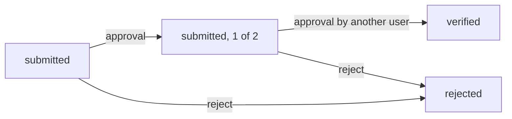

- On the page, open the record in **Verification queue** and choose
  **Approve** or **Reject** with a note. The page says how many sign-offs
  are still needed.
- Approve with `POST /api/manual/experiments/{id}/verify`. Reject with
  `POST /api/manual/experiments/{id}/reject` and a note. The answer gives
  the `status` and the sign-offs still needed (`signoffs_needed`).
- The user who entered the record, edited it, submitted it or attached
  evidence to it may not sign it off. One user signs a record once. The API
  answers 422 with the reason.
- The last approval verifies the record and fulfils its plan.
- `GET /api/manual/experiments/{id}` lists the `signoffs`, with
  `signoffs_required` and `signoffs_needed`.
- A sign-off is a row of `manual_signoffs`. It keeps the seal of the record
  it signed (`signed_hash`) and links the sign-off before it.

#### Attach a file

A record can keep files as evidence: a runbook log, a screenshot, an export
of the data you restored. On the page, choose the file in **Evidence** of the
record and **Upload file**. The list shows the type, the size and the SHA-256
of each file, and **Download** gives it back. With the API, send the bytes of
one file as the body, and its name in the query:

```bash
curl -H "Authorization: Bearer $TOKEN" --data-binary @runbook-log.pdf \
  -H 'Content-Type: application/octet-stream' \
  "$TUMULT/api/manual/experiments/$ID/attachments?name=runbook-log.pdf"
```

While auth is open, also send who attaches it, with `&added_by=alice`.

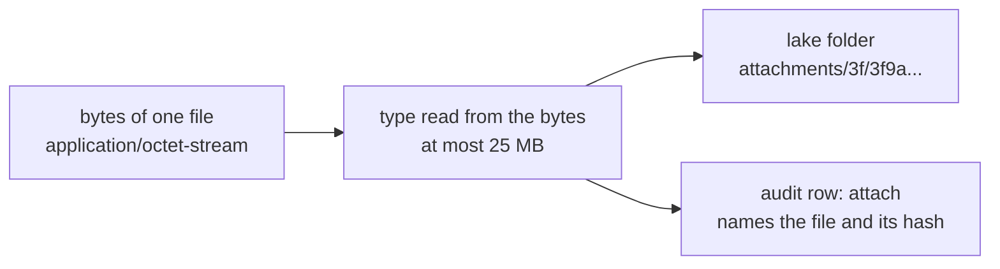

- A file can be at most 25 MB (26,214,400 bytes). A larger file is
  refused with 413, and nothing of it is kept.
- The allowed types are PDF, PNG, JPEG, plain text, CSV and JSON. Tumult
  reads the type from the bytes, not from what the client says. Text is CSV
  or JSON when the name ends in `.csv` or `.json`. Any other file, and a
  name that says another type than the bytes are, is refused with 415 and
  the list of allowed types.
- The file is stored once, by its SHA-256, in the `attachments` folder next
  to the lake database. The same file sent twice is one stored file.
- You can attach a file in any status, also after the record is verified.
  The attach is a row of the audit trail that names the file and its hash.
  It does not change the seal of the record. A file cannot be removed.
- The body must be `application/octet-stream`. Any other content type,
  such as a form or plain text, is refused with 415. A page on another site
  cannot send this type without asking first, so it cannot attach a file
  in your name.
- A link (`url` or `ticket`) is still sent as JSON, while the record is a
  draft or submitted.
- `GET /api/manual/experiments/{id}` lists each file with its
  `file_hash`, `media_type`, `size_bytes`, and its name as `label`.
- `GET /api/manual/experiments/{id}/attachments/{attachment_id}/file`
  downloads a file (Viewer). It always comes as a download, never as a
  page the browser opens.
- The lake export and the full backup carry the files, in their
  `attachments` folder, and a restore brings them back.

#### Verify the audit trail

`GET /api/manual/experiments/{id}/audit/verify` and
`GET /api/manual/plans/{id}/audit/verify` check a record or a plan again,
straight from the lake. They need the Viewer role, as the verify of a run
does. On the page, open the record or the plan and choose **Verify audit
trail**: it says ok, or lists each problem.

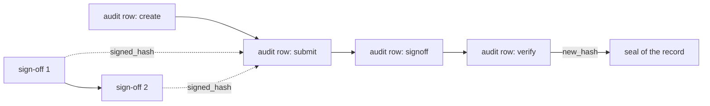

- The seal is computed again, in the form the record was sealed in
  (`hash_version`), and compared with the stored one. A record verified
  before 3.0.4 keeps form 1, which does not cover the reviewer, the steps,
  the actions or the links.
- Each audit row must start from the seal the row before it left, and the
  last row must leave the stored seal.
- Each audit row has a `link_hash` over its own fields and the row before
  it, so a changed, moved or deleted row shows. Rows written before 3.0.4
  have none: they count as `legacy_rows`, and the chain starts after them.
- The reviewer must be the one of the verify or reject row. Each sign-off
  must link the one before it, sign a seal the audit trail holds, and have
  the audit row that names it.
- Each attachment must have the attach row that names it, and each attach
  row must name an attachment that is there. Each stored file must be in
  the lake folder and hash to its `file_hash`.

The answer is `ok: true`, or `ok: false` with `problems`. Each problem names
the `table` and the `row`, and the `field` when the check can tell.

```json
{"experiment_id": "01KAQ...", "ok": false, "chain_valid": false,
 "hash_version": 2, "legacy_rows": 0,
 "problems": [{"table": "manual_experiments", "row": "01KAQ...",
   "field": "reviewed_by",
   "problem": "reviewed_by is 'mallory', but the verify row of the audit trail is by 'carol'"}]}
```

#### From the command line

`tumult manual` does all of this from a terminal or a script. It sends each
request to the daemon API, with the URL of `TUMULT_DAEMON_URL` and the token
of `TUMULT_DAEMON_TOKEN`, so the same roles and rules apply. The
[CLI reference](../guides/cli-reference.md#tumult-manual) lists every flag.

```bash
tumult manual create --file failover.toon     # the record body, as TOON or JSON
tumult manual submit 01KAQ...
tumult manual sign-off 01KAQ... --approve     # as another user
tumult manual attach 01KAQ... runbook-log.pdf
tumult manual verify 01KAQ...                 # exits 1 when it is not ok
tumult manual show 01KAQ... --format json
```

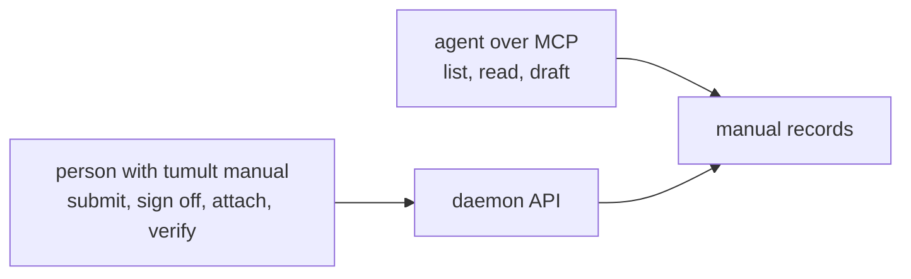

- The file of `create` is the body that `POST /api/manual/experiments`
  takes, and the file of `plans create` the body of `POST /api/manual/plans`.
  A field the API does not know is refused, and the error names it.
- `list` filters by `--status`, `--type`, `--target`, `--from` and `--to`.
  `show` prints the steps, actions, links, attachments and sign-offs, and how
  many sign-offs are still needed. It also prints the severity of the
  findings and of each action, the tester, the TLPT block and what retested
  an action.
- Every read takes `--format json` and prints what the API answered.
- While the daemon has no user yet, `--by` names who acts. With auth on, the
  user of the token acts.
- The MCP tools `tumult_manual_list`, `tumult_manual_get`,
  `tumult_manual_create_draft` and `tumult_manual_plans_list` let an agent
  read and draft. No MCP tool submits, signs off, verifies or attaches: an
  agent may draft, a person signs.

## Telemetry explorers

### Logs

Route `/logs`. Log volume by severity and a table you can search, for the
log records that came in over OTLP and OTel-Arrow.

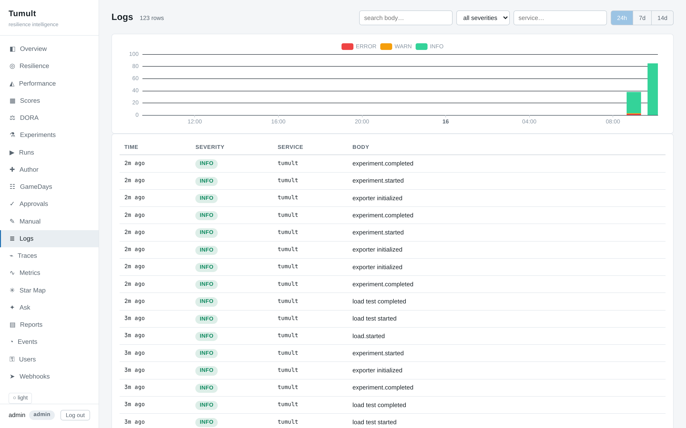

- **API:** `GET /api/logs`, `GET /api/logs/volume`.

### Traces

Routes `/traces` and `/traces/{id}`. A scatter of trace durations, a trace
table, and a waterfall per trace with a span drawer.


- **API:** `GET /api/traces`, `GET /api/traces/durations`,
  `GET /api/traces/{id}`, `GET /api/experiments/windows`.

### Metrics

Route `/metrics`. One metric as a line, area or bar chart, grouped by an
attribute if you like, with experiment windows on top.


- **API:** `GET /api/metrics/catalog`, `GET /api/metrics/query`,
  `GET /api/experiments/windows`.

### Ask

Route `/ask`. Ask a question; see the SQL it became and the result. The
query is read only.


- **API:** `POST /api/ask`.

## Reports and administration

### Reports

Route `/reports`. Compliance reports R1, R2 and R3 with their SHA-256, an
HTML preview and a PDF download, and quick metric digests.


- **API:** `GET /api/reports/v2`, `POST /api/reports/v2/generate`,
  `GET /api/reports`, `POST /api/reports/generate`, `GET /api/experiments`,
  `GET /api/metrics`.

### Events

Route `/events`. Run lifecycle events with their actor, newest first.


- **API:** `GET /api/events`.

### Users

Route `/users`, for admins. Accounts, roles, environment scopes and API
tokens.


- **API:** `GET /api/users`, `POST /api/users`,
  `POST /api/users/{id}/role`, `POST /api/users/{id}/scopes`,
  `POST /api/users/{id}/password`, `POST /api/users/{id}/disable`,
  `GET /api/tokens`, `POST /api/tokens`, `POST /api/tokens/{id}/revoke`.

### Webhooks

Route `/webhooks`, for admins. Sinks for run events.

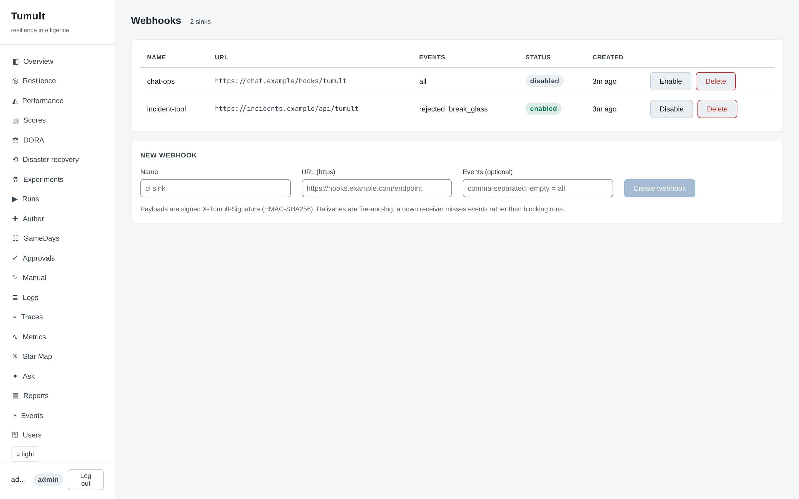

- **API:** `GET /api/webhooks`, `POST /api/webhooks`,
  `POST /api/webhooks/{id}/enable`, `POST /api/webhooks/{id}/delete`.

### Login

Route `/login`. Sign in, and change the password at the first sign in.


- **API:** `POST /api/auth/login`, `POST /api/auth/change-password`.

## Not on a page yet

- Entities from [entity events](../guides/entity-events.md): read them with
  `GET /api/entities`.
- Forecast bands of semantic metrics: `GET /api/forecast`.

Charts follow the theme you pick (dark, light or auto), and tooltips escape
every value that comes from the lake.
