# Krönika pages, charts and evidence

The full list of pages in the web UI: the charts on each, the evidence they
show, and the API behind them. For a picture tour, read the
[platform walkthrough](../guides/platform-walkthrough.md).

Krönika is the web UI embedded in `tumultd`. Every page reads the lake
through the JSON API with the signed-in user's role and environment
scopes; a page stores nothing of its own. The list below groups the pages of
the sidebar and names, for each page, the charts on it and the evidence they
are drawn from. Pages without a chart are tables or forms and say so.

## Evidence and intelligence

| Page | Charts and panels | Evidence shown | API |
|---|---|---|---|
| **Overview** (`/`) | KPI cards with sparklines (experiments, run pass rate, deviation rate, mean time to recover, target coverage); runs per day as a bar chart for `24h`, with a band per run in the colour of its outcome, and a calendar heatmap for longer ranges, each with a colour legend; fault injections pie (the action steps of the runs per fault type and plugin, without probe samples and rollback steps); target systems table | Runs in the selected range and their fault injection steps, with run windows overlaid on the `24h` chart | `GET /api/overview`, `GET /api/experiments/windows` |
| **Resilience** (`/resilience`) | Top risks list with inline accept; accepted findings; coverage heatmap of targets against the four disciplines with a legend (missing, stale, covered) and a radar of the share of targets covered per discipline, 0 to 1; objectives heatmap of targets against every objective, coloured by margin, with a legend; compliance score line over 14 days; telemetry contract table; resilience score per target | Findings of the passive risk scan, objective verdicts, discipline coverage, the score history, and which services carry the OpenTelemetry naming contract | `GET /api/risks`, `GET /api/posture`, `GET /api/scores/tree`, `GET /api/otel/conformance`, `POST /api/risks/{id}/suppress` |
| **Performance** (`/performance`) | Target picker; verdict with how the two versions were selected and attributed; difference at the compared quantile with its confidence interval; latency distribution chart (percentile curves of baseline and candidate, the baseline dashed); tables of latency, partial runs and windows, requests and runs by version; stored verdict history | Load and probe latency samples of two `service.version`s of one target in one environment, and the verdicts an operator stored | `GET /api/perf`, `GET /api/perf/{target}`, `POST /api/perf/{target}/verdicts` |
| **Scores** (`/scores`) | Company score with a trend sparkline; treemap of domains (area by experiments and criticality, colour by band) that drills from company to domain to member; member table (the row of the node has a sparkline) | Latest run per experiment rolled up through the `org.yaml` hierarchy, with coverage against expected evidence | `GET /api/scores/tree` |
| **DORA** (`/scores?view=dora`) | Legal entity picker; heatmap of articles against functions or org units with a colour legend (coverage stops at 50 % and 80 %, or evidence status) and a table alternative; expected and actual evidence status with the largest gap first and an evidence drawer per row; maturity gauge, component bars on a 0 to 100 axis with a legend for the component that caps the level, and a level-and-index line per quarter with a legend; maturity per node with the node that caps the level; reporting readiness of the function register | Runs and manual records matched to the DORA requirement registry, the stored daily snapshots, and the function register declared in `org.yaml` | `GET /api/dora`, `GET /api/dora/{article}`, `GET /api/maturity` |
| **Star Map** (`/starmap`) | One graph of organisation units, ICT entities, systems, components, services, workloads and definitions; lens switch (evidence, risk, conformance); environment and range pickers; focus on a neighbourhood; node list with a filter; evidence drawer with coverage by discipline, runs, gate verdict, objective verdicts, manual records and risks | Spans, runs, verified manual records, risk suppressions, `org.yaml` and the manifests under `KRONIKA_MANIFESTS_DIR`, assembled per request | `GET /api/starmap`, `GET /api/gate/{target}` (drawer) |

The two scores run from 0 to 100, and each says what it measures:

- **Compliance score** (Scores, the gate, the digest). Latest run of each experiment: pass 100, pass older than 30 days 75, failure 50, never run 0. Averaged per target.
- **Resilience score** (Resilience). Continuous score: objective margins, discipline coverage, evidence freshness and recovery against target, per target and criticality weighted.

The Resilience page was called Posture. It reads `GET /api/posture`, and
old `/posture` links open it.

The DORA page reports what evidence exists. It does not state that an
entity complies; see the [DORA score guide](../guides/dora-score.md). The Star Map
lenses and marks are explained in the [Star Map guide](../guides/star-map.md), and
the performance verdict in
[Performance Regression](../guides/performance-regression.md). `/topology` is kept
as a redirect to the Star Map.

## Experiments and runs

| Page | Charts and panels | Evidence shown | API |
|---|---|---|---|
| **Experiments** (`/experiments`) | Filterable table: status, experiment, ID, started, duration, faults, target | The newest 500 experiment runs in the lake, from the CLI, MCP, the daemon or a manual record | `GET /api/experiments`, `GET /api/dimensions` |
| **Experiment detail** (`/experiments/{id}`) | Panels **Steady state** (kind of test, met before and after, recovery time and point), **Objectives**, **Steps**, **Load** (totals, and charts of latency, throughput and error rate over the run) and **Probe samples** (a chart with the time of the fault marked); trace waterfall with a span drawer; logs and metric points | The journal of the run as the lake keeps it: every step with its result, every objective with its verdict, the windows of the load, the samples of the probes. The spans the engine emitted for the run. The metric points with the name of the experiment in the time of the run | `GET /api/experiments/{id}` |
| **Runs** (`/runs`) | Table with state filters and the two-step **Halt all** | Daemon runs and their states | `GET /api/runs`, `POST /api/runs/stop-all` |
| **New run** (`/runs/new`) | Definition picker, parameter form, dry-run preview of the resolved plan | Registered definitions | `GET /api/registry`, `POST /api/runs/dry-run`, `POST /api/runs` |
| **Run detail** (`/runs/{id}`) | Run header with e-stop; **Planned blast radius**: what the definition of the run plans to hit, which is a plan and not a measure of what the run did; live trace waterfall; **Impact** panel: one chart per probe of observed values against the counterfactual median and its 80 % band, with the fault window and peak and recovery marks, and the model that produced it; approval chain with the approvals so far out of the number needed; hash-chained audit timeline | The run's state and audit rows, the plan of its definition, its spans, and its raw probe samples compared with a forecast | `GET /api/runs/{id}`, `POST /api/runs/dry-run`, `GET /api/experiments/{id}`, `GET /api/runs/{id}/impact` |
| **Author** (`/author`, `/author/new`) | Fault catalog browser; scaffolding wizard with a TOON editor | The actions and probes of the mounted plugins | `GET /api/authoring/catalog`, `POST /api/authoring/scaffold`, `POST /api/runs/validate` |
| **GameDays** (`/gamedays`, `/gamedays/{id}`) | Campaign table and registration form; campaign detail with its child runs, and an **Environment** field: the campaign runs in the environment you type | Registered campaigns and the runs they started | `GET /api/gamedays`, `GET /api/gamedays/{id}`, `POST /api/gamedays/{id}/runs`, `GET /api/runs?registry_id=` (the campaigns of the GameDay), `GET /api/runs?gameday_id=` (the runs of one campaign) |
| **Approvals** (`/approvals`) | Queue of pending requests with approve and reject | Approval requests with their content-hash pin | `GET /api/approvals`, `POST /api/runs/{id}/approve`, `POST /api/runs/{id}/reject` |
| **Schedules** (`/schedules`, operator) | Table and form | Recurring runs of registered definitions | `GET /api/schedules` |
| **Manual** (`/manual`) | Entry and review tabs | Manual evidence records in their draft, submitted, verified or rejected state | `GET /api/manual/experiments` |

The Impact panel is described in
[Forecasting and run impact](../guides/forecasting.md). It is the only place in the
UI that draws a forecast: `GET /api/forecast` returns forecast bands for
semantic metrics, and no page charts them yet.

## Telemetry explorers

| Page | Charts and panels | Evidence shown | API |
|---|---|---|---|
| **Logs** (`/logs`) | Log volume by severity as a bar chart; searchable table with attribute filters | Log records ingested over OTLP and OTel-Arrow | `GET /api/logs`, `GET /api/logs/volume` |
| **Traces** (`/traces`, `/traces/{id}`) | Scatter chart of trace durations; trace table; per-trace waterfall with a span drawer | Spans grouped into traces | `GET /api/traces`, `GET /api/traces/durations`, `GET /api/traces/{id}` |
| **Metrics** (`/metrics`) | One chart of a chosen metric as line, area or bar, optionally grouped by an attribute, with experiment windows overlaid | Raw sums, gauges and histograms | `GET /api/metrics/catalog`, `GET /api/metrics/query`, `GET /api/experiments/windows` |
| **Ask** (`/ask`) | Question box, the generated SQL and a result table | Whatever the guarded, read-only query returns from the lake | `POST /api/ask` |

## Reports and administration

| Page | Charts and panels | Evidence shown | API |
|---|---|---|---|
| **Reports** (`/reports`) | Compliance report table (R1, R2, R3) with SHA-256, HTML preview and PDF download; quick digests | Generated documents and the coverage each was built from | `GET /api/reports/v2`, `POST /api/reports/v2/generate`, `GET /api/reports` |
| **Events** (`/events`) | Table, newest first | Run lifecycle events with their actor | `GET /api/events` |
| **Users** (`/users`, admin) | Accounts, roles, environment scopes, API tokens | The auth tables | `GET /api/users`, `GET /api/tokens` |
| **Webhooks** (`/webhooks`, admin) | Table and form | Configured sinks for run events | `GET /api/webhooks` |
| **Login** (`/login`) | Sign-in and first-login password change | | `POST /api/auth/login` |

Entities stored from [entity events](../guides/entity-events.md) have no page yet;
they are read through `GET /api/entities`. Charts follow the theme
(`dark`, `light` or `auto`), and tooltips escape every value that comes
from the lake.

## Pictures

Taken from the seeded demo.

### Star Map, risk view

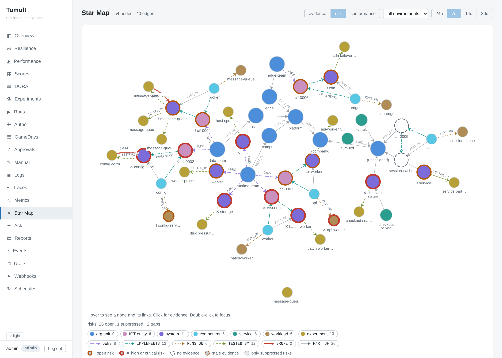

### Resilience: objectives, telemetry contract and resilience score

### Resilience: accepted risks

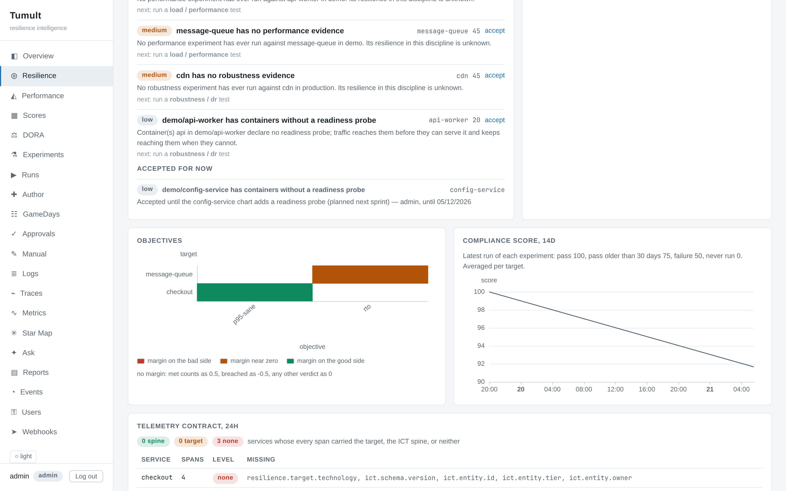

### Scores: one unit and its members

### DORA and maturity: level, gates and nodes

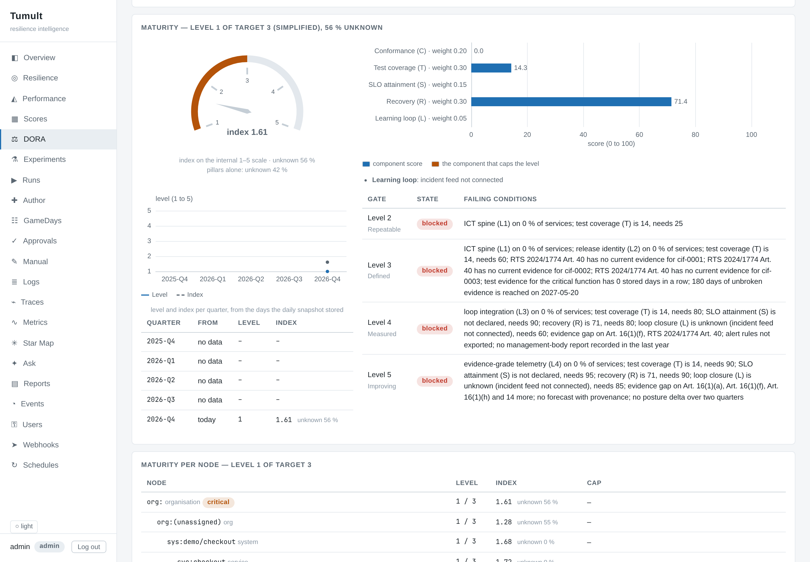

### Performance: stored verdicts

### Experiments

### Runs

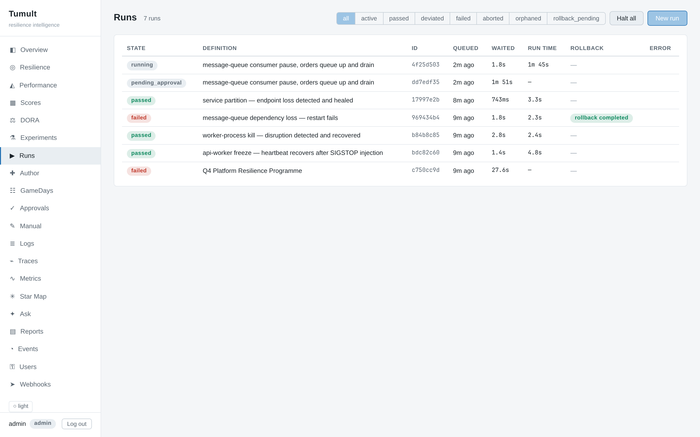

### Author an experiment

### GameDays

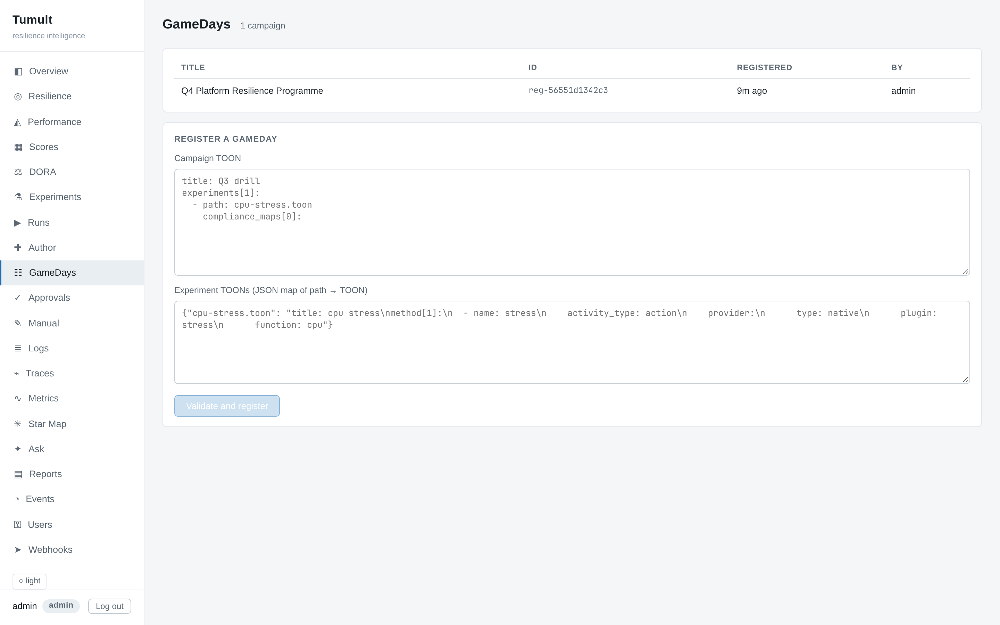

### One GameDay with its regulatory mapping

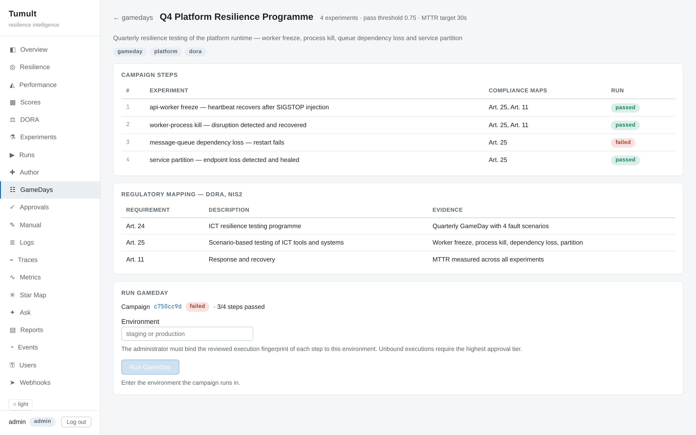

### Approvals

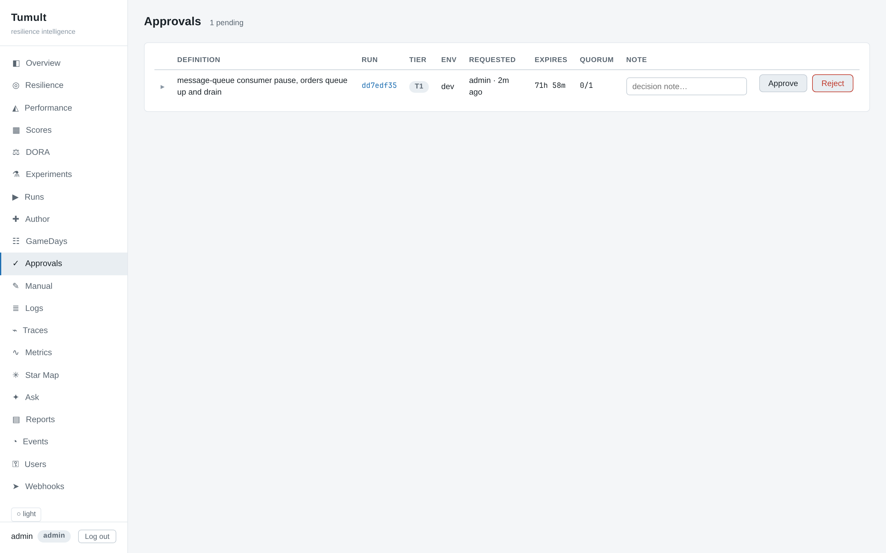

### Manual evidence

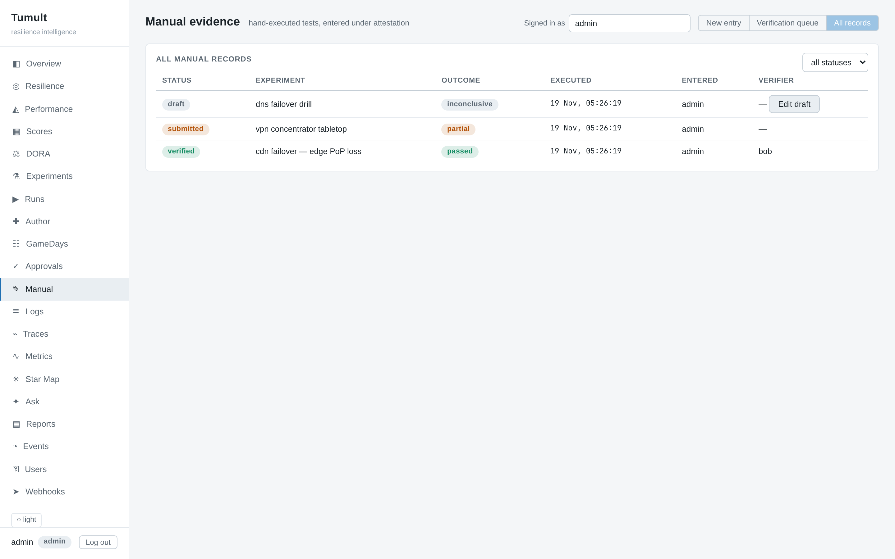

### Events

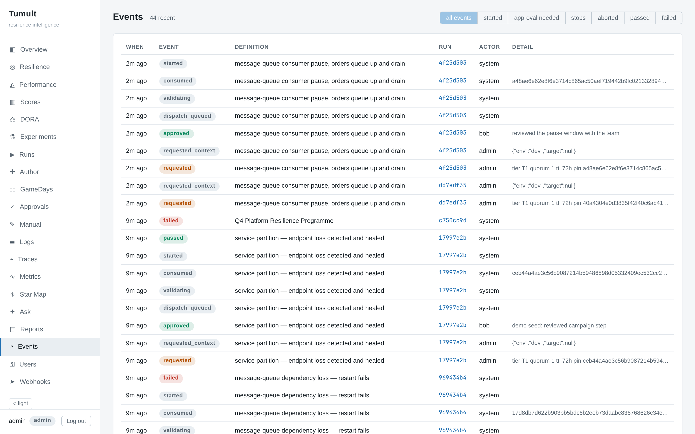

### Logs

### Traces

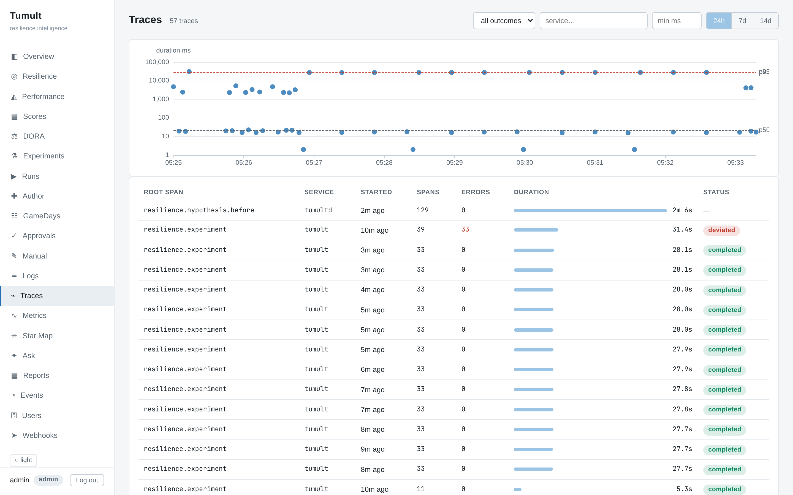

### Metrics

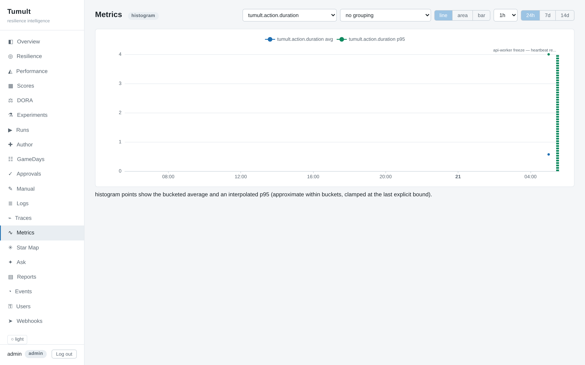

### Ask

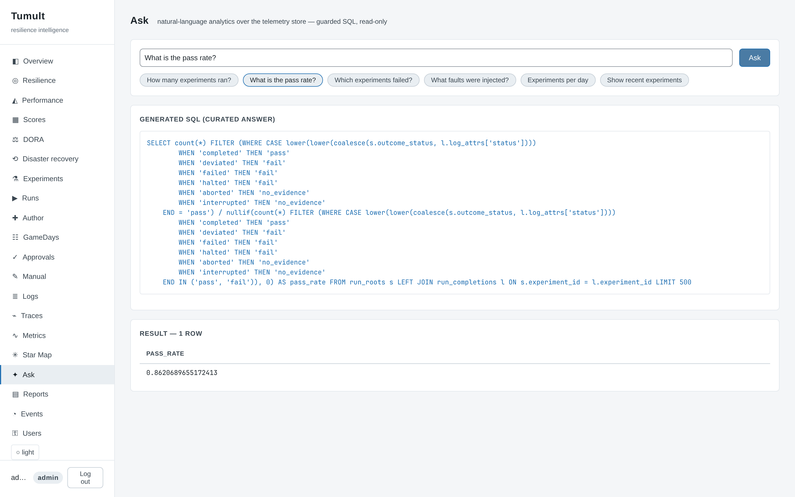

### Reports

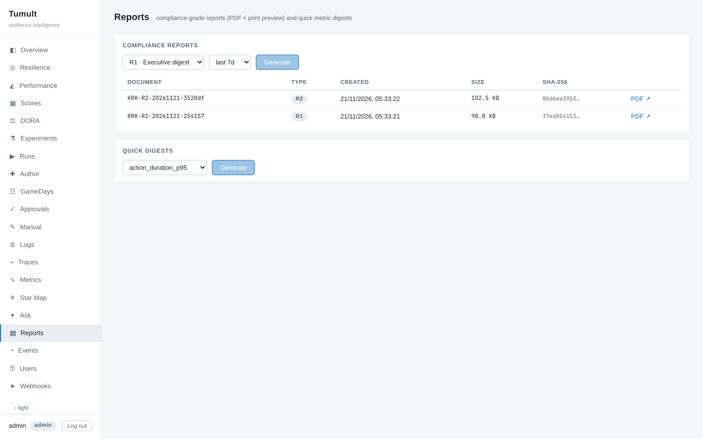
