# UI standard

Krönika, the web UI of Tumult, takes every colour and size from one set of
design tokens, and builds its pages from a small set of its own components.
This page is the standard. A change to the UI follows it, and the checks at
the end hold it.

## Where the values live

The tokens are JSON files in the W3C DTCG format, in `web/tokens/`. One
generator writes them into every file that needs a colour or a size.

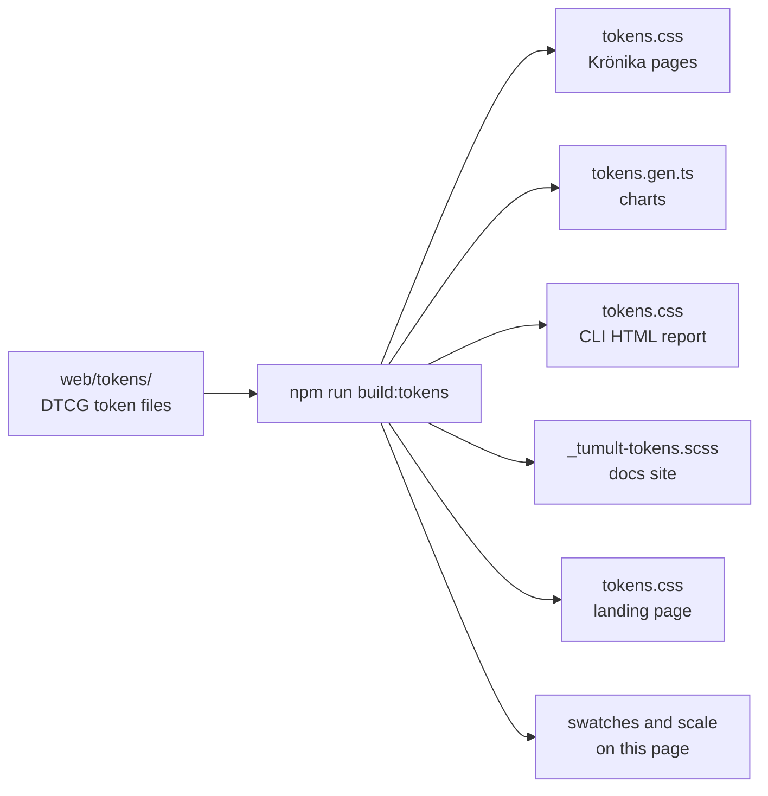

| Token file | Holds |
|---|---|
| `primitive.tokens.json` | The raw colours and fonts. No output has them. |
| `light.tokens.json`, `dark.tokens.json` | The colour roles of each theme, and the series of the charts. |
| `semantic.tokens.json` | The roles that are the same in each theme: the mono font and the chart roles. |
| `page.tokens.json` | Type, spacing, radius, border widths, layers and the widths of drawers. |
| `docs.tokens.json` | The colours of the docs site and the landing page. |
| `tumult.resolver.json` | The sets and the two themes. Dark is the default. |

To change a value, change a token file, run `npm run build:tokens` in
`web/`, and commit the token file and the outputs together. Never edit an
output: CI fails when one is not what the generator writes.

## Colour roles

A page names a role, such as `var(--text-dim)`, never a colour. Colour is
never the only signal: a word or a mark says the same thing.

| Role | Use | Light | Dark |
|---|---|---|---|
| `bg` | The page behind everything. | 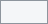 | 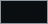 |
| `bg-raised` | The sidebar, inputs and other parts above the page. |  | 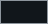 |
| `bg-panel` | The inside of a panel, and a chart tooltip. |  |  |
| `bg-hover` | A row under the pointer, and a neutral badge. |  | 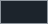 |
| `border` | Thin lines: panel edges, table rows, chart grid lines. | 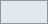 |  |
| `border-strong` | Table heads, chart axes, the edges of buttons and drawers. | 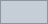 | 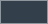 |
| `border-input` | The edge of a field. |  |  |
| `text` | Body text. |  | 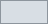 |
| `text-dim` | Labels, and the text of chart axes. | 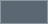 |  |
| `text-faint` | Hints and time stamps. |  |  |
| `ok` | Status: it went well. | 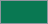 | 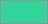 |
| `warn` | Status: it needs a look. | 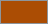 | 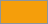 |
| `fail` | Status: it failed. | 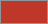 | 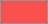 |
| `accent` | Links, focus and the active item. |  | 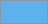 |
| `accent-dim` | The fill of a primary button and of the chosen segment. |  | 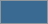 |
| `on-accent` | Text on the `accent-dim` fill. |  |  |
| `chart.series` | The series of a chart, in this order. | 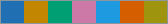 | 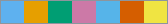 |

`npm run build:tokens` draws the swatches from the tokens.

Krönika meets the contrast of WCAG 2.2 AA in both themes.
`web/src/lib/contrast.test.ts` checks it from the tokens, and names each
pair under its bar with its ratio:

- Text, statuses and `accent` on every surface: 4.5:1.
- `on-accent` on `accent-dim`, and the text of a badge on its tint: 4.5:1.
- `border-input` on its fill and the panel, and `accent` as the focus ring
  on every surface: 3:1.
- Chart series, bands and Star Map colours on the panel: 3:1.
- `border` and `border-strong` need no 3:1: they draw edges that text
  already names.

## Type, spacing and radius

The sizes are tokens in `web/tokens/page.tokens.json`. Use the token, such
as `var(--font-size-md)` or `var(--space-2)`, never a raw size.
`npm run build:tokens` draws this picture from that file, so it shows the
scale of today.

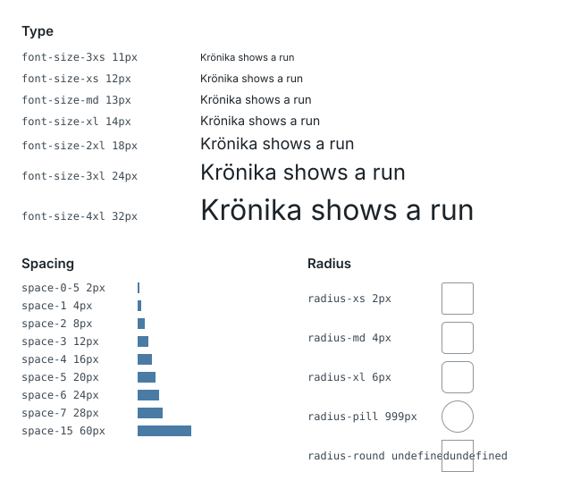

## How a page reads

- A page goes from a row of key numbers, to a trend, to a table, to one run.
- A panel names the time window it shows, and says so when it has no data.
- Filters live in the URL, so a view is a link you can share.
- Headings go down one level at a time, from the h1 of the page.

## Components

Each part is a component in `web/src/lib/components/`. A page uses the
component and does not build the part by hand: scan tests fail on a badge,
a page head, a group of buttons, a drawer or a state built by hand.

### Badge

A short word in the colour of its tone, such as the state of a run. Give it
a kind and a value, and `web/src/lib/tone.ts` picks the tone, so a word has
one tone on every page.

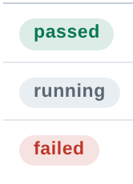

### PageHeader

The head of every page: a link back, the title, a sub line, then badges and
controls. The title also names the browser tab.

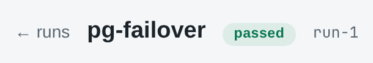

### Panel

The box of one part of a page, with its title. A stat tile is a panel too,
and a wide table scrolls inside its panel.

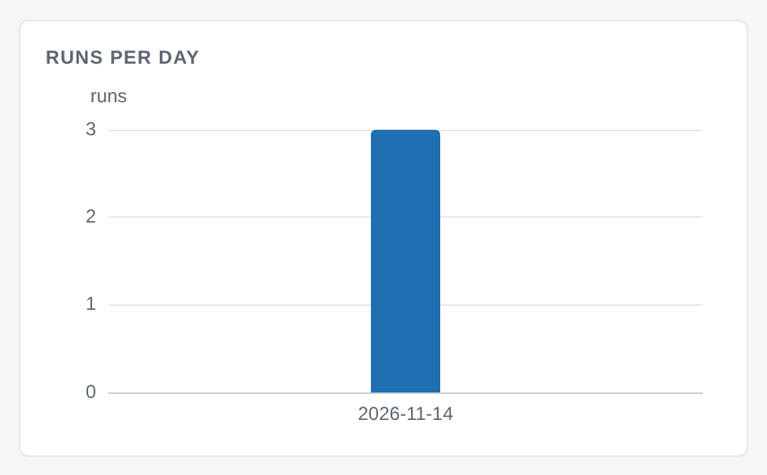

### Segmented

A group of buttons where one is chosen, such as a time range or a filter.
Each button says whether it is pressed.

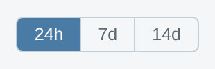

### Tabs

Tabs that switch the panel below them. The arrow keys move between tabs,
and the page keeps the tab in its URL.

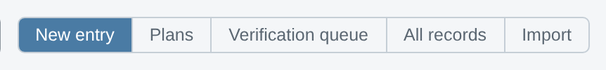

### Drawer

The details of one item, over the right edge of the page, or in the page as
on the Star Map. Escape closes it, and the focus goes back to what opened
it.

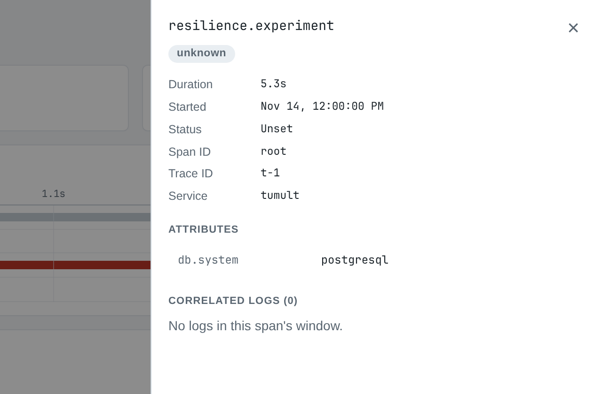

### MetaRow

The stat tiles at the head of a run, a trace or an experiment: four in a
row, two on a small screen.

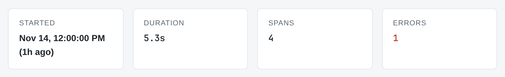

### State

A part of a page with no data to show: empty, an error, or loading. The
next part has its kinds.

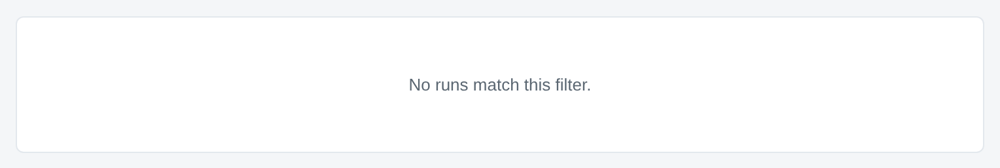

## States

| Kind | When | What the reader gets |
|---|---|---|
| `empty` | The answer has no rows. | A short message, and a link to what to do next where there is one. |
| `error` | The answer failed. | The reason, as an alert, so a screen reader says it at once. |
| `loading` | The answer is on its way. | A busy block that keeps the place of the data, with the hidden word "Loading". |

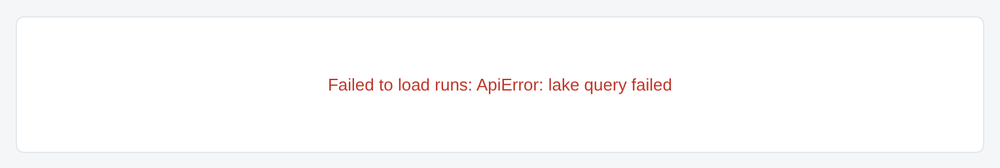

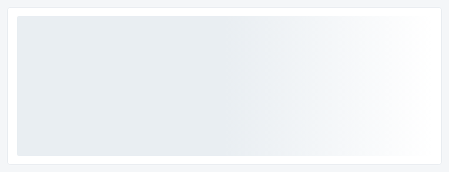

## Keyboard and names

- **Rows.** A row that opens on a click has a link or a button in the cell
  that names it, so the keyboard opens it too.
- **Fields.** Every field has a name: a label around it, or an
  `aria-label` where there is no room for one.
- **Focus ring.** A field shows a ring in the `accent` colour when the
  keyboard moves the focus there. A button and a link keep the ring of the
  browser.
- **Titles.** Every page names the browser tab, such as "Runs · Krönika".
- **Skip link.** The first Tab stop of a page is "Skip to main content".
  The navigation is named "Main" and marks the page it shows with
  `aria-current`.

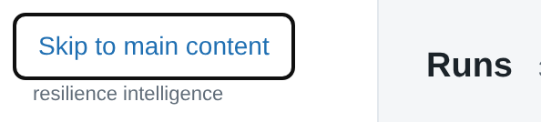

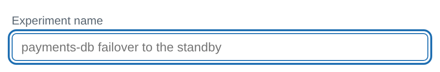

## Phone layout

The breakpoints have names, listed at the top of `web/src/lib/theme.css`:

| Name | Width | Below it |
|---|---|---|
| `xl` | 1200 px | The key numbers of the Overview go three in a row. |
| `lg` | 1100 px | Two panels side by side go one under the other. |
| `md` | 900 px | The sidebar folds behind the Menu button of a top bar. |
| `sm` | 800 px | Key numbers and stat tiles go two in a row. |

The Menu button says whether the menu is open. Escape closes the menu and
gives the focus back to the button, and a link in the menu closes it. A wide
table scrolls inside its panel, so the page never scrolls sideways.

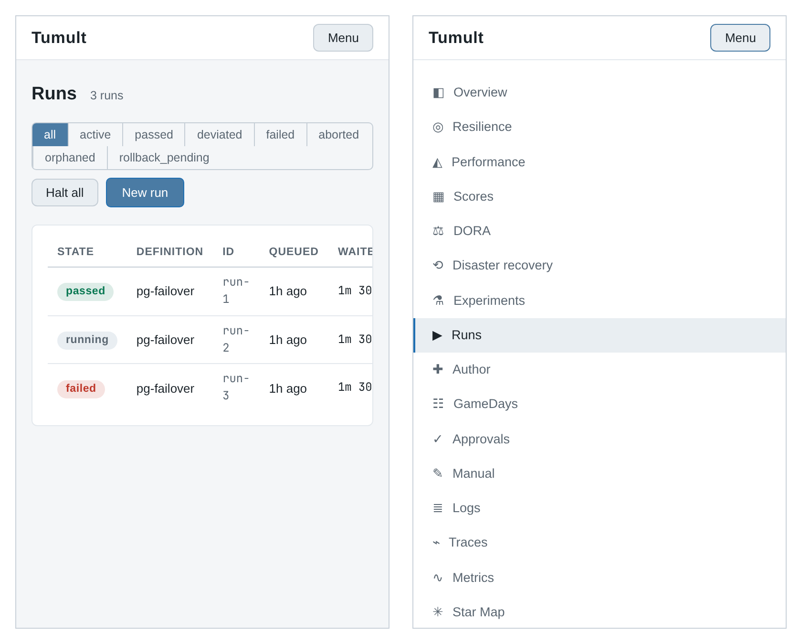

## Rules a change must follow

| Check | Fails on | Fix |
|---|---|---|
| Style lint, `npm run lint:styles` | A raw colour, size or spacing in a style of `web/src/`. | Use a token. The allow list `web/style-literals-allow.txt` holds the few values a token cannot hold, each with its reason, and only shrinks. |
| Token outputs, `web/src/lib/tokens.test.ts` | An output that is not what the token files give. | Run `npm run build:tokens` and commit the outputs. |
| Contrast, `web/src/lib/contrast.test.ts` | A pair under its bar. | Change the token. |
| Style snapshot, `web/tests/style-snapshot.spec.ts` | A computed style that moved on a mocked page, in either theme, wide or narrow. | A change on purpose writes the baselines again in the same commit, and lists what moved. |
| Scans, such as `web/src/lib/state-scan.test.ts` | A part built by hand, a copy of a rule of `theme.css`, a row with no link, a field with no name, a page with no title. | Use the component or the shared class. |
| Browser tests, `npm run test:e2e` | A page that scrolls sideways on a phone (`web/tests/phone.spec.ts`), a row, a field or a drawer the keyboard cannot reach, a state a screen reader does not hear. | Fix the page. |
| Live tests in CI | A page that does not show what a real daemon of the build stored (`npm run test:live`), or a CLI HTML report that a browser cannot draw (`npm run test:report`). | Fix the page or the report. |

To write the style snapshot baselines again, in `web/`:

```sh
STYLE_SNAPSHOT_UPDATE=1 npx playwright test tests/style-snapshot.spec.ts
```
