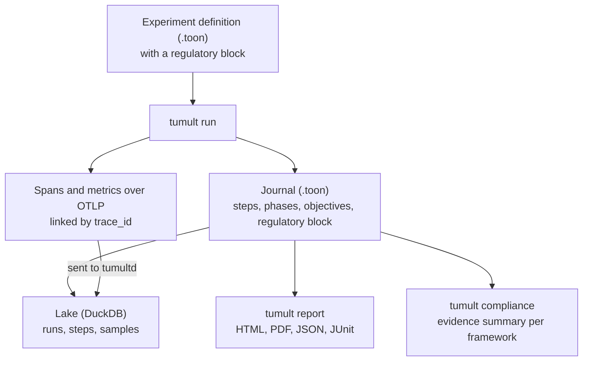

# Regulatory mapping

Which controls of seven frameworks a Tumult run gives evidence for, how
strong that evidence is, and where Tumult keeps it for an auditor.

> **Evidence, not compliance.** A run gives evidence toward a control.
> Passing runs do not prove compliance and are no legal attestation. An
> auditor decides compliance against the official text.

The mapping lives in code, in `tumult-core/src/compliance/citations.rs`,
and this page follows it. Each control has a strength: **direct**,
**supporting** or **indirect**. To list every control with its source and
the date it was last checked:

```bash
tumult compliance --framework dora --sources
```

## Frameworks

| Framework | `--framework` | Applies to | Source |
|---|---|---|---|
| DORA, Digital Operational Resilience Act (EU 2022/2554) | `dora` | EU financial entities | [EUR-Lex](https://eur-lex.europa.eu/eli/reg/2022/2554/oj) |
| NIS2 (EU 2022/2555) | `nis2` | EU essential and important entities | [EUR-Lex](https://eur-lex.europa.eu/eli/dir/2022/2555/oj) |
| PCI-DSS 4.0 | `pci-dss` | Anyone who handles card data | [PCI SSC](https://www.pcisecuritystandards.org/document_library/) |
| Basel Committee (BCBS) principles | `basel-iii` | Banks | [BIS](https://www.bis.org/bcbs/publ/d516.htm) |
| ISO 22301:2019 | `iso-22301` | Voluntary, often in contracts | [ISO](https://www.iso.org/standard/75106.html) |
| ISO 27001:2022 | `iso-27001` | Voluntary, often in contracts | [ISO](https://www.iso.org/standard/27001) |
| SOC 2 (Trust Services Criteria 2017) | `soc2` | Voluntary, often in contracts | [AICPA](https://www.aicpa-cima.com/topic/audit-assurance/audit-and-assurance-greater-than-soc-2) |

DORA on this page is the EU act. The DevOps "four keys" that share the
name are in the [metadata standard](resilience-metadata-standard.md#scores).

## Where the evidence goes



Every step result in a journal has the `trace_id` and `span_id` of its
span, so an auditor can go from a report to the journal and on to the
trace. A run without telemetry has an empty `trace_id`.

## DORA

| Control | Strength | What a run shows | Where Tumult keeps it |
|---|---|---|---|
| Art. 24, testing programme | supporting | Definitions with hypothesis, method and rollbacks, and the runs of each. For a daemon run, who started it and who approved it | definition files; journals; lake `experiments`; daemon `run_audit` (`actor`) and `approval_decisions` (`approver`) |
| Art. 24(6), yearly tests | supporting | When each test ran and how often. Whether every critical system was tested is up to your own inventory | journal `started_at_ns`; lake `experiments.started_at_ns` |
| Art. 25, testing of ICT tools and systems | direct | Scenario tests, and performance under fault and load | journal `method_results`, `during_result`, `load_result` |
| Art. 26, threat-led penetration testing | indirect | Not covered: a run is a resilience test, not a TLPT. It can help design TLPT scenarios | |
| Art. 11, response and recovery | direct | Recovery measured against a declared recovery time objective, and the rollbacks that ran | journal `post_result`, `objectives` (`rto_target_s`, `rto_measured_s`), `rollback_results` |
| Art. 12, backup and restoration | supporting | Only a run that restores something: the restore, and an integrity probe you declare, read after the fault | journal `post_result.probes` (`returned_to_baseline`) |

## NIS2

| Control | Strength | What a run shows | Where Tumult keeps it |
|---|---|---|---|
| Art. 21(2)(c), business continuity | direct | Recovery measured after a fault, and data integrity checked | journal `post_result` |
| Art. 21(2)(b), incident handling | supporting | A controlled fault exercises incident handling. The reporting duties of Art. 23 are not covered | journals |
| Art. 21(2)(f), effectiveness of measures | supporting | The steady state before, during and after the fault, compared | journal `steady_state_before`, `during_result`, `steady_state_after` |

## PCI-DSS

| Control | Strength | What a run shows | Where Tumult keeps it |
|---|---|---|---|
| Req. 12.10.2, incident response plan tested every 12 months | supporting | A dated run that triggers the incident response procedure | journal `started_at_ns` |

Not covered: penetration testing (Req. 11.4) and segmentation testing
(Req. 11.4.5). A fault such as a network partition is not a security test.

## BCBS

| Control | Strength | What a run shows | Where Tumult keeps it |
|---|---|---|---|
| Principles for Operational Resilience, Principle 4 | direct | Severe but plausible disruptions, with recovery measured | journal `during_result`, `post_result` |
| BCBS 239, Principle 6 | indirect | Reporting systems that stay up under a fault. BCBS 239 is about risk data, so this is weak evidence | journal `during_result` of probes on the reporting system |

## ISO 22301

| Control | Strength | What a run shows | Where Tumult keeps it |
|---|---|---|---|
| Clause 8.5, exercise programme | direct | Scenario exercises with a report after each, and trends over time | journals; `tumult report` output; lake `experiments` (`tumult trend`) |

## ISO 27001

| Control | Strength | What a run shows | Where Tumult keeps it |
|---|---|---|---|
| A.5.30, ICT readiness for business continuity | direct | ICT continuity tested, with recovery measured | journal `post_result` |
| A.5.29, information security during disruption | supporting | How the system behaves during the fault | journal `during_result` |

## SOC 2

| Control | Strength | What a run shows | Where Tumult keeps it |
|---|---|---|---|
| CC7.5, recovery from incidents | direct | Recovery time against an objective | journal `post_result.mttr_s`, `objectives` |
| CC7.4, response to incidents | supporting | A controlled fault exercises the incident response programme | journal `method_results`, `rollback_results` |
| CC7.2, monitoring for anomalies | supporting | Spans and metrics of the target during the fault | the lake, on the Traces and Metrics pages |

## Tag an experiment

Add a `regulatory` block to the definition. A run copies it into its
journal, and `tumult compliance` counts the journals that have one.

```toon
regulatory:
  frameworks[2]: DORA, NIS2
  requirements[1]:
    - id: dora.art24.6
      description: Yearly test of the systems of a critical function
      evidence: Experiment definition and dated journals
  tester:
    name: Platform resilience team
    kind: internal
```

- Name a DORA requirement by its registry id, as the
  [DORA score](guides/dora-score.md#requirement-ids) does. `tumult
  validate` refuses a DORA id the registry does not know, and names the
  nearest one. A run of the file still runs, as it did before.
- The older forms still read as the same id: `DORA-Art24`,
  `DORA Art. 24(6)`, and a bare `Art. 24(6)` when DORA is the only
  framework of the block. The HTML report shows the registry id next to
  the id as written.
- An id of another framework, such as `Art. 21(2)(c)` of NIS2, is kept as
  written and not checked.
- `tester` says who ran the test and whether the tester is `internal` or
  `external` (DORA Art. 24(4)). It is optional.

Then read a directory of journals for one framework:

```bash
tumult compliance journals/ --framework dora
```

The lake does not keep the `regulatory` block or the tags of a
definition. Keep the journal files.

## Journals as audit evidence

| Evidence | Journal field |
|---|---|
| What ran | `experiment_title`, `method_results` |
| When | `started_at_ns`, `ended_at_ns` |
| The steady state before and after | `steady_state_before`, `steady_state_after` |
| What happened under the fault | `during_result`, `probe_samples` |
| How fast it recovered | `post_result`, `objectives` |
| Which rollbacks ran | `rollback_results`, `rollback_failures` |
| A guard that stopped the run | `halt` |
| Prediction against outcome | `estimate`, `analysis` |
| The trace of each step | `trace_id`, `span_id` of each step result |

`tumult report` turns a journal into HTML, PDF, JSON or JUnit.

Tumult deletes no evidence on its own: automatic retention must stay at
zero. Keep journals and the lake as long as your regulator or auditor
asks. Backup and export are in
[Data portability and recovery](guides/data-portability.md).
