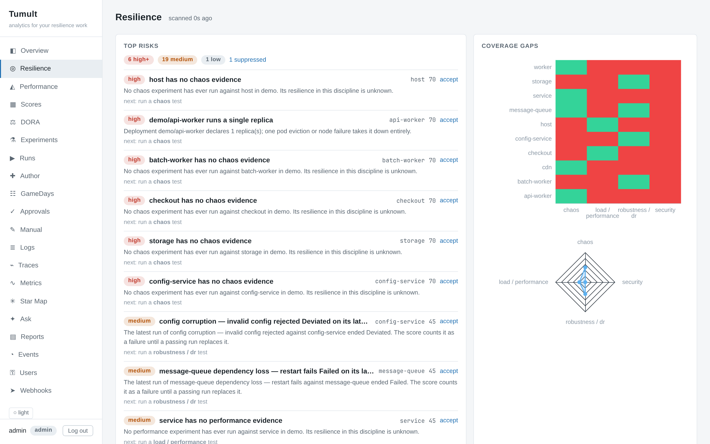
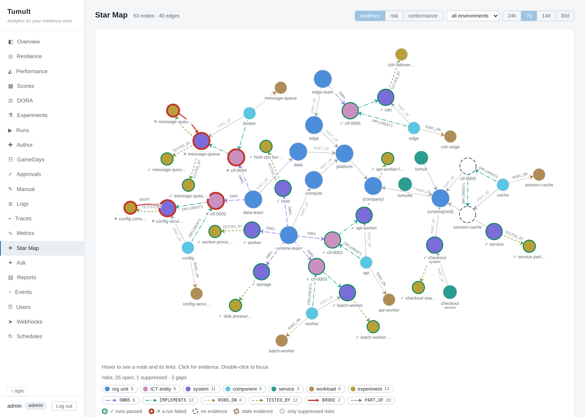
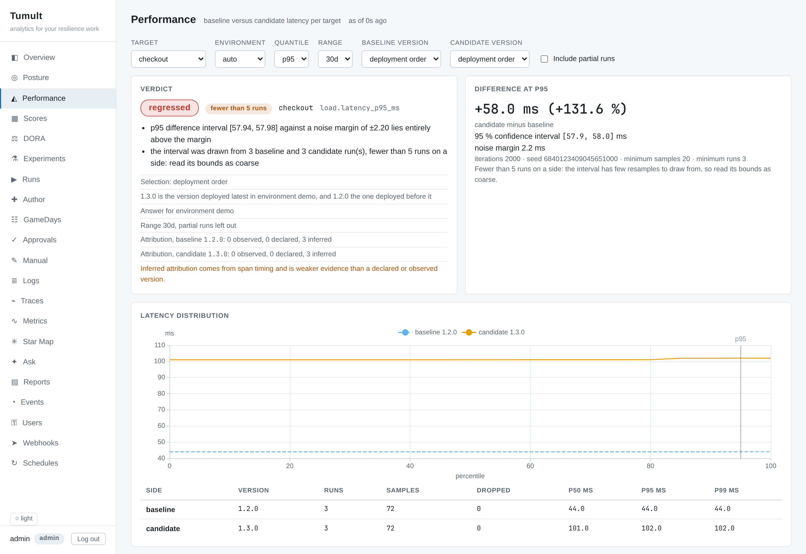
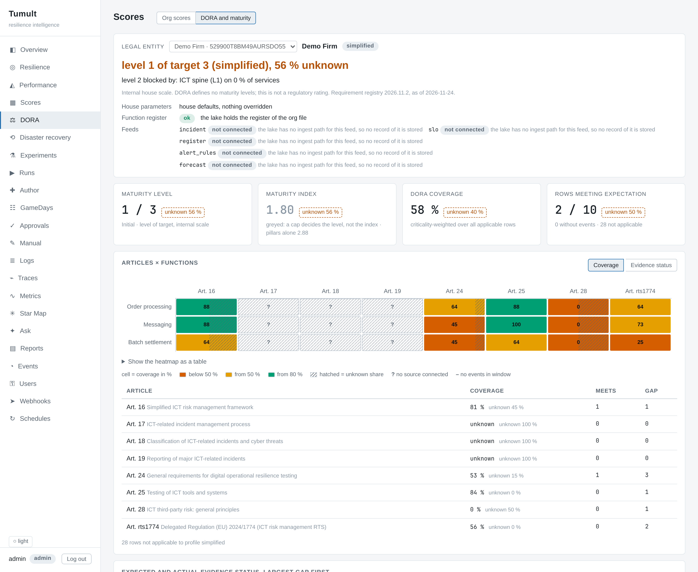

# Tumult 3.0.0

Tumult 3.0 moves from chaos testing to **resilience intelligence**.

Tumult still runs experiments. Now every run, every load test, every recorded
exercise and your live telemetry become evidence. Tumult turns that evidence
into answers: how resilient is this system, what is the biggest risk, and
are we ready for DORA?

## What is new

### Resilience page

One score per system, from 0 to 100. It shows ranked risks, gaps in testing
and how fresh the evidence is. You can accept a risk with a reason.

Tests count towards four disciplines:

| Discipline | Run kinds |
|---|---|
| chaos | chaos |
| load / performance | performance (`load` is accepted) |
| robustness / dr | robustness, dr |
| security | security |

### Star Map

A graph of your organisation, ICT entities, systems, workloads and tests.
Each relation has a name and its own line. Hover a node to see its links.

Read more: [Star Map guide](../guides/star-map.md).

### Performance verdicts

Compare two versions of a service. Tumult says `improved`, `unchanged`,
`regressed` or `inconclusive`, with the reason. Use `tumult perf` in CI.

Read more: [Performance regression guide](../guides/performance-regression.md).

### DORA and ICT maturity score

A maturity level per ICT function and for the whole entity, built only from
evidence in the lake. Every number links to the evidence behind it.

Read more: [DORA score guide](../guides/dora-score.md).

### Forecasts and run impact

The run page shows what the metric would have done without the fault, with
an 80 % band. Read more: [Forecasting guide](../guides/forecasting.md).

### More ways in

- OTel-Arrow (OTAP) ingest next to OTLP/gRPC and OTLP/HTTP, with gzip and zstd.
- OpenTelemetry entity events (turn on with `KRONIKA_ENTITY_EVENTS=1`).
  Read more: [Entity events guide](../guides/entity-events.md).
- A second load tool: `oha`, next to k6.

## Before you upgrade

1. **Back up your lake.** Stop the daemon and run
   `tumult store backup --output <dir>`.
2. **There is no way back.** The lake moves to schema v21 and the DuckDB
   engine to 2.0. An older Tumult cannot open the lake after the upgrade.
3. **Logs changed.** `tumultd` writes JSON logs to stderr, and its default
   `service.name` is `tumultd`. Read the [logging guide](../guides/logging.md).
4. **Other breaking changes:**
   - `tumult perf` fails on `inconclusive` by default.
   - `tumult run --output-format json` exits non-zero when it cannot print
     the journal.
   - Node ids in `GET /api/topology` changed to `sys:<environment>/<system>`.
   - Tumult exports counters and histograms as deltas. A Prometheus or
     Mimir pipeline needs the collector's `deltatocumulative` processor.
     Read [Delta metrics](../guides/observability-setup.md#delta-metrics).
5. **The Posture page is now Resilience**, at `/resilience`. Old links still
   work. The API stays at `/api/posture`.

## Diagrams

The architecture follows the C4 model:

- [System context](../images/3.0/diagrams/c4-1-context.svg)
- [Containers](../images/3.0/diagrams/c4-2-containers.svg)
- [Ingest and store](../images/3.0/diagrams/c4-3a-ingest-and-store.svg)
- [Intelligence and API](../images/3.0/diagrams/c4-3b-intelligence-and-api.svg)

Flow charts: [telemetry ingest](../images/3.0/diagrams/flow-telemetry-ingest.svg),
[entity events](../images/3.0/diagrams/flow-entity-events.svg),
[evidence loop](../images/3.0/diagrams/flow-evidence-loop.svg),
[performance verdict](../images/3.0/diagrams/flow-performance-verdict.svg),
[DORA score](../images/3.0/diagrams/flow-dora-score.svg),
[forecast](../images/3.0/diagrams/flow-forecast.svg),
[Star Map](../images/3.0/diagrams/flow-star-map.svg).

## All changes

See the [changelog](https://github.com/mwigge/tumult/blob/main/CHANGELOG.md).
