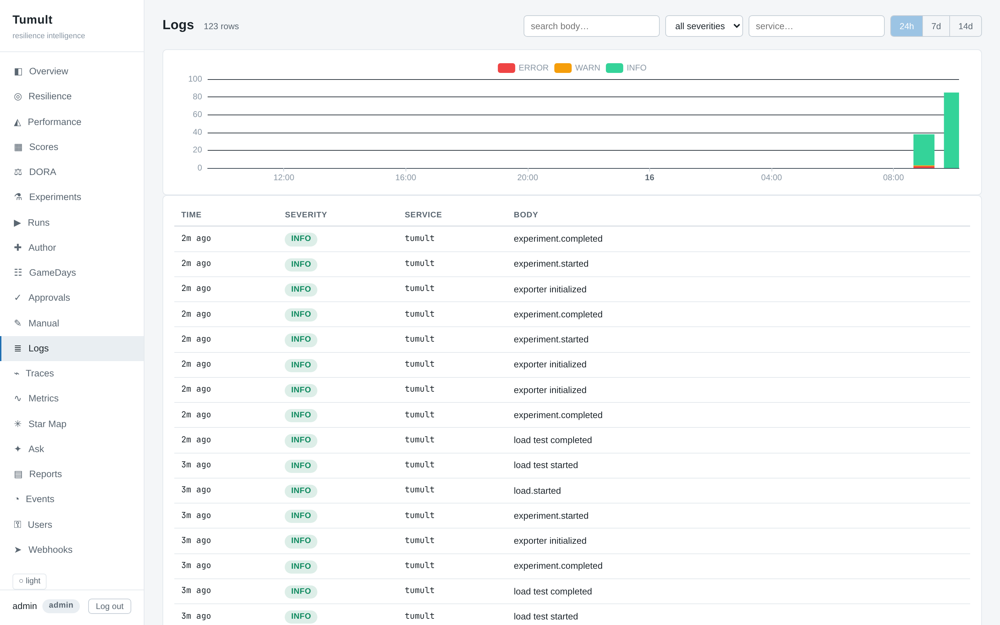

# Tumult 3.0.1

A small release. Tumult now says **resilience intelligence** everywhere,
a few small things in the web UI are fixed, and the dependencies are up to
date.

There is nothing to do before you upgrade from 3.0.0. The lake stays on
schema v21. Coming from 2.x? Read the [3.0.0 notes](3.0.0.md) first.

## One name everywhere

3.0.0 changed the product from chaos testing to resilience intelligence,
but a few places still used the old words. They are fixed now.

| Where | Now says |
|---|---|
| `tumult --help` | Rust-native resilience intelligence platform |
| `tumultd --help` | Tumult daemon — resilience intelligence platform |
| HTML report footer | Rust-native resilience intelligence platform |
| MCP server title | Tumult Resilience Intelligence MCP Server |
| Web UI, under the logo | resilience intelligence |

Commands, API paths and file formats did not change.

## Fixed in the web UI

| Page | Before | Now |
|---|---|---|
| Experiments, Star Map | The list, the detail page and the Star Map drawer showed different durations for one run | All show the run time from the journal. The detail page also shows the longer trace span, with its own label |
| Logs | The chart could run past the current time | The time axis ends at now |
| Metrics | Names of runs that start close together were drawn over each other | A name is hidden when it would touch its neighbour. Hover the line to read it. A name at the edge stays inside the chart |
| Metrics | With little data the time axis ran days into the future | The axis shows the range you picked and ends at now |

## Easier to find

- The README and the [website](https://tumult.rs) link to the release notes.
- The website has a [Releases](index.md) section.
- The changelog marks the two breaking changes of 3.0.0 as breaking.

## Dependencies

All seven open dependency updates are in this release.

| Update | Version |
|---|---|
| argon2 | 0.6.0 |
| hmac | 0.13 |
| sha2 (needed by hmac) | 0.11 |
| crossterm (terminal UI) | 0.29 |
| http-body-util | 0.1.5 |
| actions/checkout | 7.0.1 |
| Swatinem/rust-cache | 2.9.2 |
| dependabot/fetch-metadata | 3.1.0 |

Password hashes, request signatures and stored checksums keep their format.
New tests with known values check that.

## Still open

These are planned for 3.1:

- A run asked for by an operator at the highest risk tier still needs
  break-glass to start.
- Counters sent by other tools as running totals are added up point by
  point. Send them as deltas, as described in the
  [observability guide](../guides/observability-setup.md).

## More

See the [changelog](https://github.com/mwigge/tumult/blob/main/CHANGELOG.md).
