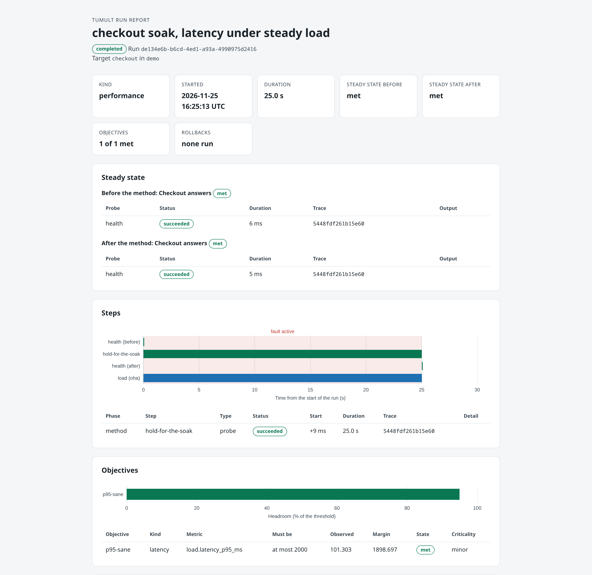
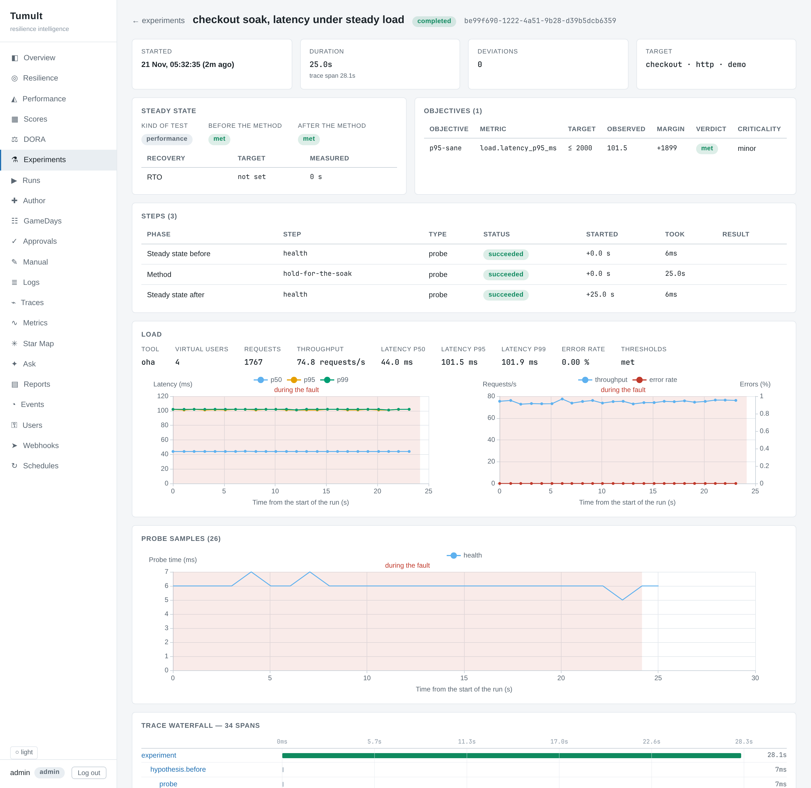
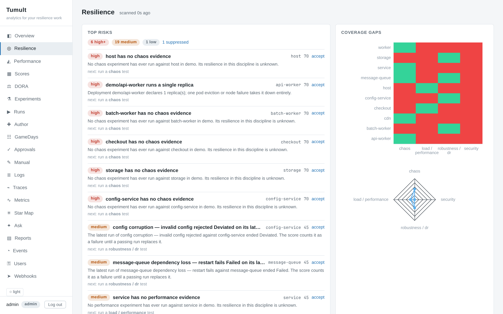

# Tumult 3.0.2

This release checks experiments from end to end, from the file to the
score. Runs are judged more strictly, a run shows its evidence in Kronika
and in its report, and the scores count runs one way.

There is no schema change. Some runs and numbers come out differently on
purpose, so read [Behaviour that changed](#behaviour-that-changed) before
you upgrade.

## What you will notice

- **Stricter files.** An unknown key, a key written twice, a bad number of
  seconds or a missing plugin is an error. Run `tumult validate`.
- **Method probes are judged.** A probe in the method that reads a value
  outside its tolerance fails its step, and the run is deviated.
- **A halt or a stop ends the running step.** Tumult kills the process
  group of a process or script step and runs the rollbacks.
- **`tumult run` says what it found,** and prints the SHA-256 of the journal.
- **A full HTML report.** `tumult report` shows the whole journal with up to
  five charts, and needs no network.
- **Evidence in Kronika.** The experiment page shows the steady state,
  objectives, steps, load and probe samples. A run that sent no trace shows
  too, marked "journal only".
- **One verdict.** Completed passes (green). Deviated, failed and halted fail
  (red). Aborted and interrupted prove nothing (grey) and stay out of scores.
- **Numbers from runs.** "Run pass rate" and the mean time to recover count
  runs. A scorecard with nothing on record has no score, not 0.
- **Charts say what they show,** with legends and axis names. The home pie
  is "Fault injections".
- **Loads that measure.** The daemon runs the tool the load names. k6
  reports p99 and counts failed requests. A game day waits for its load.
- **Journals are kept.** A game day and the MCP run tools refuse to replace
  a journal. Pass `--force` or `force: true`.
- **Safer reads.** An MCP viewer cannot read host files through the analyze
  tools, and a scoped reader sees the scores of its own environments only.

A run now prints these lines after its steps.

```text
Hypothesis: met before, met after
Objectives: 3 met, 2 breached, 1 inconclusive
  breached: many-requests: load.total_requests must be at least 100, observed 40
  breached: short-tail: load.latency_p99_ms must be at most 50, observed 100
  inconclusive: rpo: rpo must be at most 5, not measured
Load (oha): 40 requests, 13.3 requests/s, p50 20.0 ms, p95 80.0 ms, p99 100.0 ms, error rate 0.00 %, thresholds met
Journal written to: journal.toon
Journal SHA-256: <64 hex characters>
```








## Behaviour that changed

| What | Before | Now | What to do |
|---|---|---|---|
| Unknown or repeated key in a file | Dropped, or the last one won | An error that names the key | Fix the file |
| Timeout or pause that is no number of seconds | A panic, or skipped | Refused | Use 0 or more |
| Step that names a plugin the binary lacks | A warning | An error | Install it or fix the name |
| Objective on an unknown metric | Always inconclusive | Refused | Use a known metric |
| jmeter load, unknown oha threshold | Failed or deviated in the run | Refused | Use k6 or oha |
| Probe with a tolerance in the method | Not compared | Judged, and the run deviates | Check the tolerance |
| Run whose method action failed | Recovery 0 s, `rto` met | No recovery, `rto` inconclusive | None |
| Halt, Ctrl-C or stop | Waited for the step | Ends a process or script step | None |
| Exit code of `tumult gameday run` | 0 | 1 unless COMPLIANT | Adjust the pipeline |
| JUnit of a deviated run | No failure | A failing case | Expect the CI job to fail |
| Journal already at the path | Replaced by a game day or MCP | Refused | `--force` or `force: true` |
| `tumult gameday create --load` without a script | A file that could not run | Refused | Add `--load-script` |
| `--dry-run` with `--output-format` | Accepted | Refused | Use one |
| `tumult run --load none` | The same as no flag | Runs without the load of the file | None |
| PID 1 of the daemon image | `tumultd` | `tini`, which starts `tumultd` | Keep `tumultd` in the command, not in `--entrypoint` |
| Journal hash | 64-bit | SHA-256 of the file | Check with `sha256sum` |
| Run status in the API | Capitals in some answers | Lower case | Compare in lower case |
| Aborted and interrupted runs | Failures, or `incomplete` | No evidence, out of the scores | None |
| Colours | Deviated orange, aborted red | Deviated and halted red, aborted and interrupted grey | None |
| Home pass rate card | "Hypothesis pass rate", from a counter | "Run pass rate", from runs | None |
| Score with nothing on record | 0.0 and `poor` | `null` and `unknown` | Handle `null` |
| Scores of a scoped reader | Rows of other environments too | Its own environments | None |
| Pentest, TLPT, tabletop in the risk view | Chaos | Security, or no discipline | Set `manual_kinds` to count them otherwise |
| Mean time to recover | Over spans | Over runs | Update your own copy of `metrics/mttr.yaml` |
| `action_duration_p95` | A mean | The 0.95 quantile | None |
| `tumult.probes.total` | A wrong value was a success | Outside tolerance is its own outcome | Check your alerts |
| Recovery in the compliance summary | Runs that recovered | Runs that watched for recovery | None |
| `tumult trend --target` | Matched the title | Matches the target | Use target names |
| Load tool of a daemon run | Always k6 | The tool the load names | Install that tool |
| k6 error rate | From the checks | Failed requests | None |
| Game day load that does not start | Went on, load impact 1.0 | Ends with the error | Fix the load |
| Kafka, Redis, timewarp probe on a failed query | Printed 0 | Fails | Check access to the target |
| `ping-latency` probe on a host that does not answer | Printed nothing, exit 0 | Fails | Check the target |
| Coverage gaps | Step names | Functions that runs called | Run `tumult chaosgraph coverage-gaps --refresh` |
| Names on screen | "Fault breakdown", "Experiments per day", "Resil" | "Fault injections", "Runs per day", "Hypothesis met" | None |
| GameDay page launch | Always "dev" | The Environment you type | Type it |
| OTLP write that fails | 500, `INTERNAL` | 503, `UNAVAILABLE` | None, the exporter sends it again |
| AWS FIS stop or status | `experiment_id` only | Also `experiment_template_id` | Grant `fis:ListExperiments` |
| Playbook with a rollback and no guard | Proposed | Downgraded | Add a guard |
| `tumult export` to Parquet, CSV, Arrow | The run | The run and its steps in `activities/` | None |

## Upgrade

The lake stays on schema v21, and there is no migration step. Coming from
2.x? Read the [3.0.0 notes](3.0.0.md) first.

Before you upgrade, check these points.

- Run `tumult validate` on your experiment files.
- Check pipelines that read the exit code of `tumult gameday run` or a JUnit
  file.
- Check API clients that compare a run status or read a score that can be
  `null`.

## More

Each change is in the
[changelog](https://github.com/mwigge/tumult/blob/main/CHANGELOG.md).
