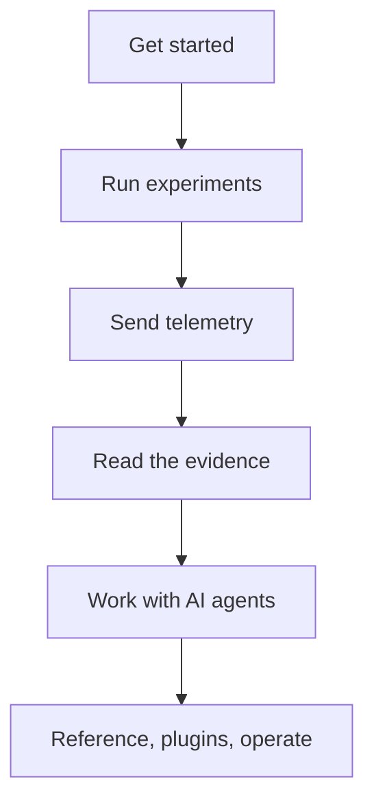

# Tumult 3.0.3

This release makes the docs short, light and true, with a picture for each
idea. CI now checks the pages against the code, so they stay true. Tumult
also starts child processes one at a time on macOS, names each score for
what it is, and drops code that nothing used.

There is no schema change, and the lake stays on v21. A few outputs change,
so read [Behaviour that changed](#behaviour-that-changed) before you
upgrade.

## What you will notice

- **Short docs by task.** The sidebar follows what you want to do: get
  started, run experiments, send telemetry, read the evidence, work with AI
  agents. Most guides fit on one screen, and old addresses redirect.
- **A picture for each idea.** Diagrams are drawn from their sources as SVG,
  mermaid diagrams render on the site, and 38 screenshots of Kronika come
  from one command.
- **Docs that match the code.** CI fails when the CLI reference misses a flag
  of `--help`, when the Kronika pages reference misses an API call of a page,
  or when a page names a file that is not there.
- **Each score has its own name.** A GameDay prints "GameDay score", the
  agentic score gate names the "agentic score", and only the Resilience page
  shows the resilience score.
- **No more hangs on macOS.** A probe, a script plugin step, the network
  proxy or an agent CLI no longer waits for a load window that started at
  the same moment.
- **The SigNoz import works.** It imports the snapshot that the lake export
  names, once.

## Behaviour that changed

| What | Before | Now | What to do |
|---|---|---|---|
| Score line of `tumult gameday run` and `analyze` | `Resilience Score: 1.00` | `GameDay score: 1.00` | Update scripts that read the line |
| Error of the agentic score gate | `resilience score gate failed` | `agentic score gate failed` | The same |
| `tumult init --plugin` with a plugin that is not installed | A starter with an `echo` step | Refused | Install the plugin |
| A step stored as `timeout` | Read as `timeout` | Read as `failed` | None |
| `TUMULT_CLICKHOUSE_URL` set | No word | The warning `cli.clickhouse.deprecated` | Move off ClickHouse; 3.1 removes it |
| The `sources` block of `GET /api/starmap` | The same in every answer | Gone | Stop reading it |
| Empty degradation and data loss fields in journals | Written | Gone; old journals still read | None |
| `tumult agentic proxy --client copilot` | An `HTTPS_PROXY` hint | No hint; the proxy opens no tunnel | Use a client that takes a base URL |
| `PARQUET_GLOB` of the SigNoz import | Used, and matched nothing | Refused (exit 2); the script needs `python3` | Drop the variable |
| Supported versions | 2.20.x and 2.19.x | The latest 3.0.x | Upgrade |

## Upgrade

The lake stays on schema v21, and there is no migration step. Coming from
2.x? Read the [3.0.0 notes](3.0.0.md) first.

## More

Each change is in the
[changelog](https://github.com/mwigge/tumult/blob/main/CHANGELOG.md).
