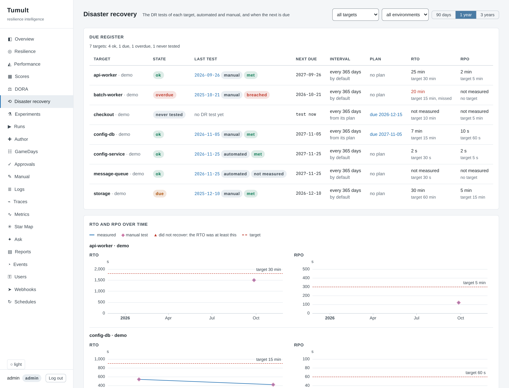

# Tumult 3.0.4

This release tests disaster recovery (DR) for real. A DR run measures how
long the target was down and how much data it lost, and a run that does not
come back fails. A DR exercise that people run by hand is now a full record,
with a plan, files, sign-offs and an audit trail. One page and three reports
show the DR tests of each target, with the evidence an auditor asks for.

The lake moves from schema v21 to v26 the first time 3.0.4 opens it. Some
runs and scores come out differently on purpose, so read
[Behaviour that changed](#behaviour-that-changed) before you upgrade. The
[disaster recovery guide](../guides/disaster-recovery.md) shows how to write
and read a DR test.

## What you will notice

- **The RTO starts at the outage.** The clock runs from the first probe read
  that fails after the method starts to the first read that passes again. A run that
  does not come back breaches its RTO. A fault that no probe saw proves
  nothing: its RTO is inconclusive, "no outage observed".
- **The test sets its recovery window.** A `recovery` block says how long a
  run watches for recovery and how often it reads the probes.
  `tumult run --recovery-window` sets the window for one run.
- **The RPO is measured.** A step writes markers before the fault, and a
  probe reads them back after the recovery and prints the seconds of data
  lost. An `rpo` objective judges that number.
- **Real DR steps for PostgreSQL.** The plugin can back up, restore, stop
  the primary and promote a standby. The demo fails a Postgres pair over
  and restores a backup for real, and `make demo-check` proves both.
- **Robustness verdicts.** A soak judges how far its p95 and error rate
  drift, and a spike how fast the p95 comes back.
- **Manual exercises are first class.** A restore test or a failover drill
  gets a plan with a due date, the RTO and RPO planned and actual, people,
  steps, actions with owners, files kept by their SHA-256, sign-offs by
  other users and an audit trail you can verify. Use the Manual page,
  `tumult manual` or the MCP tools. An agent may draft a record; only a
  person signs it.
- **One DR page.** The Disaster recovery page of Krönika shows the DR tests
  of each target, runs and records together, when the next test is due, and
  the RTO and RPO over time.
- **Reports for an auditor.** The DR test report of a target, the DR
  exercise report of one record, and an evidence pack built from the DORA
  requirement registry.
- **Findings about recovery.** The risk view flags a run that did not
  recover, a target with no measured recovery, data lost beyond the RPO and
  a DR test that is late.
- **DORA counts real DR tests.** A backup or restore row counts a run only
  when it ran a backup, restore or promote step. The DORA view shows which
  plan scenarios of RTS 2024/1774 each critical or important function has
  tested.
- **`tumult trend` follows the RTO and the RPO** of a target across runs.

## Behaviour that changed

| What | Before | Now | What to do |
|---|---|---|---|
| DR run that does not come back in its window | RTO `inconclusive` | RTO breached: the run deviates, its rollbacks run and `tumult run` exits 1 | Make the window at least as long as the RTO |
| RTO of an outage inside the method | 0 s, met | Timed from the first read that saw it | Check your RTO targets |
| Fault that no probe saw | RTO 0 s, met | `inconclusive`, "no outage observed", and no evidence of recovery | Make a probe see the fault |
| `mttr_s` and `rto_measured_s` of a run with no outage | 0 | Empty (`null`), and left out of the MTTR of the overview and the reports | Handle `null` |
| JUnit of a run with a breached blocking objective | No failing case | A failing case for the objective | Expect the CI job to fail |
| `tumult validate` on a misfit objective, such as `rpo` on `fault.duration_s`, or a `${...}` that nothing fills | Passed | Refused | Fix the file, or pass `--var` |
| Recovery share of a GameDay and of `tumult compliance` | Against the GameDay target or 30 s | Against the `rto_target_s` of each run | Set `rto_target_s` |
| `scoring.recovery_required: true` | No effect | A step that measured no recovery is a failed recovery | Make the probe of each step see its fault |
| GameDay where no run measured a recovery | Recovery 1.00 | `not measured`, and the other three parts share its weight | None |
| Run that did not recover, in the risk view | `objective_breached` only | Also `recovery_target_missed`, and 0 for the recovery part of the resilience score | None |
| DORA Art. 11(6) switchover, Art. 12(2), Art. 16(1)(f) and RTS 2024/1774 Art. 40 | Any run of kind `dr` | Only a run with a `backup`, `restore` or `promote-replica` step | Add such a step, or record a manual restore test |
| New DORA rows `rts1774.art26` and `rts1774.art39` | Not scored | A gap on each critical or important function until a test names its scenarios; a level 5 entity drops to 4 | Name the scenarios in `regulatory.scenarios` |
| Manual record or experiment file with a DORA id the registry does not know | Taken | Refused with the nearest id: 422, or an error of `tumult validate` | Use the registry id, such as `dora.art24.6` |
| Unknown field in a manual API body | Dropped | 422 naming the field | Fix the client |
| Manual self review | 400 | 422 | Check for 422 |
| Draft manual record on `GET /api/experiments` | Listed | Not listed | None |
| Independence in the R2 evidence pack | "Independence has not been verified" | "N of M tests name an external tester" | None |
| `checkout-spike-oha` | `performance`, one oha process per stage | `robustness`, one per 2 s window | None |
| Redis action `simulate-failover` | A hang with the name of a failover | A deprecated name of `simulate-hang` | Use `simulate-hang` |
| Lake schema | v21 | v26, and a 3.0.3 build refuses it | Back up first |

## Upgrade

The lake moves from schema v21 to v26 by itself the first time 3.0.4 opens
it. A 3.0.3 build refuses a v26 lake, so back it up first: stop the daemon
and run `tumult store backup --output <dir>`.

The five steps are additive. Rows stored before keep the new columns empty.

- **v22:** a manual record holds a DR exercise: the RTO and RPO planned and
  actual, whether the data was verified, people, steps, actions, links,
  plans, sign-offs and files.
- **v23:** `probe_samples.reading`, the number a probe printed.
- **v24:** what a DR run measured: `impact_observed`, the outage start, the
  recovery time and `mttr_s`, and `recovered` and `reason` on a verdict.
- **v25:** the view `dr_tests`, one row per DR test.
- **v26:** the plan scenarios of a run and of a manual record.

A manual record sealed before keeps its seal (`hash_version` 1) until its
next edit, submit, verify or reject.

Before you upgrade, check these points.

- Run `tumult validate` on your experiment files.
- Give each DR test a recovery window at least as long as its RTO.
- Check pipelines that read a JUnit file or the exit code of `tumult run`.
- Check clients of the manual API: an unknown field is now 422.

Coming from 2.x? Read the [3.0.0 notes](3.0.0.md) first.

## Known limits

- k6 keeps no load windows, so the soak drift and spike recovery objectives
  are always inconclusive with k6. Use oha. A window in which nothing
  answered leaves no sample, so a drift does not see a blackout.
- The Reports page has no form for the DR test and DR exercise reports.
  Make them with `POST /api/reports/v2/generate` or `tumultd report
  --template`.
- No page or route closes the action of a record yet. Track it by its
  ticket.
- A target that was never tested shows `never tested` on the DR page, but
  raises no finding.
- `POST /api/risks/{id}/recommend` has no experiment to offer for
  `rpo_missed`, `recovery_not_measured`, `dr_test_overdue` or
  `manual_exercise_overdue`.
- The risk view knows no criticality of a target, so a finding on a
  critical target is not raised a step.
- The JUnit case of an RTO that did not recover says "observed N", not that
  the target did not recover. A run that deviates only because its load
  missed its thresholds has no failing case.
- A run with no `--var`, no `configuration` and no `secrets` fills no
  `${...}`. In the arguments of a process step, it goes to the program as
  written.
- A run counts for the DORA backup and restore rows only when the lake has
  its trace or its definition. A run read from its definition shows no
  rollbacks.
- The evidence pack counts external testers of manual records only. A run
  names its tester in its journal, which the lake does not keep.
- A run reported only over OTLP names no plan scenarios. A scenario is the
  word of the author; only `backup_restore` is checked against a step.
- The RPO of `postgres-restore-rpo` includes the time `pg_dump` takes,
  which grows with the orders table of the demo.
- On the DORA view, the plan scenario table scrolls sideways at 1440 px,
  and the heatmap labels the RTS 2024/1774 rows "Art. rts1774".
- The demo is docker only. Kubernetes DR and the DR of real cloud accounts
  are not proven by it.

## More

Each change is in the
[changelog](https://github.com/mwigge/tumult/blob/main/CHANGELOG.md).
