# Tumult 3.0.5

This release gives Krönika, the web UI, one standard look. Every colour and
size comes from one set of design tokens, and the CLI HTML report, the docs
site and the landing page take their colours from the same set. Krönika is
easier to read in light and dark, works on a phone, and opens everything
from the keyboard. The [UI standard](../reference/ui-standard.md) page shows
how it fits together.

Two new Concepts pages explain the
[kinds of testing](../concepts/kinds-of-testing.md) and the
[regulations and standards](../concepts/regulations.md) they give evidence
for.

## What you will notice

- **Colours you can read.** Krönika meets WCAG 2.2 AA contrast in both
  themes. Text is 4.5:1 or more on every surface, and fields, buttons,
  badges, bands and chart lines 3:1 or more. A primary button is white text
  on a mid blue in light, as in dark.
- **Darker dim text.** In light, labels and axis text are darker, so body
  text, dim text and faint text are three clear steps.
- **Even sizes.** Four body text sizes and three display sizes in place of
  eleven, one 4 px spacing scale and three corner sizes. Body text and the
  navigation are 13 px and most gaps grow by 2 px, so every page moves a
  little.
- **One colour per word.** A badge such as `failed` or a `low` finding has
  the same colour on every page.
- **A phone layout.** Below 900 px the side bar folds behind a Menu button.
  A wide table scrolls inside its panel, so no page scrolls sideways.
- **Keyboard access.** A key opens every row that a click opens. A field
  shows a focus ring, the first Tab stop skips to the main content, a drawer
  closes on Escape, and the arrow keys move between tabs. Every field has a
  name and every page a title.
- **No dark flash.** A user who chose light sees light from the first paint.
- **The 3.0.4 leftovers are fixed.** The Reports page makes the DR test and
  DR exercise reports. The DORA plan scenario table fits at 1440 px, and the
  DORA view says "RTS 2024/1774". A manual DR test links to its record.

| Light | Dark |
|---|---|
|  | 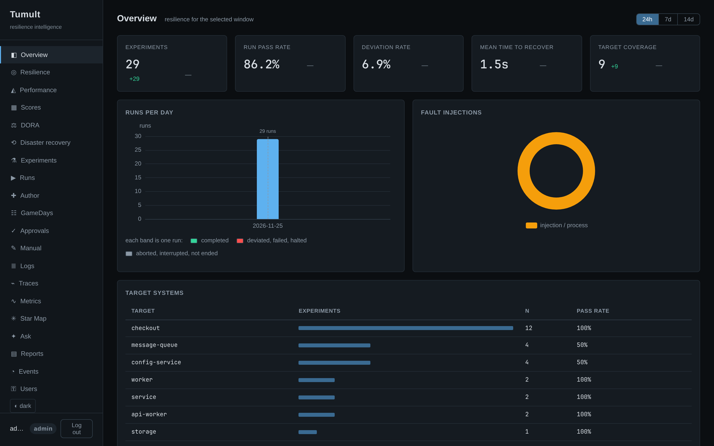 |
|      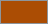  |    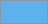 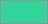  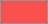 |
|  | 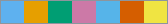 |

The swatches are text, dim text, faint text, accent, ok, warn and fail, then
the chart colours in order.

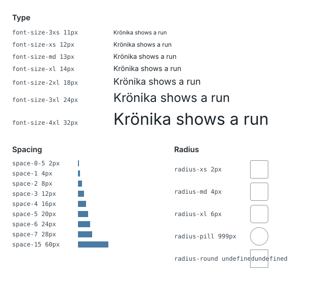

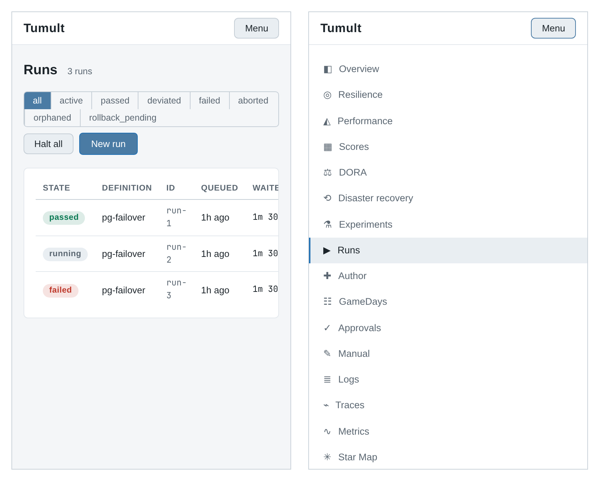

| Skip link | Focus ring |
|---|---|
| 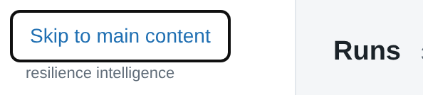 | 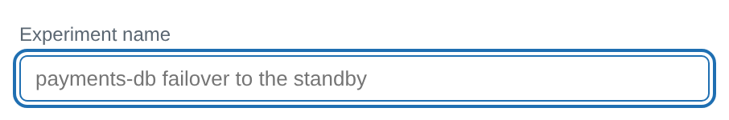 |

## Behaviour that changed

Only colours and layout change. A few words now take the colour they have on
the other pages.

| What | Before | Now | What to do |
|---|---|---|---|
| A `low` finding in the Star Map drawer | Amber | Grey, as on every other page | None |
| An `aborted` event on the Events page | Red | Grey; `deviated` and `halted` are red, `rollback_pending` amber | None |
| An `inconclusive` objective or a `submitted` record in the Star Map drawer | Grey | Amber, as on the run page and the Manual page | None |
| Log severities such as `ERROR2` or `WARN3` | Grey | Red, amber or green, as `ERROR`, `WARN` and `INFO` | None |
| Light chart lines | Some under 3:1 on white | 3:1 or more; the first line takes the accent colour | None |
| CLI HTML report colours | Its own | The colours of Krönika: ok, warn and fail a little darker in light, fail a little lighter in dark | None |

## Upgrade

The lake stays at schema v26, so 3.0.5 needs no migration. Stop the daemon,
put in the 3.0.5 binaries or images, and start it again. No API, CLI flag or
file format changes.

What you see change is Krönika:

- **Colours for contrast:** faint text, the status colours, field edges,
  badges, bands and the light chart lines move just enough to pass.
- **Darker dim text:** `text-dim` in light is `#3b4751`, was `#5b6772`. The
  CLI HTML report, the docs site and the landing page take it too.
- **Sizes:** body text is 11, 12, 13 or 14 px, display text 18, 24 or
  32 px, and spacing is on a 4 px scale.
- **Phone layout:** below 900 px, the Menu button opens the navigation.
- **Keyboard access:** a focus ring on fields, a skip link, Escape on
  drawers and the arrow keys on tabs.

If you keep your own screenshots or visual tests of Krönika, take them
again.

Coming from 3.0.3 or older? Read the [3.0.4 notes](3.0.4.md) first: 3.0.4
moves the lake to v26.

## Known limits

- Roles and names are tested in a browser, but no screen reader run has
  proven the pages.
- The chaos lab, the demo control panel, the watch page and the TUI keep
  their own look. The compliance and digest reports stay light on purpose.
- The CLI HTML report follows the theme of the system, not the theme
  chosen in Krönika.
- The [known limits of 3.0.4](3.0.4.md#known-limits) still hold, except the
  two this release fixes: the DR report forms and the DORA view.

## More

Each change is in the
[changelog](https://github.com/mwigge/tumult/blob/main/CHANGELOG.md).
