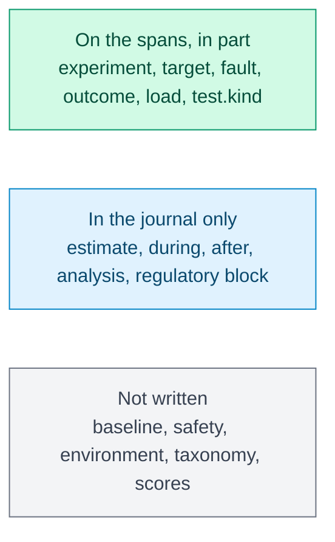

# Resilience metadata standard

The `resilience.*` names for the telemetry of a resilience test: what ran,
what it hit, which fault it injected and how it ended. They follow the
[OpenTelemetry semantic conventions](https://opentelemetry.io/docs/specs/semconv/),
so any tool can write them. The first section says what Tumult writes.

On this page:

- [What Tumult writes](#what-tumult-writes)
- [Conventions](#conventions)
- [Required groups](#required-groups): [experiment](#experiment), [target](#target), [fault](#fault), [outcome](#outcome)
- [Phase groups](#phase-groups): [estimate](#estimate), [baseline](#baseline), [during the fault](#during-the-fault), [after the fault](#after-the-fault), [analysis](#analysis)
- [Optional groups](#optional-groups): [safety](#safety), [environment](#environment), [regulatory](#regulatory), [load](#load), [taxonomy](#taxonomy), [scores](#scores)
- [Fault types and subtypes](#fault-types-and-subtypes)
- [Metrics](#metrics)
- [Scientific rules](#scientific-rules)
- [Conformance](#conformance)

## What Tumult writes

A Tumult run writes one trace. Its spans and the attributes of each are on
the [telemetry reference](guides/telemetry-reference.md). This section says
which groups of the standard they carry, and where they differ.

| Group | What Tumult writes | Where it differs from the standard |
|---|---|---|
| experiment | `id` and `title` on the root span; `name` only as a label of the deviation metric | `title` is not in the standard. `version`, `suite`, `tags`, `created_by` and `run_number` are not written |
| `resilience.test.kind` | on the root span | |
| target | `system`, `technology`, `environment`, `criticality`, `version` and `version_source` on the root span, from the `target` block; `type`, `name` and `component` on step spans | `type` is `process`, `native` or `script`. `version`, `version_source` and `name` are not in the standard. `tier` and `region` are not written |
| fault | `type` and `name` on step spans; `blast_radius` on the root span | `type` is `injection` for an action and `observation` for a probe, not a value of the closed set. `blast_radius` is the free note of the definition. `subtype`, `severity`, `duration_s`, `reversible`, `plugin` and `action` are not written; the plugin is `resilience.plugin.name` |
| outcome | `status`, `hypothesis_met`, `recovery_time_s`, `impact_observed`, `recovered`, `rto_target_s`, `rto_state`, `rpo_target_s`, `rpo_measured_s` and `rpo_state` on the root span. Each one but `status` only when the run has that fact | `recovery_time_s` runs from the outage the probes saw, not from the end of the fault. `rto_state` and `recovered` come from the verdict on `rto_target_s`. `rpo_state` comes from the verdict that measured the data lost. The other outcome attributes are not written |
| load | on the `resilience.load` span | also `script`, `latency_p50_ms`, `latency_p99_ms`, `total_requests`, `aborted`, `truncated`, the window counts, `reason` and `error` |
| estimate, during, after, analysis | no span attribute | the journal keeps them as `estimate`, `during_result`, `post_result` and `analysis` |
| baseline, safety, environment, regulatory, taxonomy, scores | nothing | the journal keeps the `regulatory` block of the definition |

The daemon reads these names from any sender. It keeps `experiment.id`,
`experiment.name` (or `.title`), `outcome.status`, `.hypothesis_met`,
`.recovery_time_s`, `fault.type`, `.subtype`, `.severity`, `.blast_radius`,
`.plugin` (or `plugin.name`) and `target.system`, `.technology` and
`.environment` (or `deployment.environment.name`) in columns of its span
table, and every other attribute in a map.

## Conventions

| Rule | Detail |
|---|---|
| Names | Lowercase, dot-separated, snake_case segments: `resilience.<group>.<attribute>` |
| Levels | **Required**: on every conforming span. **Recommended**: when known. **Optional**: may be present. **Conditional**: required when a stated condition is true |
| Enums | Closed sets. Add a value by changing this standard |
| Arrays | `string[]`, a JSON array on a span |
| Timestamps | Epoch nanoseconds, `int64`, such as `1711670400000000000` |
| Durations | Seconds, `float64`. A definition may say `120s` or `5m`; a runner turns that into seconds before it writes an attribute |
| Spans | Every attribute is a span attribute. `resilience.experiment.*` is also a resource attribute of the root span, and `resilience.target.*` goes on every span of the trace |
| Metric labels | Only bounded values: `fault.type` (7), `fault.subtype` (about 35), `target.system` (12), `target.technology`, `target.environment` (4), `outcome.status` (6). Never free text, `target.component` or `probe.{name}.*`; for a probe, use one instrument with a `probe.name` label |

## Required groups

These four groups must be on every experiment.

### Experiment

| Attribute | Type | Level | Meaning |
|---|---|---|---|
| `resilience.experiment.id` | `string` | Required | UUID v4 of this run |
| `resilience.experiment.name` | `string` | Required | Stable name of the experiment, the same for every run |
| `resilience.experiment.version` | `string` | Recommended | Version of the definition, such as `2.1.0` |
| `resilience.experiment.suite` | `string` | Optional | Campaign or suite the experiment belongs to |
| `resilience.experiment.tags` | `string[]` | Optional | Free tags for filters |
| `resilience.test.kind` | `string` | Recommended | Discipline: `chaos`, `performance`, `robustness`, `dr`, `security`. A reader counts `load` as `performance` and `dr` towards robustness |
| `resilience.experiment.created_by` | `string` | Recommended | User or system that started the run |
| `resilience.experiment.run_number` | `int` | Recommended | Run counter per experiment name, for trends |

### Target

| Attribute | Type | Level | Meaning | Values |
|---|---|---|---|---|
| `resilience.target.system` | `string` | Required | Kind of system | `database`, `cache`, `message-broker`, `api`, `container`, `vm`, `host`, `kubernetes`, `network`, `application`, `middleware`, `cloud-service` |
| `resilience.target.technology` | `string` | Required | Product, such as `postgresql`, `redis`, `kafka`, `nginx` | open, bounded |
| `resilience.target.component` | `string` | Required | Instance, such as `payments-db-primary`. High cardinality | |
| `resilience.target.tier` | `string` | Recommended | Tier | `frontend`, `backend`, `data`, `infrastructure`, `network`, `platform` |
| `resilience.target.criticality` | `string` | Recommended | Business criticality | `critical`, `high`, `medium`, `low` |
| `resilience.target.environment` | `string` | Required | Where the run happens | `production`, `staging`, `development`, `sandbox` |
| `resilience.target.region` | `string` | Optional | Region or data centre, such as `eu-west-1` | |

### Fault

| Attribute | Type | Level | Meaning | Values |
|---|---|---|---|---|
| `resilience.fault.type` | `string` | Required | Fault category | see [fault types](#fault-types-and-subtypes) |
| `resilience.fault.subtype` | `string` | Required | Fault within the type | see [fault types](#fault-types-and-subtypes) |
| `resilience.fault.severity` | `string` | Required | Expected severity | `minor`, `moderate`, `major`, `catastrophic` |
| `resilience.fault.duration_s` | `float` | Recommended | Planned length of the fault | |
| `resilience.fault.blast_radius` | `string` | Required | Planned scope | `single-instance`, `service`, `availability-zone`, `region`, `global` |
| `resilience.fault.reversible` | `boolean` | Required | Whether the fault can be undone by itself | |
| `resilience.fault.plugin` | `string` | Required | Plugin that injects the fault | |
| `resilience.fault.action` | `string` | Required | Action within the plugin, such as `kill_postgresql_process` | |

### Outcome

| Attribute | Type | Level | Meaning | Values |
|---|---|---|---|---|
| `resilience.outcome.status` | `string` | Required | How the run ended | `completed`, `deviated`, `aborted`, `failed`, `interrupted`, `halted` |
| `resilience.outcome.hypothesis_met` | `boolean` | Required | Whether the hypothesis held | |
| `resilience.outcome.deviation_detected` | `boolean` | Required | Whether the system deviated | |
| `resilience.outcome.deviation_magnitude` | `float` | Conditional | Size of the deviation in sigma, when one was detected | |
| `resilience.outcome.recovery_time_s` | `float` | Recommended | Seconds until the target recovered | |
| `resilience.outcome.mttr_s` | `float` | Recommended | Mean time to recovery, the same as `resilience.post.recovery_time_s` | |
| `resilience.outcome.impact_observed` | `boolean` | Recommended | Whether the probes saw an outage after the fault started | |
| `resilience.outcome.recovered` | `boolean` | Conditional | Whether the target came back from the outage while the run watched, when the run has an RTO and saw an outage | |
| `resilience.outcome.rto_target_s` | `float` | Conditional | The recovery time objective, when the run declares one | |
| `resilience.outcome.rto_state` | `string` | Conditional | The verdict on the RTO, when the run declares one | `met`, `breached`, `inconclusive` |
| `resilience.outcome.rpo_target_s` | `float` | Conditional | The recovery point objective, when the run declares one | |
| `resilience.outcome.rpo_measured_s` | `float` | Conditional | Seconds of data lost, when the run measured them | |
| `resilience.outcome.rpo_state` | `string` | Conditional | The verdict on the RPO, when the run has one | `met`, `breached`, `inconclusive` |
| `resilience.outcome.data_loss` | `boolean` | Recommended | Whether data was lost | |
| `resilience.outcome.rollback_executed` | `boolean` | Required | Whether a rollback ran | |
| `resilience.outcome.rollback_success` | `boolean` | Conditional | Whether the rollback worked, when one ran | |

## Phase groups

A run in five phases (estimate, baseline, during, after, analysis) needs
these groups.

### Estimate

The prediction, written before the fault.

| Attribute | Type | Level | Meaning | Values |
|---|---|---|---|---|
| `resilience.estimate.expected_outcome` | `string` | Required | Predicted outcome | `deviated`, `recovered`, `unaffected` |
| `resilience.estimate.expected_recovery_s` | `float` | Recommended | Predicted recovery time | |
| `resilience.estimate.expected_degradation` | `string` | Recommended | Predicted degradation | `none`, `minor`, `moderate`, `severe` |
| `resilience.estimate.expected_data_loss` | `boolean` | Recommended | Whether data loss is expected | |
| `resilience.estimate.confidence` | `string` | Recommended | Confidence in the prediction | `low`, `medium`, `high` |
| `resilience.estimate.rationale` | `string` | Recommended | Why. High cardinality: spans only | |
| `resilience.estimate.prior_runs` | `int` | Optional | Earlier runs the estimate used | |

### Baseline

The steady state before the fault: the normal that deviation is measured
against.

| Attribute | Type | Level | Meaning | Values |
|---|---|---|---|---|
| `resilience.baseline.method` | `string` | Required | How thresholds are set | `static`, `percentile`, `mean-stddev`, `iqr`, `learned` |
| `resilience.baseline.started_at` | `int64` | Required | Start of the window | |
| `resilience.baseline.ended_at` | `int64` | Required | End of the window | |
| `resilience.baseline.duration_s` | `float` | Required | Length of the window | |
| `resilience.baseline.warmup_s` | `float` | Recommended | Warm-up left out of the statistics | |
| `resilience.baseline.samples` | `int` | Required | Samples in the window | |
| `resilience.baseline.interval_s` | `float` | Required | Time between samples | |
| `resilience.baseline.confidence` | `float` | Recommended | Confidence level, `0.0` to `1.0` | |
| `resilience.baseline.sigma` | `float` | Conditional | Standard deviations of the threshold, when the method is `mean-stddev` | |
| `resilience.baseline.source` | `string` | Recommended | Where the data came from | `live`, `historical`, `aqe` |
| `resilience.baseline.anomaly_detected` | `boolean` | Recommended | Whether the window held anomalies | |

Per probe `{name}` (lowercase snake_case, such as `query_latency`), under
`resilience.baseline.probe.{name}.*`: `mean` (Required), and `stddev`,
`p50`, `p95`, `p99`, `min`, `max` and `error_rate` (`0.0` to `1.0`), all
Recommended `float`.

### During the fault

| Attribute | Type | Level | Meaning |
|---|---|---|---|
| `resilience.during.started_at` | `int64` | Required | When the fault started |
| `resilience.during.ended_at` | `int64` | Required | When the fault ended |
| `resilience.during.fault_active_s` | `float` | Required | How long the fault was active |
| `resilience.during.sample_interval_s` | `float` | Required | Time between samples |

Per probe, under `resilience.during.probe.{name}.*`: `samples` (`int`) and
`mean` (`float`), Required; `max`, `min` and `error_rate` (`float`),
`breached_at` (`int64`, the first breach, absent without one) and
`breach_count` (`int`), Recommended.

### After the fault

| Attribute | Type | Level | Meaning |
|---|---|---|---|
| `resilience.post.started_at` | `int64` | Required | Start of the recovery window |
| `resilience.post.ended_at` | `int64` | Required | End of the recovery window |
| `resilience.post.duration_s` | `float` | Required | Length of the window |
| `resilience.post.samples` | `int` | Required | Samples in the window |
| `resilience.post.recovery_time_s` | `float` | Required | Seconds from the end of the fault until every probe is back within its threshold. When a probe did not come back: the largest time of a probe, so recovery takes at least this long |
| `resilience.post.full_recovery` | `boolean` | Required | Whether every probe came back |

Per probe, under `resilience.post.probe.{name}.*`: `mean` (`float`),
`returned_to_baseline` (`boolean`) and `recovery_time_s` (`float`; when the
probe did not come back, the time of its last failing sample), Required;
`p95` and `error_rate` (`float`), Recommended.

### Analysis

| Attribute | Type | Level | Meaning | Values |
|---|---|---|---|---|
| `resilience.analysis.estimate_accuracy` | `float` | Recommended | `1` when the predicted outcome is the outcome the run measured, else `0`. Empty for a run that failed or was stopped | |
| `resilience.analysis.estimate_recovery_delta` | `float` | Recommended | Measured minus predicted recovery time; positive means slower than predicted | |
| `resilience.analysis.estimate_data_loss_correct` | `boolean` | Optional | Whether the predicted data loss is what the measured RPO shows | |
| `resilience.analysis.trend` | `string` | Recommended | Trend against earlier runs | `improving`, `stable`, `degrading` |
| `resilience.analysis.resilience_score` | `float` | Recommended | `1` when the run completed, else `0` | |
| `resilience.analysis.regulatory_evidence` | `string[]` | Recommended | Ids of the evidence the run produced, such as report ids | |

## Optional groups

### Safety

| Attribute | Type | Level | Meaning | Values |
|---|---|---|---|---|
| `resilience.safety.abort_conditions` | `string[]` | Recommended | Conditions that stop the run, such as `error_rate > 0.5` | |
| `resilience.safety.max_duration_s` | `float` | Recommended | Longest allowed run; a runner must stop the run after it | |
| `resilience.safety.max_blast_radius` | `string` | Recommended | Widest allowed scope; a runner must not go beyond it | |
| `resilience.safety.requires_approval` | `boolean` | Optional | Whether a person must approve the fault | |
| `resilience.safety.rollback_strategy` | `string` | Required | When rollbacks run | `always`, `on-deviation`, `never`, `manual` |

### Environment

| Attribute | Type | Level | Meaning | Values |
|---|---|---|---|---|
| `resilience.environment.platform` | `string` | Required | Compute platform | `bare-metal`, `vm`, `container`, `kubernetes`, `serverless` |
| `resilience.environment.cloud_provider` | `string` | Optional | Cloud provider | `aws`, `gcp`, `azure`, `on-premise` |
| `resilience.environment.cluster` | `string` | Optional | Cluster, such as `prod-eu-01` | |
| `resilience.environment.namespace` | `string` | Optional | Kubernetes namespace or a similar boundary | |

### Regulatory

| Attribute | Type | Level | Meaning | Values |
|---|---|---|---|---|
| `resilience.regulatory.frameworks` | `string[]` | Recommended | Frameworks the run is evidence for | `DORA`, `NIS2`, `PCI-DSS`, `ISO-22301`, `ISO-27001`, `SOC2`, `Basel-III` |
| `resilience.regulatory.requirement_id` | `string` | Recommended | Control within the framework, such as `DORA-Art.25` | |
| `resilience.regulatory.evidence_type` | `string` | Recommended | Kind of evidence, such as `recovery-test` | |
| `resilience.regulatory.compliance_status` | `string` | Recommended | Status the outcome supports | `compliant`, `non-compliant`, `partial` |

How Tumult maps runs to frameworks is in [Regulatory mapping](regulatory-mapping.md).

### Load

For a load test that runs with the experiment, with k6 or oha.

| Attribute | Type | Level | Meaning |
|---|---|---|---|
| `resilience.load.tool` | `string` | Optional | `k6` or `oha` |
| `resilience.load.vus` | `int` | Optional | Virtual users |
| `resilience.load.duration_s` | `float` | Optional | Length of the load |
| `resilience.load.throughput_rps` | `float` | Optional | Requests per second |
| `resilience.load.latency_p95_ms` | `float` | Optional | 95th percentile latency in milliseconds |
| `resilience.load.error_rate` | `float` | Optional | Error rate, `0.0` to `1.0` |
| `resilience.load.thresholds_met` | `boolean` | Optional | Whether every threshold of the load passed |

### Taxonomy

Classes to slice experiments by. All are Optional `string`.

| Attribute | Values |
|---|---|
| `resilience.taxonomy.track` | `chaos`, `security`, `performance`, `continuity` |
| `resilience.taxonomy.category` | `fault_injection`, `latency`, `resource_stress`, `state_manipulation`, `dependency_failure` |
| `resilience.taxonomy.domain` | `compute`, `network`, `storage`, `data`, `platform`, `application` |
| `resilience.taxonomy.component` | `cpu`, `memory`, `io`, `disk`, `broker`, `primary`, `replica`, `pod`, `node`, `gateway` |
| `resilience.taxonomy.scenario` | `cpu_stress`, `memory_pressure`, `io_saturation`, `partition`, `failover`, `leader_election`, `connection_kill` |

### Scores

Three optional layers, computed from journals after a run. Tumult writes
none of these attributes; its own scores are computed in the daemon.

| Attributes | Meaning |
|---|---|
| `resilience.score.quality.complexity`, `.risk` | `low`, `medium`, `high`, `critical`, from steps, settings, rollbacks, a missing hypothesis and past deviations |
| `resilience.score.quality.blast_radius` | `contained`, `moderate`, `broad`, `systemic` |
| `resilience.score.quality.rollback` | `none`, `weak`, `good`, `excellent` |
| `resilience.score.quality.grade` | `A` (90 % or more of the last 10 runs passed), `B` (70 %), `C` (50 %), `D` (less) |
| `resilience.score.quality.otel_score`, `.needs_review` | `0` to `100` for trends; true when risk is high or critical and blast radius is broad or systemic |
| `resilience.fault.fmea_severity`, `.fmea_detectability`, `.fmea_rpn` | FMEA ratings from 1 to 10 (IEC 60812:2018), and their product |
| `resilience.score.devops.deployment_frequency_per_day`, `.lead_time_hours`, `.change_failure_rate`, `.mttr_hours`, `.chaos_coverage_pct` | The Accelerate four keys, plus the share of services with runs |
| `resilience.score.regulatory.framework`, `.control_id` | Framework and control, such as `PCI-DSS-12.10.2` |
| `resilience.score.regulatory.confidence` | `0.0` to `1.0`: base weight x quality x complexity factor x rollback factor x min(probes / threshold, 1) x outcome factor |
| `resilience.score.regulatory.outcome_factor` | Passed `1.0`, failed with a good rollback `0.85`, failed `0.30` |

The `devops` layer (Forsgren, Humble and Kim, *Accelerate*, 2018) needs
data from CI and incident tools. It is not the EU Digital Operational
Resilience Act, which has the same short name DORA.

## Fault types and subtypes

Each subtype belongs to exactly one type.

| Type | Subtypes |
|---|---|
| `termination` | `process-kill`, `container-kill`, `vm-stop`, `node-shutdown`, `pod-delete`, `service-stop` |
| `resource-stress` | `cpu-stress`, `memory-stress`, `io-stress`, `disk-fill`, `fd-exhaustion`, `thread-exhaustion` |
| `network` | `latency-injection`, `packet-loss`, `partition`, `dns-failure`, `bandwidth-limit`, `corruption`, `port-block`, `connection-reset` |
| `state` | `connection-kill`, `lock-injection`, `replication-lag`, `failover-trigger`, `leader-election`, `cache-flush` |
| `dependency` | `upstream-timeout`, `downstream-error`, `circuit-break`, `service-unavailable` |
| `configuration` | `config-change`, `feature-toggle`, `resource-limit`, `permission-revoke` |
| `data` | `corruption`, `deletion`, `reorder`, `duplication`, `schema-drift` |

## Metrics

Recommended metric instruments:

| Metric | Type | Unit | Labels |
|---|---|---|---|
| `resilience.experiment.duration` | Histogram | `s` | `fault.type`, `target.system`, `outcome.status` |
| `resilience.experiment.count` | Counter | `{experiment}` | `fault.type`, `target.system`, `outcome.status` |
| `resilience.recovery.duration` | Histogram | `s` | `fault.type`, `target.system` |
| `resilience.deviation.count` | Counter | `{deviation}` | `fault.type`, `target.system`, `fault.severity` |

Tumult itself uses `tumult.*` for metrics, `resilience.*` for the spans of
a run, and one prefix per component for other spans (`k8s.*`, `cypher.*`).
Its [log events](guides/logging.md) use the `resilience.*` names for ids.

## Scientific rules

| Rule | What it asks |
|---|---|
| Reproducible | The experiment, target, fault, safety and environment groups are filled, and the definition is under version control and named by `resilience.experiment.version` |
| Falsifiable | The hypothesis has numbers: `estimate.expected_outcome`, `estimate.expected_recovery_s`, and a verdict in `outcome.hypothesis_met`. "Recovers within 30 seconds after a failover" can fail; "is resilient" cannot |
| Raw samples | The baseline count and summary are written, and the journal keeps the raw samples |
| Controlled variables | `environment.*` and `target.*` show what changed between runs |
| Blast radius | `fault.blast_radius` is declared before the fault and `safety.max_blast_radius` is the hard limit; a runner stops a run that goes beyond it |
| Predictions | `estimate.*` before the fault, `analysis.estimate_accuracy` and `analysis.trend` after it |

## Conformance

An implementation conforms when:

1. Every Required attribute is on every experiment span.
2. Every Conditional attribute is there when its condition is true.
3. Enum values come from the documented sets.
4. Timestamps are epoch nanoseconds and durations are seconds.
5. Each fault subtype is used with its own type.
6. Probe attributes follow `probe.{name}.*` with a lowercase snake_case name.
7. High-cardinality attributes are not metric labels.
8. Extra attributes use a prefix of their own, such as `resilience.vendor.mycompany.*`.
