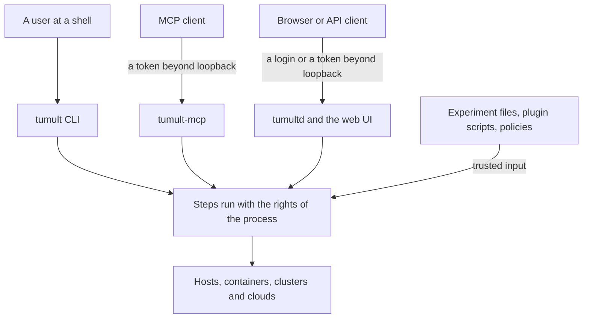

# Security assessment

This page says what the source of Tumult does for security, where it does
it, and what was not checked. It was checked on 2026-11-21 against the
source of Tumult 3.0.3: 34 Rust crates, the images, the compose files and
the deploy files. To report a flaw, see [SECURITY.md](https://github.com/mwigge/tumult/blob/main/SECURITY.md).

## Who can reach what

Tumult trusts the files it runs. An experiment, a plugin script or an
autopilot policy can do anything the user that runs Tumult can do. Keep
them in a reviewed repository.

## What the code does

| Area | What the code does | Where |
|---|---|---|
| Listeners | The MCP server refuses to serve HTTP beyond loopback without a token or an auth file. `tumultd` refuses to serve its API beyond loopback while it has no user. On loopback with no auth, every caller has full access | `tumult-mcp/src/server.rs`, `tumultd/src/admin.rs` |
| TLS | `tumultd` serves TLS when `KRONIKA_TLS_CERT` and `KRONIKA_TLS_KEY` are set. The MCP server has no TLS: put a TLS proxy in front of it | `tumult-ingest/src/config.rs` |
| Logins | Passwords are hashed with argon2id, and tokens are stored as their SHA-256. After 5 failed logins, one more try is allowed every 10 seconds, per address and user name | `tumult-auth/src/lib.rs`, `tumult-api/src/auth/rate_limit.rs` |
| MCP roles | A read-only tool needs the viewer role. Every other tool, and any unknown tool name, needs the operator role | `tumult-mcp/src/handler/dispatch.rs` |
| MCP paths | A path that a client sends must stay inside the working directory of the server | `tumult-mcp/src/tools/validation.rs` |
| Script plugins | The script must sit inside its plugin folder. Arguments reach it as `TUMULT_*` environment variables, never on a command line. A null byte or a bad name is refused. A timeout kills the whole process group. The script inherits the environment of Tumult | `tumult-plugin/src/executor.rs` |
| Process steps | The program runs without a shell. Each output stream is capped at 8 MiB | `tumult-exec/src/process.rs` |
| Secrets | Secrets are read from environment variables or files when the run starts | `tumult-core/src/engine/config.rs` |
| SSH | Host keys are checked against `known_hosts` by default | `tumult-ssh/src/config.rs` |
| Web UI | Cookies are marked secure when `tumultd` listens beyond loopback. No `Content-Security-Policy` header is set | `tumultd/src/serve/mod.rs` |

## Unsafe code

Outside tests there are 6 `unsafe` blocks. Each one is a Unix call to wait
for a process or to signal a process group, and each has a safety comment.

| File | Blocks | What for |
|---|---|---|
| `tumult-core/src/runner/oha.rs` | 4 | `waitid` on the oha process (3), `kill` of its process group (1) |
| `tumult-exec/src/process.rs` | 1 | `kill` of the process group of a process step |
| `tumult-plugin/src/executor.rs` | 1 | `kill` of the process group of a script |

Counted with `git grep -nw unsafe -- '*.rs'`, with comments, the `tests/`
folders and the `#[cfg(test)]` modules left out. No crate forbids unsafe
code, and no lint asks for the safety comment.

## Dependencies and CI

- The Cargo Deny job of CI runs `cargo deny check` (advisories, licenses,
  bans and sources) on every pull request (`.github/workflows/ci.yml`).
- `deny.toml` ignores 11 advisories, each with its reason. Nine say a crate
  is no longer maintained. Two, RUSTSEC-2026-0194 and RUSTSEC-2026-0195,
  are flaws in quick-xml. It comes in through typst, which renders only the
  bundled report templates, so no outside XML reaches it.
- The web UI job runs `npm audit --audit-level=moderate`.
- Each action in `.github/workflows/` is pinned to a commit. The example
  gate `deploy/ci/github-gate.yml` uses a tag.
- Dependabot watches Cargo and GitHub Actions (`.github/dependabot.yml`),
  not npm, pip or Docker images.
- A release has a `SHA256SUMS.txt` for its archives
  (`.github/workflows/release.yml`). There is no signature and no SBOM.
- The fuzz target in `tumult-core/fuzz/` exists, but no CI job runs it.

## Images and compose files

| Pin | Images |
|---|---|
| By digest | `python:3.12-slim` of the Chaos Lab, `alpine:3.20.10` of the SSH test server, the Python base of forecastd |
| To a version | `rust:1.92.0-bookworm`, the OpenTelemetry Collector, Jaeger, Grafana, Tempo, Mimir, Loki, Prometheus, Kafka, curl |
| A tag that moves | `debian:bookworm-slim`, `node:22-bookworm-slim`, `postgres:16-alpine`, `redis:7-alpine`, `mysql:8.0`, `python:3.12-slim` of the OTel example |
| `latest` | SigNoz in `docker/docker-compose.demo.yml` and `docker/docker-compose.observability.yml`, the Collector in `docker/docker-compose.kronika-collector.yml`, `ghcr.io/mwigge/tumult-mcp` in `docker/docker-compose.tumult.yml`, `ghcr.io/mwigge/tumult` in `deploy/ci/` |

- The images of `tumultd`, forecastd, the Chaos Lab, the demo app and the
  demo traffic run as a user that is not root. The CLI image
  (`docker/Dockerfile.tumult`), the MCP image built on it
  (`docker/Dockerfile.tumult-mcp`), the demo control panel, the SSH test
  server and the OTel example app run as root. The CLI and MCP images carry
  the Docker CLI.
- `docker/docker-compose.demo.yml` and `docker/docker-compose.tumult.yml`
  mount the Docker socket, writable, into the MCP container. They publish
  port 3100 on every address of the host, and without `TUMULT_MCP_TOKEN`
  they use a fixed token (`tumult-demo`, `tumult-dev`). Whoever reaches
  that port with the token controls Docker on the host. Run them on a
  trusted machine, or set a strong token.
- The demo and test compose files use fixed passwords (`demo`, `tumult`,
  `tumult_test`). `docker/docker-compose.kronika.yml` needs its passwords
  and tokens set, and publishes its ports on 127.0.0.1 only.
- The manifests in `deploy/k8s/` run each pod as a user that is not root,
  with a read-only root file system and every capability dropped. The
  units in `deploy/systemd/` use `DynamicUser`, `NoNewPrivileges` and
  `ProtectSystem=strict`.

## The agentic proxy

`tumult agentic proxy` listens on `127.0.0.1:8080` by default and forwards
to the one `--upstream` it is given. It passes the `authorization` and
`x-api-key` headers on, so it sees the API key of the agent. It drops
`proxy-authorization`, the hop-by-hop headers and `accept-encoding`, and
sends its own `traceparent` (`tumult-agentic/src/proxy/forward.rs`). By
default its journal keeps metadata only: no prompt and no answer
(`tumult-agentic/src/model.rs`).

## Agents and prompt injection

With an `agent`, `tumult_recommend` puts signals from the journals into the
prompt of an agent, and the agent answers with experiments
(`tumult-intelligence/src/agent.rs`). The text from the journals is cleaned
of control characters and cut to length first. The experiments that come
back are checked for their form, and on the autopilot path by the safety
gate, but not for their intent. So:

- Read an experiment from an agent before it runs.
- Have the MCP client ask a person before `tumult_run_experiment`,
  `tumult_gameday_run`, `tumult_autopilot_run` with `execute` and
  `tumult_autopilot_respond` with `approve`.
- On the server, these tools need the operator role, and an approval runs
  the safety gate again on the current state.

## Not assessed

- No penetration test, and no test against a running deployment.
- The code of the 910 packages in `Cargo.lock`, unsafe code included,
  beyond what `cargo deny` reports.
- The built images were not scanned for known flaws.
- Not every SQL statement was read to check that it binds its values.
- The web UI code, such as cross-site scripting, beyond the headers above.
- The cloud, Kubernetes and Windows plugins, ClickHouse, and the scripts
  in `plugins/`.
- The Python services (forecastd, the Chaos Lab) beyond their Dockerfiles.
- The git history was not scanned for secrets.
- `unwrap` calls and integer casts in production code were not counted.
