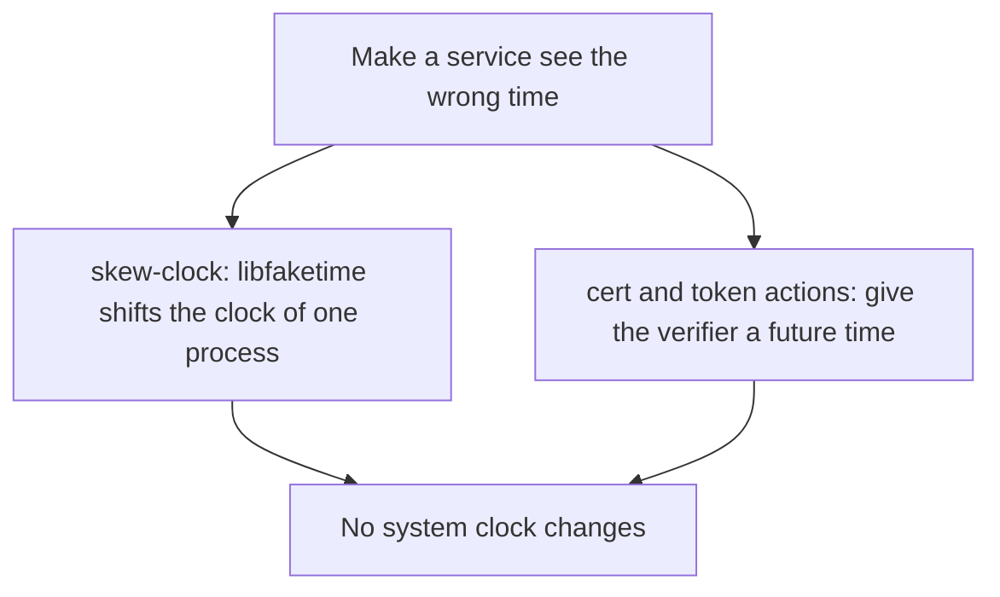

# tumult-timewarp

A script plugin for faults of time and randomness: a skewed clock, a
certificate or a token that expires, and a random number generator under
load. Tumult finds it in `plugins/`.

It runs where Tumult runs (in the demo, the `tumult-mcp` container). A
step acts on that machine, or on a sibling container through
`docker exec` when you set `target`.

## Why it does not change the clock

Containers share the clock of the host kernel. A time namespace does not
give a container its own wall clock, and `date -s` moves the clock of the
host for every container at once. So the plugin does two safe things
instead:

## Actions

| Action | What it does | Arguments |
|---|---|---|
| `skew-clock` | Runs a command under `faketime`, so it sees a shifted clock. Needs libfaketime on the runner or in `target`; it exits 1 with a hint when it is missing. | `skew_seconds` (3600, may be negative), `faketime_cmd` (`date -u +%s`), `target` |
| `advance-clock-past-cert-expiry` | Makes a short-lived certificate, then checks it with `openssl verify -attime` now (valid) and at now plus the skew (expired). Writes `cert-result.txt`. | `cert_ttl_seconds` (5), `skew_seconds` (8640000, 100 days) |
| `token-ttl` | Makes an HMAC token with a short life, then checks it now (accepted) and at a skewed now (refused). Writes `token-result.txt`. | `token_ttl_seconds` (2), `skew_seconds` (3600), `token_secret` |
| `entropy-drain` | Starts readers of `/dev/random` in the background | `drain_workers` (4), `drain_duration` (60) |
| `rng-pressure` | Starts workers that make random bytes in a loop | `rng_workers` (4), `rng_duration` (60) |
| `stop-entropy-drain` | Rollback: stops the workers of the two actions above. Safe to run twice. | |
| `restore-clock` | Rollback: removes the certificate and token files. Safe to run twice. | |

Every action keeps its files in `tw_state_dir` (`/tmp/tumult-timewarp`).
On Linux 5.6 and later, reading `/dev/random` never blocks, so
`entropy-drain` adds read and CPU load but does not empty the pool.

## Probes

| Probe | Result | Arguments |
|---|---|---|
| `entropy-available` | `/proc/sys/kernel/random/entropy_avail`, in bits. About 256 on a modern kernel. | `target` |
| `crypto-throughput` | Milliseconds to make a fixed amount of random bytes. It rises under `rng-pressure`. | `crypto_bytes` (33554432, 32 MiB) |
| `clock-offset` | Seconds that the clock of `target` is ahead of the runner. 0 when the clocks agree or `target` is not set. It fails when `docker exec` fails or the target answers no number. | `target`, `target_cmd` (`date -u +%s`) |

## Demo experiments

- `demo/experiments/demo-timewarp-clock.toon`: a skewed clock refuses a
  token that was valid, the demo app stays healthy, and the rollback
  cleans up.
- `demo/experiments/demo-timewarp-entropy.toon`: under `rng-pressure`,
  crypto work still completes and the entropy stays readable.
