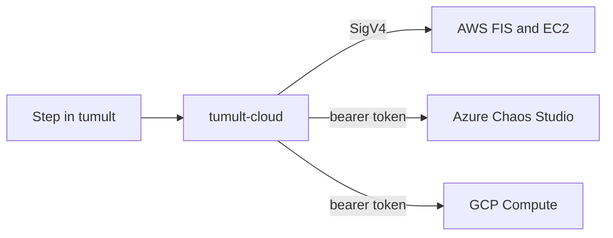

# tumult-cloud

Connect Tumult to the fault services of the clouds. This native plugin
starts, stops and reads AWS FIS and Azure Chaos Studio experiments, and
stops or ends single instances. It does not build cloud faults of its own.



```toon
provider:
  type: native
  plugin: tumult-cloud
  function: aws_fis_start_experiment
  arguments:
    experiment_template_id: EXTabc123EXAMPLE
    region: us-east-1
```

## Functions

| Function | Cloud API | Required arguments |
|---|---|---|
| `aws_fis_start_experiment` | FIS `StartExperiment` | `experiment_template_id` |
| `aws_fis_stop_experiment` | FIS `StopExperiment` | `experiment_id` or `experiment_template_id` |
| `aws_fis_experiment_status` | FIS `GetExperiment` | `experiment_id` or `experiment_template_id` |
| `aws_ec2_stop_instance` | EC2 `StopInstances` | `instance_id` |
| `aws_ec2_terminate_instance` | EC2 `TerminateInstances` | `instance_id` |
| `azure_chaos_start` | Chaos Studio `Experiments.Start` | `subscription`, `resource_group`, `experiment_id` |
| `azure_chaos_cancel` | Chaos Studio `Experiments.Cancel` | `subscription`, `resource_group`, `experiment_id` |
| `azure_chaos_status` | Chaos Studio `Experiments.Get` | `subscription`, `resource_group`, `experiment_id` |
| `gcp_compute_stop_instance` | Compute `instances.stop` | `project`, `zone`, `instance` |

The AWS functions also take `region`. Without it, Tumult reads
`AWS_REGION`, then `AWS_DEFAULT_REGION`.

## Stop or read by template

FIS gives an experiment its ID when it starts, so an experiment file names
the template. A stop or a status by `experiment_template_id` asks FIS for
the experiments of that template (`ListExperiments`, at most 20 pages of
100):

- A stop stops every experiment of the template that is `pending`,
  `initiating` or `running`, also one that someone else started. When none
  is, it succeeds and sends nothing, so a rollback can run twice. When FIS
  refuses one stop, the others are still stopped, and the step fails and
  names the refused one.
- A status is the status of the newest experiment of the template. A
  template with no experiment is an error.

This also works in the rollback of a run that a restarted daemon finishes.

## Credentials and permissions

Tumult reads credentials from environment variables only. It does not ask
an instance profile. A missing variable fails the step before any network
call, and the error names the variable.

| Cloud | Variables | Permissions |
|---|---|---|
| AWS | `AWS_ACCESS_KEY_ID`, `AWS_SECRET_ACCESS_KEY`, optional `AWS_SESSION_TOKEN` | `fis:StartExperiment`, `fis:StopExperiment`, `fis:GetExperiment`, `fis:ListExperiments` (by template), `ec2:StopInstances`, `ec2:TerminateInstances` |
| Azure | `AZURE_ACCESS_TOKEN`, from `az account get-access-token --resource https://management.azure.com` | `Microsoft.Chaos/experiments/start/action`, `.../cancel/action`, `.../read` |
| GCP | `GOOGLE_OAUTH_ACCESS_TOKEN` or `CLOUDSDK_AUTH_ACCESS_TOKEN`, from `gcloud auth print-access-token` | `compute.instances.stop` |

`AWS_ENDPOINT_URL_FIS` and `AWS_ENDPOINT_URL_EC2` send the AWS calls to
another endpoint, such as a VPC endpoint, as they do for the AWS command
line.

GCP has no managed fault service like FIS or Chaos Studio, so the crate
offers one direct fault there: `gcp_compute_stop_instance`.

## Endpoints

| Cloud | Endpoint and version |
|---|---|
| AWS FIS | `https://fis.<region>.amazonaws.com`, REST-JSON, API `2020-12-01` |
| AWS EC2 | `https://ec2.<region>.amazonaws.com`, Query, `Version=2016-11-15` |
| Azure | `https://management.azure.com`, `Microsoft.Chaos`, `api-version=2024-01-01` |
| GCP | `https://compute.googleapis.com/compute/v1/projects/{project}/zones/{zone}/instances/{instance}/stop` |

The crate uses `reqwest` and its own SigV4 signer (`src/sigv4.rs`) instead
of the AWS SDK, which would add a large tree of crates for six calls. The
AWS `get-vanilla` test vector pins the signer.

## What is tested, and what is not

Tested without a cloud account (`tests/hermetic.rs`, `tests/aws_steps.rs`
and unit tests): the method, path, query and body of each call, the SigV4
header and the bearer token, the error mapping (`403` is `Auth`, `404` is
`NotFound`, `429` is `Throttled`), the early failure on a missing
variable, and a stop or status by template against a local stand-in for
FIS.

Not tested: a call to a real cloud, that FIS answers `ListExperiments` in
the shape Tumult reads, that a given IAM policy or role allows the call,
and the effect in the cloud. The docker demo has no cloud account.
`scripts/cloud-smoke.sh` makes one real call when you have credentials.
